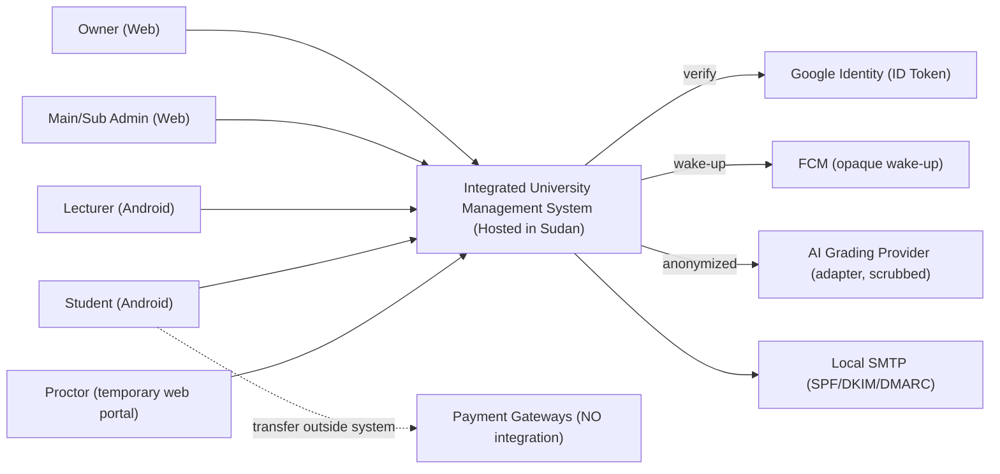
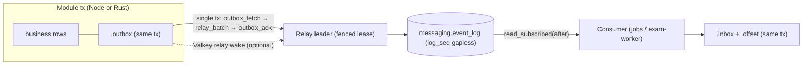
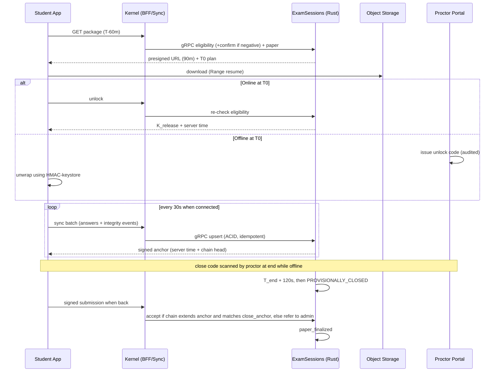

وثيقة معمارية النظام (SAD)

نظام الإدارة الجامعية المتكامل (Integrated University Management System)

الإصدار 2.1، مسودة للاعتماد

القسم 0: ضبط الوثيقة

0.1 بيانات الوثيقة

| البند | القيمة |
|---|---|
| نوع الوثيقة | وثيقة معمارية النظام (System Architecture Document – SAD) |
| الإصدار | 2.1 |
| الحالة | مسودة للاعتماد (Draft for Approval) |
| يخلف | الإصدار 2.0 |
| جهة التصديق | مالك المنتج |
| النطاق الجغرافي | جمهورية السودان |
| اللغة | العربية، مع المصطلحات التقنية بالإنجليزية |

0.2 تسلسل الإصدارات

كانت للوثيقة تسميتان متداخلتان، فاعتُمد هنا تسلسل واحد:

| الإصدار | الاسم السابق | الوصف |
|---|---|---|
| 1.1 | SAD v3 | أول معمارية متكاملة على Java وSpring Modulith |
| 2.0 | SAD.V2 | التحول إلى NestJS وRust (D-01)، ومعالجة V-01 إلى V-41 |
| 2.1 | — | هذا الإصدار: تنظيف الوثيقة، وتوحيد جدول الحالة، وتصحيح التحجيم، وإغلاق ملاحظات المراجعة المعمارية (W-01 إلى W-30) |

هذه الوثيقة مكتفية بذاتها. حلول الإصدار 1.1 (R-01 إلى R-38) وحلول الإصدار 2.0 (V-01 إلى V-41) مدمجة في المتن، ولا يُرجع إلى الإصدارات السابقة كمرجع ملزم. سجل الإصدار 2.0 محفوظ للتتبع فقط في الملحق ج.

0.3 المراجع وحالتها الرسمية

| الرمز | المرجع | الحالة الرسمية | أثرها على هذه الوثيقة |
|---|---|---|---|
| ANX | الملحق المعماري الموقّع | موقّع من مالك المنتج بتاريخ 28/9/2026 | ملزم. له الأسبقية على كل ما سواه |
| BRD | وثيقة متطلبات الأعمال، الإصدار 1.0 | مسودة للاعتماد، وخانة التوقيع فارغة | بنودها مرجع تصميم ملزم بشرط توقيعها (SAD-OI-13). وكل بند فيها موسوم «افتراض يحتاج تصديق» يبقى كذلك هنا |
| REF-A إلى REF-D | الوثائق الوظيفية الأربع | ملاحق للـBRD | مرجع تفصيلي |

0.4 قاعدة الأسبقية

عند التعارض تُطبَّق الأسبقية بهذا الترتيب: الملحق الموقّع، ثم قرارات مالك المنتج المصدّقة في الـBRD، ثم بنود الـBRD الأخرى، ثم هذه الوثيقة. أي بند هنا يمسّ الملحق لا يسري إلا بطلب تغيير موقّع، وهذا البند حالياً هو CR-01 (القسم 28).

0.5 وسوم الحالة

| الوسم | المعنى |
|---|---|
| [معتمد] | مستمد من الملحق الموقّع أو من قرار مصدّق. لا يُعاد فتحه إلا بطلب تغيير |
| [مقترح] | قرار معماري من هذه الوثيقة. يصبح معتمداً بتوقيع مالك المنتج على هذه الوثيقة |
| [CR] | يمسّ الملحق. لا يسري إلا بتوقيع طلب التغيير نفسه، وتوقيع الوثيقة لا يكفي |
| [بوابة] | قرار مقترح مشروط بنجاح اختبار إثبات محدد (القسم 22.2) قبل الإطلاق |
| [مفتوح] | مسألة غير محسومة، مسجّلة في القسم 27 |

إدراج قرار في هذه الوثيقة لا يعني اعتماده. المرجع الوحيد للحالة هو الجدول 0.6.

0.6 الجدول الموحد لحالة القرارات

العمود «يحجب» له ثلاث قيم. «بدء التنفيذ» تعني أنه لا يُبدأ بناء الجزء المعني قبل الحسم. «الإطلاق» تعني أنه يجوز البناء ولا يجوز التشغيل الفعلي. «لا» تعني أنه قابل للتأجيل.

| # | القرار أو المسألة | الحالة | يحجب | الجزء المحجوب | الحاسم أو الدليل المطلوب |
|---|---|---|---|---|---|
| 1 | Modular Monolith بست عشرة وحدة | [معتمد] | — | — | الملحق |
| 2 | PostgreSQL وPgBouncer وNginx | [معتمد] | — | — | الملحق |
| 3 | Outbox على PostgreSQL، ولا Broker في الإصدار الأول | [معتمد] | — | — | الملحق §11 |
| 4 | NestJS أساساً وRust لوحدتي ExamSessions وIntegrity (D-01) | قرار مالك المنتج، [بوابة] G-RUST | الإطلاق | ExamSessions وIntegrity | نتيجة G-RUST (22.2) |
| 5 | CR-01: وحدة إصدار واحدة بدل «Deployable واحد» | [CR] | بدء التنفيذ | exam-edge وexam-worker فقط | توقيع CR-01 (القسم 28). وحدات Node تبدأ دون انتظار |
| 6 | توقيع الـBRD الإصدار 1.0 (SAD-OI-13) | [مفتوح] | بدء التنفيذ | كل بند مأخوذ من الـBRD وغير موجود في الملحق | مالك المنتج |
| 7 | الكاتب الوحيد للأحداث (ADR-05) | [مقترح] | بدء التنفيذ | Schemas المنصّة | مالك المنتج، ثم G-EVT |
| 8 | Audit وMessaging مكوّنا منصّة لا وحدة سابعة عشرة (SAD-OI-03) | [مقترح] | بدء التنفيذ | Schemas المنصّة | مالك المنتج |
| 9 | التقنيات (القسم 23) | [مقترح] | بدء التنفيذ | الكل | مالك المنتج |
| 10 | قيم التحجيم (10.4) | [بوابة] G-POOL | الإطلاق | الإعدادات فقط | موارد الخادم (SAD-OI-05)، ثم LT-01 إلى LT-09 |
| 11 | الأهلية بثلاث بوابات والجلوس المشروط (ADR-22، SAD-OI-14) | [مقترح] | بدء التنفيذ | منطق الأهلية | مالك المنتج والجامعة |
| 12 | سياسة الامتحان مع الانقطاع (ADR-10، SAD-OI-09) | [مقترح]، [بوابة] G-OFF | الإطلاق | الامتحان الأوفلاين | مالك المنتج والجامعة، ثم G-OFF |
| 13 | خطة التعافي (ADR-16) | [مقترح]، [بوابة] G-DR | الإطلاق | التشغيل الفعلي | تمرين استعادة كامل ناجح |
| 14 | ضمانات الأمان عند الأعطال (14.1 و14.9) | [مقترح]، [بوابة] G-SEC | الإطلاق | التشغيل الفعلي | G-SEC |
| 15 | الحضور بالبلوتوث | [بوابة] G-BLE | الإطلاق | BLE فقط، وQR جاهز بديلاً | PoC على 300 جهاز |
| 16 | الاستضافة (SAD-OI-04) | [مفتوح] | الإطلاق | التوافر | مالك المنتج |
| 17 | مزوّد الذكاء الاصطناعي (SAD-OI-06) | [مفتوح] | الإطلاق | AIGrading فقط | مالك المنتج |
| 18 | أدنى إصدار أندرويد (SAD-OI-08) | [مفتوح] | بدء التنفيذ | تطبيق الجوّال | الفريق ومالك المنتج |
| 19 | مهلة التظلّم (SAD-OI-16) | [مفتوح] | الإطلاق | SAGA-04 | مالك المنتج |
| 20 | مسار الطوارئ عند تعطل Google، وPlay Integrity، والبريد في أكثر من جامعة، والأجهزة المؤسسية | [مفتوح] | لا | — | تفاصيلها في القسم 27 |

0.7 سجل تغييرات الإصدار 2.1

| # | التغيير | السبب | القسم |
|---|---|---|---|
| W-01 | حذف الملاحظات التحريرية وملاحظات طريقة القراءة من متن الوثيقة | لا مكان لها في وثيقة مرشحة للاعتماد | — |
| W-02 | إعادة كتابة الأقسام من 0 إلى 4 | فُقدت من نص الإصدار 2.0 عند تداخل سجل المراجعة مع مخطط السياق | 0 إلى 4 |
| W-03 | نقل سجل V-01 إلى V-41 إلى الملحق ج وإعادة بنائه | البند V-33 تالف في المصدر، ونص البنود من V-34 إلى V-41 مفقود | ملحق ج |
| W-04 | جدول حالة موحد | تعدد الوسوم دون مرجع واحد يبيّن ما يحجب التنفيذ | 0.6 |
| W-05 | نموذج طلب تغيير رسمي لـCR-01 | قرار Rust يمسّ صياغة §9 من الملحق | 28 |
| W-06 | بوابة إثبات جدوى Rust (G-RUST) ومسار بديل محدد | الجدوى غير مثبتة، وخبرة Rust نادرة | 6.4، 22.2 |
| W-07 | إعادة حساب جدول الـPools كاملاً | app_kernel بنسبة 2.33 مع إعلان 2.0، وصف integrity معالج داخل الجدول، وIdentity يستهلك أحداثاً ولا Pool له في jobs، وتفسير reserve_pool_size خاطئ | 10.4 |
| W-08 | فرض الحد الأقصى في PostgreSQL بـCONNECTION LIMIT لكل دور، وreserve_pool_size = 0 | reserve_pool_size في PgBouncer يُطبَّق على كل Pool منفرداً، فلا يفسّر الهامش الإجمالي | 10.4 |
| W-09 | توجيه صريح للقراءة والكتابة بين الـPrimary والنسخة غير المتزامنة | وجود نسخة للتقارير لا يضمن التوجيه الصحيح | 9.7 |
| W-10 | تصحيح تنبيه «انتظار أكثر من 30 ثانية في api» | مستحيل مع مهلة استعارة 1s | 10.6 |
| W-11 | تقصير المعاملات الخلفية (30s، مع التقطيع) | المعاملات الطويلة في Pool مشترك تجوّع الطلبات التفاعلية | 10.3 |
| W-12 | تعريف ضمانَي «بلا فجوات» (G1 وG2) | الترقيم المتتابع وحده لا يثبت عدم فقد الأحداث | 12.2 |
| W-13 | الإلحاق والتأكيد في معاملة واحدة | يزيل حالة «إلحاق دون تأكيد» من جذورها | 12.2 |
| W-14 | فحص تتابع aggregate_seq عند المستهلك، وجدول اختيار الـAggregate | ضمان الترتيب يعتمد على اختيار المعرّف التجميعي الصحيح | 12.3 |
| W-15 | سياسة الـDLQ وإعادة التشغيل والصلاحيات | لم تكن معرّفة | 12.5 |
| W-16 | مصفوفة اختبار فشل الأحداث | إثبات صفر فقد وصفر تكرار | 12.6 |
| W-17 | توحيد عقد إيجار الـRelay في messaging.writer_lease | تعارض بين 12.2 (kernel.leader_lease) و9.2 (messaging.writer_lease_*) | 12.2، 20.2 |
| W-18 | تصحيح المقطع المتداخل في 12.2 وعنوانه المفقود | نص مدموج غير مفهوم | 12.2 |
| W-19 | حماية DPoP من إعادة الاستخدام دون الاعتماد على Valkey | الكاش المحلي لا يكشف الإعادة عبر نسخة أخرى | 14.1 |
| W-20 | فرض ELIGIBILITY_PENDING في قاعدة البيانات | منع أي مسار نشر قبل الحسم | 6.3 |
| W-21 | إثبات زمن الإغلاق في الامتحان الأوفلاين برمز إغلاق يدخله المراقب | سلسلة Hash تثبت السلامة لا الزمن | 15.5 |
| W-22 | جدول تهديدات الامتحان الأوفلاين ومصفوفة اختبار على أجهزة حقيقية | — | 15.7، 22.3 |
| W-23 | الفصل بين RPO الملتزم به وRPO المتوقع، وتحليل synchronous_mode_strict | — | 20.3 |
| W-24 | تمرين الاستعادة الكامل بمعايير قبول، ومطابقة التخزين بعد الاستعادة | وجود النسخة لا يثبت قابليتها للاستعادة | 20.4 |
| W-25 | قوالب تنفيذ إلزامية للوحدات | خفض الانحراف وكلفة التطوير | 24 |
| W-26 | بوابات الاعتماد السبع | تحويل الإثبات العملي إلى شرط إطلاق | 22.2 |
| W-27 | تصحيح «tenancy.settings_changed / .settings_changed» إلى .settings_changed | خطأ صياغة | 12.4 |
| W-28 | إبطال الكاش المحلي (LRU) عبر نبضة Valkey | استهلاك jobs للأحداث لا يُبطل كاش نسخ api | 11.3 |
| W-29 | تسلسل التدقيق آمن تحت التزامن دون تسوير | دالة audit لا تستطيع قراءة عقد الـKernel | 14.5 |
| W-30 | النشر المتدحرج بـmaxSurge = 0 | نسخة api رابعة مؤقتة تكسر نسب الـPools | 20.2 |

القسم 1: الغرض والنطاق

تصف هذه الوثيقة معمارية النظام الذي حددت الـBRD متطلباته: نظام SaaS متعدد الجامعات، معزول البيانات، ومستضاف داخل السودان حصراً. يخدم النظام المالك والإداري الرئيسي والفرعي والمحاضر والطالب، والمراقب بوصول مؤقت. الواجهة الإدارية تطبيق ويب، وواجهتا المحاضر والطالب تطبيق أندرويد في الإصدار الأول.

تغطي الوثيقة الوحدات وحدودها، وملكية البيانات، وأنماط الاتصال، والاتصالات بقاعدة البيانات، والأحداث، والأمان، وتطبيق الجوّال والعمل دون اتصال، والنشر والتعافي، والاختبار وبوابات الاعتماد. ولا تغطي تصميم الواجهات، ولا مخططات الجداول التفصيلية خارج ما يلزم لضمانات الصحة والأمان، ولا خطة المشروع.

والنطاق الخارج مطابق للقسم 3.2 من الـBRD. لا تكامل برمجي مع بوابات الدفع، ولا iOS، ولا فيديو، ولا مراقبة بالكاميرا.

القسم 2: المحركات المعمارية

2.1 سمات الجودة الحاكمة

| الرمز | السمة | الهدف القابل للقياس | المصدر |
|---|---|---|---|
| QA-01 | الأداء في الذروة | 2,000 ممتحن متزامن، وp95 أقل من 2s، وصفر فقد إجابات | NFR-PERF-003/004، AC-051 |
| QA-02 | التوافر | 99.9% داخل نوافذ الامتحانات، و99.5% شهرياً | NFR-AVL-001/002 |
| QA-03 | الصمود | تعطل أي مكوّن منفرد لا يوقف الامتحان الجاري ولا يُفقد بيانات مثبتة | NFR-AVL-006، CN-04، CN-05 |
| QA-04 | الأمان والعزل | لا وصول عابر للمستأجرين بأي مسار، وسجل تدقيق غير قابل للتعديل | NFR-SEC-001 إلى 011، AC-039، AC-054 |
| QA-05 | قابلية التعديل والفصل | فصل أي وحدة لاحقاً دون تغيير ملكية البيانات أو العقود | الملحق §9 و§11 |
| QA-06 | صحة البيانات | صفر فقد وصفر تكرار في التسليم والمال والأحداث، وPostgreSQL مصدر الحقيقة الوحيد | AC-007، BR-044 |

2.2 المبادئ

| الرمز | المبدأ | آلية الفرض |
|---|---|---|
| P-01 | حدود الوحدات تُفرض آلياً لا بالاتفاق | Nx وdependency-cruiser، وظهور crates في Rust |
| P-02 | لكل وحدة Schema ودور قاعدة بيانات، ولا GRANT عابر | اختبار GRANT آلي في CI |
| P-03 | PostgreSQL مصدر الحقيقة الوحيد، وValkey للتسريع فقط | حظر صريح (11.1) ومراجعة كود |
| P-04 | الكتابة في الوحدة المالكة فقط | RLS والصلاحيات |
| P-05 | لا استدعاء لوحدة أخرى ولا لخدمة خارجية أثناء معاملة مفتوحة | حارس CLS، ونوع Tx غير قابل للإرسال في Rust |
| P-06 | قاعدة القفزتين | مراجعة العقود (8.2) |
| P-07 | كل كتابة Idempotent بمفتاح يُثبَّت داخل معاملة العمل | القالب الإلزامي (24) |
| P-08 | العزل بين المستأجرين في قاعدة البيانات (RLS)، لا في التطبيق وحده | FORCE RLS، واختبارات AC-039 |
| P-09 | Offline-First للحضور والامتحان | 15.2 و15.5 |
| P-10 | القرار العقابي يصدره إنسان: الغش والحرمان والأهلية | SAGA-04، و6.3 |
| P-11 | السيادة: البيانات داخل السودان، وكل ما يعبر الحدود موثّق | 14.6 |
| P-12 | وحدة إصدار واحدة | 6.4، وCR-01 |
| P-13 | سلوك متطابق بين اللغات | متجهات اختبار ومجموعات مطابقة (6.5) |

القسم 3: القيود

| القيد في الـBRD | أثره المعماري | القسم |
|---|---|---|
| CN-01: الاستضافة داخل السودان | استضافة ذاتية، وتقنيات مفتوحة المصدر، ولا خدمات سحابية مُدارة | 20، 23 |
| CN-02 وCN-03: حدود مكافحة الغش في الجهاز | الرصد استدلالي، والحكم بشري | 15.4 |
| CN-04 وCN-05: اتصال وكهرباء غير مستقرين | Offline-First، وحزم مسبقة، ومزامنة مجمّعة | 15 |
| CN-06: الاعتماد على Google | JWKS مخزّنة، ومسار طوارئ | 14.1 |
| CN-07: لا تكامل مع بوابات الدفع | مراجعة بشرية ثلاثية المراحل | 16.5 |
| CN-08: BLE لا يقيس المسافة بدقة | رمز دوّار، ومساعدان، وتحكيم المحاضر | 15.3 |
| CN-09: ربط الجهاز | SAGA-03، وأجهزة مؤسسية | 14.1، 15.6 |
| CN-10: تصحيح العربية بالذكاء الاصطناعي غير مستقر | مراجعة بشرية إلزامية | 16.4 |
| CN-11: ذروة الامتحانات | التحجيم للذروة لا للمتوسط | 10 |
| CN-12: أندرويد فقط للطالب والمحاضر | — | 15 |
| الملحق §12: Kubernetes أو Docker Compose | الحدود المعمارية مستقلة عن أداة النشر | 20.2 |

القسم 4: السياق (C4 – المستوى 1)



لا يحمل أي اتصال خارجي بيانات معرّفة للطالب سوى المصادقة من جهاز المستخدم نفسه مع Google. تفاصيل ما يعبر الحدود في 14.6.

القسم 5: الحاويات (C4 – المستوى 2) ومسار الطلب

5.1 المخطط

```mermaid
flowchart TB
    subgraph Clients
      W["Admin/Owner Web (React+TS, RTL, DPoP)"]
      M["Android (Kotlin, DPoP)"]
      P["Proctor Portal (cookie session)"]
    end
    N["Nginx (active/standby VIP): TLS, routing, body limits, unauth rate-limit"]
    subgraph Pod["api Pod x3 (single release unit)"]
      subgraph NODE["NestJS process (role=api)"]
        K["Kernel: /api/v1, /bff/v1, /sync/v1, AuthN+DPoP, Saga starter, Rate-limit"]
        NM["13 Node modules"]
      end
      subgraph RUST["Rust exam-edge (sidecar)"]
        EX["ExamSessions"]; IN["Integrity"]
      end
      K --|"gRPC over UDS"| RUST
    end
    subgraph BG["Background roles (same release)"]
      JOBS["NestJS jobs x2"]; SCHED["NestJS scheduler x2"]
      RELAY["NestJS relay x2"]; WS["NestJS realtime x2 (no DB)"]
      EW["Rust exam-worker x2"]
    end
    R[("Valkey + Sentinel")]
    PGB["PgBouncer (active/standby VIP)"]
    PG[("PostgreSQL Primary + Sync Replica (Patroni+etcd)")]
    PGRO[("Async Reporting Replica (read-only)")]
    S3[("Object Storage")]
    W-->N; M-->N; P-->N
    N-->K; N-->|/ws|WS; N-->|"files. presigned"|S3
    NODE-->PGB; RUST-->PGB; BG-->PGB
    PGB-->|"alias ums (RW)"|PG
    PGB-->|"alias ums_ro (RO)"|PGRO
    NODE-->R; RUST-->R; WS-->R; NODE-->S3; EW-->S3
```

5.2 مسار الطلب

| الخطوة | الطبقة | ما يحدث | ما لا يحدث |
|---|---|---|---|
| 1 | العميل | HTTPS/JSON، ورمز وصول مع DPoP للويب والجوّال، وCorrelation-ID، وIdempotency-Key لكل كتابة | أندرويد لا يستدعي /api/v1 |
| 2 | Nginx | TLS، وتوجيه بالمسار، وحدود الجسم (1MB لـ/api و/sync، و256KB لـ/bff، و25MB لـfiles.)، وحد IP للمسارات غير المصادَقة فقط بقائمة سماح لعناوين NAT | لا حدود IP على المسارات المصادَقة، ولا صلاحيات |
| 3 | Kernel | التحقق من الرمز وDPoP دون قراءة قاعدة البيانات، والمستأجر، وفك المعرّف العام، وحد المعدل لكل (مستأجر، مستخدم، جهاز)، والتوجيه داخل العملية أو بـgRPC إلى Rust | لا قراءة لـSchema أي وحدة |
| 4 | الوحدة | تفويض المورد، ومنطق المجال، وIdempotency داخل المعاملة | لا كتابة في بيانات غيرها |
| 5 | Valkey | Cache-aside، وPub/Sub، وحدود المعدل | ليس مصدر حقيقة |
| 6 | Pool الوحدة ثم PgBouncer | استعارة اتصال، وset_config(...,true) | لا اتصال لكل طلب |
| 7 | PostgreSQL | العمل والـOutbox ومفتاح Idempotency في معاملة واحدة، مع RLS | — |
| 8 | Relay | كاتب وحيد إلى messaging.event_log | — |
| 9 | المستهلكون | الإزاحة والـInbox في Schema المستهلك | — |

القسم 6: الوحدات وحدودها

6.1 الوحدات الست عشرة [معتمد – الأسماء]

| # | الوحدة | Schema | بيئة التشغيل | المسؤولية | بيانات مملوكة (أمثلة) |
|---|---|---|---|---|---|
| 1 | Identity | identity | NestJS | الحسابات، والتحقق من Google، وإصدار الرموز، والأدوار، وصلاحيات الفرعي، والأجهزة الشخصية والمؤسسية، والإعارات، والجلسات، والمراقب، والدليل | user، account_directory، device، device_loan، refresh_token، proctor_access، permission_matrix |
| 2 | Tenancy | tenancy | NestJS | الجامعات، والاشتراك، والعدّادات، والإعدادات، والأعلام، وعناوين NAT | tenant، subscription، billing_counter، ai_usage_counter، tenant_settings، feature_flag، tenant_key_ref |
| 3 | Academic | academic | NestJS | البرامج، والمواد، وسلم التقديرات | program، course، grading_scale |
| 4 | Cohorts | cohort | NestJS | الدفعات، والطلاب وحالاتهم، والوثائق، والفصل، والتكليف، والاستيراد | cohort، student_profile، student_document_meta، semester_instance، lecturer_assignment، import_job |
| 5 | Facilities | facilities | NestJS | المنشآت، والحجوزات، والجدول | facility، booking، schedule_event |
| 6 | Attendance | attendance | NestJS | BLE وQR والباركود، والقوائم، والمخالفات | attendance_session، attendance_record، violation_log |
| 7 | QuestionBank | qbank | NestJS | الأنواع الستة، والوسوم، والإجابات النموذجية | question، model_answer، ai_rubric |
| 8 | ExamSessions | exam | Rust | الموازين، والجلسات، والحزم، والأوراق، والتسليم، والحرمان، والاستثناءات، والملحق، والنتائج، والأهلية | weighting، exam، bank_snapshot، exam_package، exam_key، exam_paper، answer، submission، close_anchor، deprivation_request، eligibility_projection، eligibility_exception، result، deadline_task |
| 9 | AIGrading | aigrading | NestJS | المهام، والمقترحات، والمحوّل، والتنقية | grading_job، grading_suggestion، provider_call_log |
| 10 | Integrity | integrity | Rust | الأحداث، والنقاط، والتحذيرات، والمراجعة، والحكم، والتظلّم | integrity_event، session_score، review_case، verdict، appeal |
| 11 | Payment | payment | NestJS | البوابات، والإشعارات، والتأكيد، والمعاملات، والأرصدة، والاشتباه | gateway، transaction، ledger_balance، suspicion_flag، receipt_fingerprint |
| 12 | Conversations | conversation | NestJS | الدردشات، والدعم، والقنوات، والإعلانات | thread، message، channel، announcement |
| 13 | Files | files | NestJS | البيانات الوصفية، والعزل، والفحص، والروابط، والأرشيف | file_object، archive_package، archive_key_ref |
| 14 | Notifications | notification | NestJS | الخريطة، والقوالب، والقنوات، والمركز | notification، template، user_preference، delivery_attempt |
| 15 | Reporting | reporting | NestJS | نسخ القراءة، واللوحة، والتصدير، ومؤشرات المالك | dashboard_projection، finance_stats، exam_stats، platform_metrics |
| 16 | Kernel | kernel | NestJS | التوجيه، والـBFF، والـSync، والتحقق، والـSaga، والعقود، وعقود الإيجار، والمؤقّتات | saga_instance، saga_step، contract_registry، leader_lease، job_schedule |

6.2 مكوّنات المنصّة [مقترح – SAD-OI-03]

| المكوّن | التموضع |
|---|---|
| Audit | Schema audit. الكتابة عبر audit.append()، والتسلسل الخلفي عبر audit.chain_pending()، والقراءة من النسخة غير المتزامنة |
| Messaging | Schema messaging. الإلحاق عبر messaging.relay_batch() من قائد الـRelay فقط، والقراءة عبر messaging.read_subscribed()، وعقد إيجار الكاتب في messaging.writer_lease |
| Sync Gateway | مكوّن حافة بمسار /sync/v1 ضمن حدود الـKernel، قابل للفصل (الملحق §16) |
| Realtime Gateway | دور NestJS بلا قاعدة بيانات، فوق Valkey Pub/Sub |
| Settings | كل وحدة تملك إعداداتها، وشاشة موحدة تجمعها |

6.3 قرارات ملكية حاسمة

ملكية بيانات الطالب موزّعة: الحساب والجهاز في Identity، والملف والحالة والوثائق في Cohorts، والملف الثنائي في Files. الموازين في ExamSessions مرتبطة بالتكليف الذي يملكه Cohorts. حدث الغش مرتبط بالورقة ويملكه Integrity. الرسوب النهائي يُسجَّل في ExamSessions بعد integrity.verdict_final. حزم الامتحان ملكية تقنية لـExamSessions في Bucket خاص هو exam-pkg، بلا سجل في files.file_object. ولقطة بنك الأسئلة تُنسخ إلى exam.bank_snapshot عند التأكيد، فلا يحتاج توليد الحزم إلى قراءة QBank.

الأهلية لدخول الامتحان [مقترح – ADR-22، SAD-OI-14]

تُحسب الأهلية في ExamSessions من eligibility_projection عبر ثلاث بوابات:

| البوابة | المصدر | طبيعتها | ما يُعرض للطالب |
|---|---|---|---|
| financial_ok | payment.balance_changed | حرمان (BR-031) | «محروم: رسوم غير مكتملة» |
| attendance_ok | attendance.ratio_updated | حرمان (BR-031) | «محروم: نسبة الحضور» |
| documents_verified | cohort.document_verified وidentity.account_status_changed | قيد وصول، لا حرمان (FR-AUTH-015، AC-003) | «الوثيقة الناقصة: …» |

قواعد القرار:

| الحالة | السلوك |
|---|---|
| النسخة تقول «مؤهل» | قبول دون قفزة إضافية |
| النسخة تقول «غير مؤهل» | قراءة تأكيد واحدة من الوحدة المصدر (القفزة 2) قبل الرفض |
| التأكيد يثبت السلب | رفض بسبب محدد، وزر «طلب رفع الحرمان» يرسل الطلب للإداري (FR-EXM-034/035). لا جلوس مشروط في هذه الحالة إطلاقاً |
| تعذّر التأكيد تقنياً فقط | يُنشأ eligibility_exception ويُرسل إشعار حرج للإداري المخوَّل. إن لم يصدر قرار قبل T0 وكان conditional_sitting مفعّلاً، يجلس الطالب بحالة ELIGIBILITY_PENDING |
| قرار الإداري لاحقاً | القبول يرفع الحالة. الرفض يلغي الورقة بقرار موثّق في Audit |

المراقب يرى الحالة ولا يقرر (BR-032). والجلوس المشروط ليس رفعاً للحرمان، لأنه لا ينطبق إلا حين تكون حالة الحرمان مجهولة تقنياً، لا حين تكون ثابتة. القيمة الافتراضية لـconditional_sitting تُحسم في SAD-OI-14.

تُعاد الأهلية عند تنزيل الحزمة، وعند تجديد رابطها، وعند طلب مفتاح الفتح.

فرض ELIGIBILITY_PENDING في قاعدة البيانات

لا يعتمد الحجب على الواجهة ولا على منطق التطبيق وحده، بل يُفرض في أربع طبقات:

1. يحمل exam_paper العمود eligibility_state بالقيم (CLEAR / PENDING / REJECTED). تحويل ورقة إلى PENDING أو منها لا يتم إلا عبر الدالة exam.resolve_eligibility() التي تكتب قيد Audit في المعاملة نفسها.
2. دالتا نشر الدرجات ونتائج الفصل (exam.publish_grades() وexam.publish_semester_results()) ترفضان التنفيذ ما دامت في نطاقهما ورقة بحالة PENDING، وتعيدان قائمة الأوراق المعلّقة بأسمائها، بما يتسق مع FR-ADM-034. وقيد CHECK على exam.result يمنع إدراج نتيجة منشورة لورقة غير CLEAR.
3. يجوز أن يتقدم التصحيح الآلي والبشري للورقة المعلّقة، لكن الدرجة لا تدخل الجمع.
4. تُعرض الحالة في لوحة الإداري «يحتاج إجراءك» وفي بوابة المراقب. ويُرسل تذكير يومي، ويصدر تنبيه للمشغّل لكل استثناء مفتوح لأكثر من 72 ساعة.

يُختبر ذلك باختبار تكامل يحاول النشر عبر كل مسار ممكن: النشر العام، والنشر المخصص، وجمع نتائج الفصل، والتصدير، وبناء الأرشيف.

6.4 بيئتا التشغيل ووحدة الإصدار الواحدة [قرار مالك المنتج D-01، وCR-01، و[بوابة] G-RUST]

| البند | القرار |
|---|---|
| الإصدار | مستودع واحد (Nx مع Cargo workspace)، ورقم إصدار واحد، وبيان نشر واحد (Helm chart أو Compose) ينشر الصورتين ums-node وums-exam معاً. لا يُنشر إصدار من إحداهما منفرداً |
| التموضع | exam-edge حاوية مرافقة داخل Pod الـapi، بمقبس unix:///run/ums/exam.sock على وحدة تخزين مشتركة. والـPod لا يُعدّ جاهزاً إلا إن كانت الحاويتان جاهزتين |
| الاتصال من Node إلى Rust | gRPC عبر UDS داخل الـPod. ومن jobs إلى exam-worker عبر mTLS داخلي |
| الاتصال من Rust إلى Node | gRPC إلى خادم داخلي في عملية NestJS يعرض فقط الواجهات المسجّلة: Payment.GetEligibilityFacts، وAttendance.GetRatio، وCohort.GetDocumentStatus، وQBank.GetConfirmedBank. والـexam-worker يصل إليها عبر mTLS |
| العقد | Protobuf بإصدارات (buf)، وهو العقد نفسه الذي سيُستخدم عند الفصل |
| تفسير «Deployable واحد» | «وحدة إصدار واحدة» بدل «عملية واحدة»، ويتطلب CR-01 (القسم 28) |
| البديل المرفوض | تضمين Rust كمكتبة أصلية داخل Node (napi-rs). يحقق «عملية واحدة» لكنه يُسقط عملية Node كلها عند أي عطل في Rust، ويمنع Pool مستقلاً بـTokio |

إثبات الجدوى ومسار الخروج (G-RUST)

قرار D-01 يبقى قرار مالك المنتج. هذه الوثيقة تضيف شرطاً لإثباته، ولا تلغيه. قبل تجميد نطاق مرحلة الامتحانات يُنفَّذ نموذج مقارن للمسار الساخن (upsert المزامنة، والتسليم، ونقاط الغش) في الحالتين: Rust خلف gRPC/UDS، ونموذج NestJS مكافئ خلف الـFacade نفسه. ويُشغَّل عليهما LT-01 وLT-02 وLT-03.

| المعيار | شرط النجاح لـRust |
|---|---|
| الكمون | p99 للمسار الساخن أفضل بـ30% على الأقل، أو تباين p99 أقل بوضوح تحت الذروة |
| الموارد | استهلاك المعالج والذاكرة عند 2,000 ممتحن أقل أو مساوٍ |
| كلفة الحد | gRPC/UDS أقل من 5ms عند p95 (ميزانية 8.3) |
| الفريق | مطوّران على الأقل قادران على مراجعة كود Rust (OI-01) |

إن نجحت البوابة يستمر D-01. وإن فشلت يُرفع الأمر لمالك المنتج مع النتائج، ويكون البديل الجاهز تنفيذ الوحدتين بـNestJS خلف العقد نفسه، دون أثر على بقية الوحدات. وفي هذه الحالة يسقط CR-01 لانتفاء الحاجة إليه.

6.5 قواعد صحة البيانات عبر اللغات [مقترح]

| البيان | Node (TypeScript) | Rust | Android |
|---|---|---|---|
| المال numeric(14,2) | سلسلة ثم Decimal (decimal.js)، ويُحظر Number بقاعدة Lint | rust_decimal | BigDecimal |
| bigint (log_seq وchain_pos) | BigInt بمحلّل نوع مخصص في pg | i64 | Long |
| UUID | UUIDv7 | uuid (v7) | UUIDv7 |
| الأزمنة | timestamptz UTC بصيغة ISO-8601 بدقة الميكروثانية | time/chrono | Instant |
| تجزئة التدقيق | داخل PostgreSQL فقط (14.5) | — | — |
| سلسلة الإجابات وتوقيع العناصر | CBOR حتمي (RFC 8949 §4.2) | ciborium بوضع حتمي | مكتبة CBOR حتمية |
| المعرّف العام (9.3) | مكتبة TS | crate Rust | — |

متجهات الاختبار المشتركة في contracts/test-vectors/ تُشغَّل في CI على اللغات الثلاث، وأي اختلاف يُفشل البناء. والمنطق المشترك (Outbox وInbox وسياق المستأجر وIdempotency) مبني على دوال SQL واحدة، مع مجموعة اختبارات مطابقة تُشغَّل على مكتبتي اللغتين.

القسم 7: الـKernel (NestJS)

7.1 المكونات

| المكوّن | الوظيفة | الحدود |
|---|---|---|
| API Router | /api/v1/{module} لعملاء الويب والمراقب: نداء Facade الوحدة داخل العملية، أو gRPC لوحدتي Rust | لا تحويل ولا قواعد أعمال |
| Mobile BFF | نقاط مجمّعة مثل GET /bff/v1/student/home، بنداءات متوازية، قفزة واحدة لكل وحدة | لا وحدة تستدعي وحدة داخل التجميع |
| Sync Gateway | يتحقق من الرمز وDPoP وتوقيع كل عنصر بمفتاح JWK المطابق لـcnf.jkt، ويعالج انحراف الساعة، ويقسّم الدفعة حسب الوحدة المالكة (نداء gRPC مجمّع لكل وحدة Rust)، ويعيد إيصالاً لكل عنصر | الحَكَم مفتاح الـIdempotency في الوحدة. كاش الإيصالات في Valkey تسريع فقط |
| AuthN Context | يتحقق من ES256 وDPoP (jose)، ويستخرج السياق إلى AsyncLocalStorage (nestjs-cls)، ويطابق المستأجر، ويقرأ permission_scope من Valkey، ثم من LRU محلي (60s)، ثم من Identity.GetPermissionScope() | لا يتحقق من Google ولا يُصدر رموزاً |
| Saga Orchestrator | الحالة في kernel.saga_*، وكل أمر بمفتاح saga_id:step. يعمل في jobs ويُبدأ من api | لا يكتب في بيانات الوحدات |
| Timers | kernel.job_schedule مع الحدث kernel.job_due | لا ينفّذ عمل الوحدة |
| Contract Registry | OpenAPI وProtobuf وJSON Schema ومستهلكوها | فحص في CI |
| Ops view | مقاييس تأخر المستهلكين والأحداث الموقوفة والـDLQ، تصدّرها كل وحدة | لا وصول لجداول الـDLQ |

7.2 المحظورات

يُحظر على الـKernel امتلاك جداول أعمال، والوصول لـSchema أي وحدة، وحساب درجة أو رصيد أو أهلية، ومنطق مصادقة الأعمال، وتخزين ما يتجاوز معرّفات الـSaga وحالاتها.

7.3 سياق الطلب

يُحمَل السياق في AsyncLocalStorage ويُمرَّر إلى Rust في Metadata الـgRPC:

{
  "correlation_id": "01J9Z...ULID", "tenant_id": "uuid", "user_id": "uuid",
  "roles": ["SUB_ADMIN"], "permission_scope": {"finance": "READ_WRITE", "exams": "NONE"},
  "device_id": "uuid", "device_kind": "PERSONAL|INSTITUTIONAL", "loan_session_id": null,
  "client": "android|web|proctor", "idempotency_key": "uuid",
  "request_time_server": "2026-10-11T10:00:00Z"
}

يُبطَل permission_scope بالحدث identity.permissions_changed، فيسري سحب الصلاحية خلال ثوانٍ (11.3).

القسم 8: أنماط الاتصال

8.1 القواعد

القراءة المتزامنة تمر عبر واجهة عامة مسجّلة. في Node هي Facade مُصدَّرة من وحدة Nest في ملفات *.public.ts، وما عداها داخلي. وبين Node وRust هي gRPC بالعقد نفسه الذي سيُستخدم عند الفصل.

الكتابة تتم في الوحدة المالكة، والعمليات متعددة الوحدات تمر عبر Saga أو أحداث.

يُحظر استدعاء وحدة أخرى أو خدمة خارجية أثناء معاملة مفتوحة. يُفرض ذلك في Node بحارس CLS يرفع خطأ في التطوير والاختبار ويسجّل وينبّه في الإنتاج، وبقاعدتي @nx/enforce-module-boundaries وdependency-cruiser. وفي Rust يُفرض بـcrate لكل وحدة، وأنواع داخلية pub(crate)، ونوع معاملة Tx غير قابل للإرسال عبر عميل gRPC.

8.2 قاعدة القفزتين

تُحسب القفزات من الـKernel: القفزة 1 إلى الوحدة، والقفزة 2 قراءة واحدة اختيارية. ونداء gRPC عبر UDS قفزة كأي نداء.

| السيناريو | النمط |
|---|---|
| الأهلية | نسخة محلية، والسلب يُؤكَّد بالقفزة 2 (6.3) |
| نافذة بيانات الطالب | تجميع متوازٍ في الـBFF |
| نشر الدرجات | أمر في ExamSessions، ثم أحداث |
| جدولة امتحان | SAGA-02 |

8.3 ميزانية الكمون (p95) [مقترح]

| المقطع | الميزانية |
|---|---|
| الشبكة مع TLS | 600ms |
| Nginx والـKernel (دون قاعدة بيانات) | 30ms |
| gRPC عبر UDS (للوحدات المكتوبة بـRust) | 5ms |
| منطق الوحدة | 100ms |
| انتظار اتصال من Pool الوحدة | 50ms أو أقل |
| استعلامات (5 مفهرسة أو أقل) | 150ms |
| القفزة 2 | 250ms |
| التسلسل والرد | 70ms |
| الإجمالي | 1,255ms أو أقل، والهامش حتى 2s |

القسم 9: معمارية البيانات

9.1 البنية

PostgreSQL 16 أو أحدث، بثلاث نسخ: Primary، وSync Replica، وAsync Reporting Replica، كلها داخل السودان. Schemas الوحدات: identity، وtenancy، وacademic، وcohort، وfacilities، وattendance، وqbank، وexam، وaigrading، وintegrity، وpayment، وconversation، وfiles، وnotification، وreporting، وkernel. وSchemas المنصّة: messaging وaudit.

9.2 الأدوار والصلاحيات [مقترح]

| الدور | النوع | الصلاحيات |
|---|---|---|
| owner_\ | NOLOGIN | مالك جداول الوحدة ودوال الـOutbox الخاصة بها، ولا يستخدمه إلا أداة الترحيل |
| app_\ (16 دوراً) | LOGIN عبر PgBouncer | DML على Schema الوحدة، وEXECUTE على audit.append() وmessaging.read_subscribed(). لا صلاحية مباشرة على المنصّة. وفي identity لا صلاحية على account_directory |
| app_relay | LOGIN | EXECUTE على \.outbox_fetch() و\.outbox_ack() لكل وحدة، وعلى messaging.relay_batch() ودوال messaging.writer_lease_*(). ولا أي صلاحية على جداول |
| app_audit_chainer | LOGIN | EXECUTE على audit.chain_pending() |
| app_platform | LOGIN | tenancy وreporting.platform_* بسياسة RLS خاصة (FR-OWN-003) |
| reporting_reader | LOGIN على النسخة غير المتزامنة فقط | SELECT على reporting بسياسة المستأجر |
| audit_reader | LOGIN على النسخة غير المتزامنة فقط | SELECT على audit بسياسة المستأجر، وسياسة مستقلة لسلسلة المالك (tenant_id IS NULL) |
| ops_operator | LOGIN، خارج PgBouncer | EXECUTE على دوال \.dlq_*() فقط (12.5) |
| migrator | LOGIN (CI/CD) | يتقمّص owner_* |

ويُطبَّق على الجميع: REVOKE ALL ... FROM PUBLIC، ولا BYPASSRLS لأي دور تطبيقي، وENABLE مع FORCE RLS على كل جداول الأعمال.

9.3 عزل المستأجرين بـRLS

ALTER TABLE exam.exam_paper ENABLE ROW LEVEL SECURITY;
ALTER TABLE exam.exam_paper FORCE ROW LEVEL SECURITY;
CREATE POLICY tenant_isolation ON exam.exam_paper
  USING      (tenant_id = (SELECT NULLIF(current_setting('app.tenant_id', true), '')::uuid))
  WITH CHECK (tenant_id = (SELECT NULLIF(current_setting('app.tenant_id', true), '')::uuid));

BEGIN;
SELECT set_config('app.tenant_id', $1, true);
SELECT set_config('app.user_id', $2, true);
SELECT set_config('app.correlation_id', $3, true);
-- ...
COMMIT;

1. يُمنع SET على مستوى الجلسة. تُفتح المعاملات حصراً عبر withTenantTx() في Node (Kysely) وtenant_tx() في Rust (sqlx)، ويُفحص ذلك بقاعدة Lint وClippy مخصصة.
2. NULLIF(...,'') إلزامي، وصيغة (SELECT …) تحسب القيمة مرة واحدة لكل استعلام. وكل فهرس يبدأ بـtenant_id.
3. AC-039: المعرّف العام بصيغة {tenantCode}{base32(UUIDv7)}{hmac8}، حيث hmac8 هو أول 8 بايت من HMAC-SHA256(مفتاح المنصّة، tenant_id ‖ id). يفكّه الـKernel، فإن فشل أعاد 403 وسجّل SECURITY.CROSS_TENANT_ACCESS. والمفتاح من OpenBao.
4. الأحداث تحمل tenant_id، والمستهلك يضبط السياق منها.
5. العمليات العابرة للمستأجرين تتم بحدث kernel.job_due لكل (مهمة، مستأجر)، تعالجه الوحدة المالكة بسياق ذلك المستأجر.
6. عزل النسخ الاحتياطي (NFR-SEC-008): نسخ العنقود مشفّرة، والتصدير لكل مستأجر بأداة تطبيقية تعمل بسياقه لا بـpg_dump، ويُختبر ربع سنوياً.

9.4 المعرّفات والأنواع

المفتاح الداخلي UUIDv7، والأموال numeric(14,2) بالجنيه السوداني، والأزمنة timestamptz UTC، والـCorrelation-ID بصيغة ULID. قواعد التحويل بين اللغات في 6.5.

9.5 الحذف والاحتفاظ

| البيان | السياسة | المصدر |
|---|---|---|
| السجل الأكاديمي والمالي | بلا حذف، والتصحيح بقيود تصحيحية | BR-044، BR-053 |
| payment.transaction | لا DELETE لأي دور | FR-PAY-026 |
| الوثائق الحساسة | حذف أو تعمية بعد 5 سنوات من التخرج، مع إخطار مسبق | NFR-SEC-010/011، AC-038 |
| الإشعارات | المعلوماتية 90 يوماً، والحرجة سنة | FR-NOT-008 |
| \.outbox | حذف المُرسَل بعد 7 أيام | [مقترح] |
| messaging.event_log | 90 يوماً، ثم أرشيف مضغوط لسنة | [مقترح] |
| messaging.event_dedup | 30 يوماً | [مقترح] |
| \.dead_letter | لا يُحذف قبل الحل، ثم 90 يوماً | [مقترح] |
| Audit | دائم | [مقترح] |

التقسيم الشهري يشمل integrity.integrity_event، وexam.answer، وmessaging.event_log، وaudit.audit_entry.

9.6 مصفوفة ملكية البيانات (مختصرة)

| الكيان | المالك | القرّاء | نمط القراءة |
|---|---|---|---|
| User / Device | Identity | Kernel، Cohorts، Notifications | API + user_display |
| Tenant | Tenancy | Kernel، Reporting | API + tenancy.tenant_status_changed |
| Course | Academic | Cohorts، Facilities، ExamSessions، QBank، Reporting | course_ref |
| Student Profile / حالة الوثائق | Cohorts | ExamSessions، Attendance، Payment، Reporting، Tenancy | student_ref بلا بيانات حساسة |
| Lecturer Assignment | Cohorts | ExamSessions، QBank، Facilities، Conversations | Projection |
| Schedule / Booking | Facilities | Attendance، ExamSessions، Notifications | API + Projection |
| Attendance | Attendance | ExamSessions، Reporting | attendance.ratio_updated |
| Question | QBank | ExamSessions (لقطة عند التأكيد)، AIGrading (داخل الأمر) | API |
| Exam / Paper / Result | ExamSessions | Reporting، Files، Notifications | أحداث |
| Integrity Event / Verdict | Integrity | ExamSessions، Reporting، والبث اللحظي عبر Pub/Sub | أحداث |
| Grading Suggestion | AIGrading | ExamSessions | aigrading.suggestion_ready |
| Transaction / Balance | Payment | ExamSessions، Cohorts، Reporting | أحداث |
| File Object | Files | الجميع | روابط موقّعة |
| Audit Entry | Audit | الإداري الرئيسي فقط | API قراءة وتصدير |

9.7 توجيه القراءة والكتابة [مقترح]

| فئة الوصول | الوجهة | آلية الضمان |
|---|---|---|
| كل كتابة | Primary عبر الاسم المستعار ums | الأدوار app_* معرّفة على ums فقط |
| قراءة تتطلب أحدث حالة: الأهلية، والأرصدة، وحالة الورقة، وكل قراءة تسبق كتابة، وكل قراءة داخل معاملة | Primary | داخل withTenantTx() وPool الوحدة |
| اللوحة والإحصائيات والتصدير وقراءة التدقيق | النسخة غير المتزامنة عبر الاسم المستعار ums_ro | الدوران reporting_reader وaudit_reader، ولا وجود لهما على ums |
| منع الكتابة على النسخة | — | النسخة Hot Standby ترفض الكتابة بطبيعتها. والاسم المستعار ums_ro يضبط default_transaction_read_only = on. والدوران لا يملكان سوى SELECT |
| قراءة بعد كتابة للمستخدم نفسه (Read-your-writes) | Primary | لا توجيه تلقائي إلى النسخة. أي شاشة تعرض نتيجة كتابة حديثة تُقرأ من الـPrimary |

تعرض اللوحة زمن آخر تحديث للنسخة (pg_last_xact_replay_timestamp). وإن تجاوز تأخر النسخة 60 ثانية تُعرض اللوحة بعلامة «قد تكون متأخرة»، ويصدر تنبيه.

القسم 10: إدارة الاتصالات (Connection Pooling) [أولوية صريحة]

10.1 الطبقات

| الطبقة | الدور | التنفيذ |
|---|---|---|
| Pool الوحدة في كل عملية | يحدّ التزامن ويعزل الوحدات (Bulkhead). معظم الانتظار يحدث هنا | Node: pg.Pool لكل وحدة عبر Kysely، بحد أدنى 0 وidleTimeout 30s. Rust: sqlx::PgPool لكل وحدة |
| PgBouncer 1.23 أو أحدث | يجمع اتصالات العملاء، ويحدد عدد الاتصالات الخلفية لكل دور | pool_mode = transaction، وpool_size لكل مستخدم في قسم [users]. نشط واحتياطي خلف VIP، والنشط وحده يحمل الحركة |
| PostgreSQL | ينفّذ، ويفرض الحد الأقصى النهائي | CONNECTION LIMIT لكل دور، وmax_connections = 100 |

يجب التمييز بين ثلاثة أرقام غير متكافئة:

| الرقم | المعنى | أين يُحدَّد |
|---|---|---|
| اتصالات العملاء | ما تفتحه Pools العمليات إلى PgBouncer | الحد الأقصى لـPool كل وحدة في كل عملية (العمود «Σالعملاء» في 10.4) |
| الاتصالات الخلفية | ما يفتحه PgBouncer إلى PostgreSQL | pool_size لكل دور، ولا شيء غيره لأن reserve_pool_size = 0 |
| الحد الصلب | ما يقبله PostgreSQL من كل دور | CONNECTION LIMIT مساوٍ لـpool_size |

reserve_pool_size في PgBouncer يُطبَّق على كل Pool منفرداً لا على المجموع، فقيمة 2 مع 19 Pool تعني إمكانية فتح 38 اتصالاً إضافياً. لذلك تُضبط على 0، ويُترك الهامش صريحاً في PostgreSQL (10.4).

يُشترط التحقق في Spike أولي من دعم pool_size لكل مستخدم في إصدار PgBouncer المثبت. فإن لم يتوفر الدعم يُستخدم اسم مستعار لكل وحدة في قسم [databases] بالقيم نفسها، ويبقى CONNECTION LIMIT هو الضمان النهائي في الحالتين.

10.2 قيود Transaction Pooling

| القيد | المعالجة |
|---|---|
| SET لا يستمر بين المعاملات | set_config(...,true) فقط |
| Prepared Statements | max_prepared_statements = 200. وsqlx يعمل بالبروتوكول الموسّع، وفي pg تُسمّى الاستعلامات عند الحاجة فقط |
| LISTEN/NOTIFY والأقفال على مستوى الجلسة | ممنوعة. القادة بعقود إيجار مع epoch، والأقفال بـpg_advisory_xact_lock |
| الاتصال الخارجي أثناء المعاملة | ممنوع (P-05). لا يُمسك اتصال أثناء انتظار مزوّد الذكاء الاصطناعي أو التخزين أو gRPC |
| المعاملات الطويلة | ممنوعة في Pools المشتركة. العمل الطويل يُقطَّع إلى معاملات قصيرة لا تتجاوز ثانية واحدة، والمسح الثقيل يذهب للنسخة غير المتزامنة |

10.3 المهل

| الإعداد | التفاعلي (api وexam-edge) | الخلفي (jobs وrelay وscheduler وexam-worker) |
|---|---|---|
| مهلة استعارة الاتصال من Pool الوحدة | 1,000ms | 30s |
| عمر الاتصال الأقصى | 30 دقيقة | 30 دقيقة |
| statement_timeout | 5s (افتراضي الدور) | 30s بـSET LOCAL |
| lock_timeout | 2s | 5s بـSET LOCAL |
| idle_in_transaction_session_timeout | 10s (افتراضي الدور) | 30s بـSET LOCAL |
| query_wait_timeout في PgBouncer | 3s، شبكة أمان للجميع | — |

الخلفي ينتظر في Pool عمليته المحلية لا في PgBouncer، والمهلة 3s في PgBouncer لا تُستنفد إلا عند تشبّع غير طبيعي. وعند امتلاء الـPool يعيد الطلب التفاعلي 503 مع Retry-After. تطبيق الامتحان يعيد المحاولة بـBackoff أسّي مع Jitter، والإجابات محفوظة محلياً. وعند الـFailover يشير PgBouncer إلى الـPrimary الجديد عبر VIP يديره Patroni (vip-manager).

10.4 التحجيم والقيم الابتدائية [بوابة G-POOL – تُثبَّت بعد SAD-OI-05 وLT-01 إلى LT-09]

المنهجية

القاعدة: مجموع عملاء الدور عبر كل العمليات لا يتجاوز pool_size × 1.25 للأدوار الساخنة (exam وintegrity وidentity)، ولا يتجاوز pool_size × 2.0 لغيرها. وكل عملية تُحسب بكل نسخها المتطابقة. والوحدة غير المدرجة في ملف Pools دور العملية (متغير بيئة) لا يُنشأ لها Pool.

الأعداد: api ×3 (لكل Pod عملية NestJS وحاوية exam-edge)، وjobs ×2، وexam-worker ×2، وscheduler ×2، وrelay ×2، وrealtime ×2 بلا قاعدة بيانات. والنشر المتدحرج بـmaxSurge = 0 (20.2)، فلا تتجاوز نسخ أي دور عددها المحسوب في أي لحظة.

قاعدة التحقق: أي وحدة لها مستهلك أحداث أو خطوة Saga تحتاج Pool في jobs، ووحدتا Rust تحتاجان Pool في exam-worker.

الجدول

القيمة داخل كل خلية تعني (الحد الأقصى لكل نسخة × عدد النسخ). وCONNECTION LIMIT في PostgreSQL مساوٍ لـpool_size في كل الصفوف.

| الدور | pool_size | api ×3 | jobs ×2 | exam-worker ×2 | scheduler ×2 | relay ×2 | Σالعملاء | النسبة | السقف |
|---|---|---|---|---|---|---|---|---|---|
| app_exam | 14 | 4×3 = 12 (exam-edge) | — | 2×2 = 4 | — | — | 16 | 1.14 | 1.25 |
| app_integrity | 7 | 2×3 = 6 (exam-edge) | — | 1×2 = 2 | — | — | 8 | 1.14 | 1.25 |
| app_identity | 7 | 2×3 = 6 | 1×2 = 2 | — | — | — | 8 | 1.14 | 1.25 |
| app_attendance | 3 | 1×3 = 3 | 1×2 = 2 | — | — | — | 5 | 1.67 | 2.0 |
| app_payment | 3 | 3 | 2 | — | — | — | 5 | 1.67 | 2.0 |
| app_cohort | 3 | 3 | 2 | — | — | — | 5 | 1.67 | 2.0 |
| app_notification | 3 | 3 | 2 | — | — | — | 5 | 1.67 | 2.0 |
| app_tenancy | 3 | 3 | 2 | — | — | — | 5 | 1.67 | 2.0 |
| app_facilities | 3 | 3 | 2 | — | — | — | 5 | 1.67 | 2.0 |
| app_qbank | 3 | 3 | 2 | — | — | — | 5 | 1.67 | 2.0 |
| app_conversation | 3 | 3 | 2 | — | — | — | 5 | 1.67 | 2.0 |
| app_aigrading | 3 | 3 | 2 | — | — | — | 5 | 1.67 | 2.0 |
| app_files | 3 | 3 | 2 | — | — | — | 5 | 1.67 | 2.0 |
| app_kernel | 4 | 3 | 2 | — | 1×2 = 2 | — | 7 | 1.75 | 2.0 |
| app_academic | 2 | 3 | — | — | — | — | 3 | 1.50 | 2.0 |
| app_reporting | 1 | — | 1×2 = 2 | — | — | — | 2 | 2.00 | 2.0 |
| app_platform | 2 | 3 | — | — | — | — | 3 | 1.50 | 2.0 |
| app_relay | 1 | — | — | — | — | 1×2 = 2 | 2 | 2.00 | 2.0 |
| app_audit_chainer | 1 | — | — | — | 1×2 = 2 | — | 2 | 2.00 | 2.0 |
| المجموع على الـPrimary | 69 | | | | | | 112 | | |

ملاحظات الجدول:

1. app_kernel كان في الإصدار 2.0 بـpool_size = 3 مع 7 عملاء (نسبة 2.33 لا 2.0)، فرُفع إلى 4. وapp_integrity رُفع إلى 7 بدل خفض نسخ exam-worker، حفاظاً على تعافي المستهلك عند سقوط نسخة. وapp_identity أُضيف له Pool في jobs لأنه يستهلك cohort.document_verified وينفّذ خطوة في SAGA-01.
2. 8 مهام تصحيح متوازية لكل نسخة jobs (14.7) لا تعني 8 اتصالات، لأن المهمة لا تمسك اتصالاً أثناء انتظار المزوّد (10.2). تأخذ اتصالاً لحظة تسجيل النتيجة فقط.
3. الحد الأقصى لكل Pool محلي سقف لا حجز. الاتصالات تُفتح عند الطلب وتُغلق بعد 30 ثانية خمول.

ميزانية PostgreSQL على الـPrimary

| البند | العدد |
|---|---|
| Σpool_size للأدوار التطبيقية (CONNECTION LIMIT) | 69 |
| superuser_reserved_connections | 3 |
| reserved_connections (PG 16) لدور الرصد وPatroni | 5 |
| migrator وpgBackRest وops_operator والإدارة اليدوية | 8 |
| هامش غير مخصص | 15 |
| max_connections | 100 |

اتصالات النسخ المتماثل (walsenders) لا تُحسب ضمن max_connections، وتُضبط بـmax_wal_senders = 10. والنسخة Hot Standby يجب أن يكون max_connections فيها مساوياً للـPrimary أو أكبر، فيُضبط على 100 في كل النسخ.

النسخة غير المتزامنة عبر الاسم المستعار ums_ro

| الدور | pool_size | العملاء | النسبة |
|---|---|---|---|
| reporting_reader | 4 | api 2×3 = 6، وjobs للتصدير 1×2 = 2، فالمجموع 8 | 2.0 |
| audit_reader | 2 | api 1×3 = 3 | 1.5 |

إعدادات PgBouncer

| الإعداد | القيمة | التعليل |
|---|---|---|
| default_pool_size | 0 | لا Pool لأي دور غير مدرج صراحة |
| reserve_pool_size | 0 | انظر 10.1 |
| max_client_conn | 400 | Σالعملاء نحو 125 (112 على الـPrimary و11 على النسخة)، مع هامش لاتصالات الإدارة وإعادة الاتصال بعد الـFailover |
| max_db_connections | 75 للاسم المستعار ums | سقف إضافي فوق Σpool_size = 69 |

يمكن أن تتجاوز اتصالات الـPrimary النشطة 69 نظرياً، لكن المتوقع في الذروة أقل بكثير. يُقاس ذلك في LT-01 إلى LT-03، وتُخفض الأحجام إن ظهر أن الخادم (16 نواة مبدئياً) يتشبّع قبلها.

10.5 تخفيف الذروة

1. حزم الامتحان يولّدها exam-worker قبل الموعد في exam-pkg، ويُنزّلها العميل برابط موقّع عبر Nginx.
2. المزامنة مجمّعة كل 30 ثانية، بحد أدنى 10 ثوانٍ بين دفعتين، عدا التسليم وحدث العودة. وهذا يعادل نحو 67 طلباً في الثانية لـ2,000 ممتحن.
3. التسليم معاملة قصيرة واحدة، والتصحيح خلفي.
4. المهام الثقيلة على المعالج (PDF بـTypst، والصور بـlibvips/sharp، والبصمة الإدراكية، والأرشيف بـ7zz) تعمل في jobs فقط، عبر worker_threads أو عمليات خارجية.

10.6 المراقبة

المقاييس لكل Pool: العدد الكلي والخامل والمنتظر، وزمن الاستعارة، وعدد مرات انتهاء المهلة. ومن PgBouncer: cl_waiting وmaxwait وsv_active لكل دور. ومن PostgreSQL: pg_stat_activity حسب الدور، وتأخر النسخ. ومن Node: nodejs_eventloop_lag_p99.

| التنبيه | الشرط |
|---|---|
| انتظار تفاعلي | p95 لزمن الاستعارة في api أو exam-edge أكثر من 200ms لمدة دقيقتين |
| انتهاء المهلة | انتهاء مهلة الاستعارة في أكثر من 0.5% من الطلبات التفاعلية لمدة دقيقة |
| انتظار خلفي | زمن الاستعارة في الأدوار الخلفية أكثر من 10s |
| PgBouncer | maxwait أكثر من 1s لدقيقتين، أو cl_waiting أكثر من 20 |
| التشبّع | sv_active لدور ما عند pool_size لأكثر من 5 دقائق |
| Node | event_loop_lag_p99 أكثر من 100ms |
| النسخة | تأخر ums_ro أكثر من 60s |

القسم 11: Valkey والكاش

11.1 الاستخدامات

| الاستخدام | مثال | مصدر الحقيقة |
|---|---|---|
| Cache-aside | الإعدادات، والصلاحيات، والمواد، والجدول، والبوابات | PostgreSQL |
| مفاتيح الامتحان | {env}:exam:{tenant}:{exam}:key | exam.exam_key (مشفّر) |
| Pub/Sub | أحداث الغش للمراقب (SY-13)، والحضور الحي، وإبطال الكاش المحلي، ونبضة الـRelay | — |
| Rate Limiting | لكل (مستأجر، مستخدم، جهاز) | — |
| Denylist | الخروج من كل الأجهزة | identity.refresh_token |
| كاش jti لـDPoP | دفاع إضافي (14.1) | Idempotency في الوحدة |
| كاش إيصالات المزامنة | TTL ساعة | مفتاح Idempotency في الوحدة |

يُمنع في Valkey: الدرجات والأرصدة والحالات النهائية، وأي طابور أعمال (BullMQ وما شابه)، ومنع تكرار الأحداث، وأي ضمان أمني لا بديل له. الحماية: TLS داخلي، وACL لكل دور، وتعطيل FLUSHALL وKEYS وCONFIG. ومفتاح الامتحان لا يُخزَّن قبل T0 بأكثر من 5 دقائق.

11.2 التسمية

الصيغة {env}:{module}:{tenant_id}:{entity}:{id}:v{n}، وtenant_id إلزامي تفرضه مكتبة الكاش في اللغتين.

11.3 TTL والإبطال

| البيان | TTL | الإبطال |
|---|---|---|
| الإعدادات والصلاحيات | 5 دقائق | \.settings_changed، وidentity.permissions_changed |
| البوابات | 10 دقائق | payment.gateway_changed (AC-029) |
| الجدول | دقيقتان | facilities.schedule_event_changed |
| مفتاح الامتحان | مدة الامتحان + 30 دقيقة | exam.session_ended |
| لوحة القيادة | بلا كاش تلقائي | زر التحديث (AC-043) |

آلية الإبطال: مستهلك الحدث في jobs يحذف المفتاح من Valkey، ثم ينشر cache:invalidate:{tenant}:{key} على Pub/Sub، فتُسقطه كل نسخ api من كاشها المحلي. إن فاتت النبضة نسخةً ما، فأقصى قِدم للكاش المحلي 60 ثانية.

11.4 عند تعطل Valkey

| الوظيفة | السلوك |
|---|---|
| الكاش | LRU محلي (60s)، ثم الواجهة العامة للوحدة المالكة بقاطع دائرة. لا قراءة لـSchema من الـKernel |
| الجلسات | رمز الوصول يبقى صالحاً حتى 15 دقيقة، والإبطال يسري عند التجديد. خطر مقبول وموثّق |
| DPoP | انظر 14.1. الكتابات محمية بـIdempotency في قاعدة البيانات، والعمليات الحساسة تتطلب Nonce من الخادم لا يعتمد على Valkey |
| مفاتيح الامتحان | من exam.exam_key |
| بوابة المراقب | Polling كل 5 ثوانٍ إلى Integrity |
| Rate Limiting | حد محلي داخل كل نسخة، وصارم للدخول والمراقب |
| الـRelay | يستمر بالاستطلاع كل 500ms |
| التوافر | رئيسية ونسخة وثلاثة Sentinel، بلا Persistence |

القسم 12: الأحداث والـOutbox [مقترح – ADR-05، و[بوابة] G-EVT]

12.1 المكونات



12.2 الـRelay والمستهلكون

الـOutbox

لكل وحدة Outbox محلي في Schema الخاص بها، يحوي: outbox_id (bigint identity)، وevent_id (uuid، فريد)، والـEnvelope (12.3)، وpublished_at. يُكتب في معاملة العمل نفسها، وبعد أخذ قفل صف الـAggregate. والمبرر هو قابلية فصل الوحدة مستقبلاً.

الكاتب الوحيد

للـRelay نسختان، والقائد يحمل عقد إيجار في messaging.writer_lease بالحقول (holder، epoch، expires_at). يُجدَّد العقد كل 5 ثوانٍ، ومهلته 15 ثانية، وكل استحواذ يزيد epoch بواحد.

يعمل القائد في دورة واحدة لكل وحدة، كلها في معاملة واحدة:

1. .outbox_fetch(limit) (SECURITY DEFINER): تعيد غير المنشور مرتباً بـ(aggregate_id، aggregate_seq) مع FOR UPDATE.
2. messaging.relay_batch(epoch, events[]): تتحقق من أن epoch هو الحالي في writer_lease، وإلا رفعت خطأ وأُلغيت المعاملة كلها (التسوير). ثم تأخذ pg_advisory_xact_lock(hashtext('event_log_writer'))، وتُدرج في messaging.event_dedup(event_id) بـON CONFLICT DO NOTHING، وتُلحق الجديد فقط بـlog_seq من عدّاد في جدول (لا Sequence).
3. .outbox_ack(ids): تضبط published_at.
4. COMMIT.

لأن الإلحاق والتأكيد في معاملة واحدة، لا توجد حالة «أُلحق ولم يُؤكَّد». والـdedup دفاع إضافي ضد أي إعادة غير متوقعة.

الاستطلاع كل 500ms، أو فوراً عند نبضة relay:wake التي تنشرها الوحدة بعد التثبيت. والنبضة اختيارية، وغيابها يرفع زمن الـlag ولا يمس الصحة.

الضمانات

| الضمان | التعريف | لماذا يتحقق |
|---|---|---|
| G1: تتابع السجل | كل قيمة log_seq من 1 إلى N تقابل حدثاً مثبتاً واحداً، ولا يُرى log_seq أعلى قبل الأدنى منه | عدّاد في جدول داخل معاملة الإلحاق، مع قفل كاتب واحد. فالتثبيت متسلسل، والتراجع عن معاملة يُرجع العدّاد معها |
| G2: اكتمال النقل | كل صف Outbox مثبت يظهر في السجل مرة واحدة بالضبط في النهاية | صف الـOutbox يبقى غير منشور حتى تُثبَّت معاملة تحوي إلحاقه وتأكيده معاً، والـdedup يمنع التكرار |
| G3: ترتيب الـAggregate | أحداث الـAggregate الواحد تُعالج بترتيب aggregate_seq | الـRelay يرتّب بها، والمستهلك يتحقق من التتابع (12.3) |
| G4: معالجة واحدة فعلية | كل حدث يُعالج مرة واحدة فعلياً لدى كل مستهلك | تسليم «مرة على الأقل»، مع inbox(event_id) والإزاحة في معاملة المعالجة نفسها |

G1 وحده لا يثبت G2. فـG2 يُثبَت باختبارات الفشل (12.6)، وبمقياس دائم outbox_unpublished_age يُنبَّه عليه إن تجاوز 30 ثانية.

المستهلكون

لكل اشتراك صف في \.offset بالحقلين (subscription، last_log_seq). يقفله المستهلك بـFOR UPDATE SKIP LOCKED طوال الدفعة، فلا يعمل إلا مستهلك نشط واحد لكل اشتراك، ثم يقرأ عبر messaging.read_subscribed(sub, after, limit). المعالجة وإدراج inbox(event_id) وتقديم الإزاحة كلها في معاملة واحدة.

الأهداف: outbox_lag (من التثبيت إلى الإلحاق) أقل من 5 ثوانٍ عند p99، وconsumer_lag (من الإلحاق إلى المعالجة) أقل من 10 ثوانٍ عند p99.

12.3 الـEnvelope وضمان الترتيب

{"event_id":"uuidv7","event_type":"exam.paper_submitted","event_version":1,
 "tenant_id":"uuid","producer":"exam","aggregate_type":"exam_paper","aggregate_id":"uuid",
 "aggregate_seq":7,"occurred_at":"...Z","correlation_id":"ulid","causation_id":"uuid",
 "payload":{"paper_id":"uuid","mode":"ONLINE|OFFLINE_SYNCED|LATE_REPLACED"}}

يُضاف log_seq عند الإلحاق. المخطط بـJSON Schema في Contract Registry، ويولّد أنواع TS (json-schema-to-typescript) وRust (typify).

قاعدة التتابع عند المستهلك: يحتفظ لكل (aggregate_type، aggregate_id) بآخر aggregate_seq معالج. إن وصل حدث بقيمة أكبر من التالية المتوقعة يُوقف (parked) حتى وصول الناقص، وإن بقي موقوفاً أكثر من 5 دقائق يصدر تنبيه. وإن وصل حدث بقيمة أصغر أو مساوية فهو مكرر يُتجاوز.

اختيار الـAggregate: الترتيب مضمون داخل الـAggregate فقط، ولا ترتيب بين Aggregates مختلفة. وأي مستهلك يحتاج علاقة بين حدثين من Aggregates مختلفة يتحقق من الحالة ولا يفترض الترتيب.

| التدفق | الـAggregate | ملاحظة |
|---|---|---|
| حياة الورقة: إغلاق مؤقت، ثم تسليم، ثم إنهاء | exam_paper (paper_id) | AIGrading يبدأ من paper_finalized فقط |
| حياة الجلسة: جدولة، ثم بدء، ثم انتهاء | exam (exam_id) | لا يفترض أي مستهلك أن session_ended يسبق paper_finalized أو يليه |
| الرصيد والأهلية المالية | student_ledger (student_id) | balance_changed يحمل الرصيد الكامل لا الفرق، فيكون المستهلك Idempotent بطبيعته |
| معاملة مالية | transaction (transaction_id) | — |
| قائمة الحضور | attendance_session | — |
| نسبة الحضور | (student_id، assignment_id) | الحمولة تحمل النسبة الكاملة |
| حكم الغش | review_case | verdict_final يحمل paper_id |
| حالة الطالب والوثائق | student_profile (student_id) | — |
| الصلاحيات | user (user_id) | — |

12.4 كتالوج الأحداث

| الحدث | المنتج | المستهلكون |
|---|---|---|
| identity.user_created / _display_changed / account_status_changed | Identity | Cohorts، Notifications، Conversations، ExamSessions |
| identity.login_unknown_device / login_unregistered_email | Identity | Notifications |
| identity.device_change_requested / _approved / device_revoked / device_loan_started / _ended | Identity | Notifications، Kernel (كاش)، ExamSessions |
| identity.permissions_changed | Identity | Kernel (كاش) |
| tenancy.tenant_status_changed | Tenancy | الجميع |
| \.settings_changed | الوحدة المالكة للإعداد | Kernel (كاش) |
| academic.course_upserted / _deleted | Academic | Cohorts، Facilities، ExamSessions، QBank، Reporting |
| cohort.student_enrolled / _updated / _status_changed | Cohorts | Tenancy، ExamSessions، Attendance، Payment، Reporting |
| cohort.lecturer_assigned / _unassigned | Cohorts | ExamSessions، QBank، Facilities، Conversations |
| cohort.document_submitted / _verified / _rejected | Cohorts | Notifications، Identity، ExamSessions |
| cohort.semester_phase_changed / import_completed | Cohorts | Facilities، ExamSessions، Reporting، Notifications |
| facilities.booking_confirmed / _conflict_detected / schedule_event_changed | Facilities | ExamSessions، Attendance، Notifications، Kernel |
| attendance.list_finalized / ratio_updated / upload_pending | Attendance | ExamSessions، Reporting، Notifications |
| qbank.bank_confirmed | QBank | ExamSessions، Notifications |
| exam.weighting_confirmed / scheduled / session_started / session_ended | ExamSessions | Facilities، Integrity، Notifications، Identity، Reporting |
| exam.paper_provisionally_closed / paper_submitted / paper_auto_submitted / paper_finalized | ExamSessions | AIGrading (paper_finalized فقط)، Reporting، Notifications |
| exam.eligibility_exception_raised / _resolved | ExamSessions | Notifications، Reporting |
| exam.deprivation_changed / grades_published / semester_results_published | ExamSessions | Notifications، Reporting، Files، Cohorts، Kernel (SAGA-05) |
| integrity.warning_threshold_reached / referral_threshold_reached | Integrity | Notifications، Reporting |
| integrity.verdict_confirmed / _final / _cleared | Integrity | ExamSessions، Notifications |
| aigrading.suggestion_ready / suggestion_failed / usage_recorded | AIGrading | ExamSessions، Tenancy |
| payment.submitted / preliminary_confirmed / _rejected / final_confirmed / balance_changed / gateway_changed / suspicion_flagged | Payment | Notifications، Reporting، Files، Cohorts، ExamSessions، Kernel |
| files.scan_completed / archive_built | Files | Payment، Cohorts، Notifications |
| kernel.job_due | Kernel (Scheduler) | الوحدة المسماة في الحمولة |

integrity.event_recorded ليس حدثاً في السجل. تنشره Integrity بعد التثبيت مباشرة إلى Valkey على القناة rt:{tenant}:{exam}، ويبثّه الـRealtime، وعند تعطل Valkey تستطلع البوابة.

12.5 الفشل والـDLQ وإعادة التشغيل

| البند | السياسة |
|---|---|
| إعادة المحاولة | Backoff أسّي مع Jitter حتى 10 محاولات (من ثانية واحدة إلى 5 دقائق تقريباً) |
| بعد الاستنفاد | ينتقل الحدث إلى \.dead_letter مع آخر خطأ وعدد المحاولات، وتُوقف (parked) الأحداث اللاحقة للـAggregate نفسه، وتستمر بقية الـAggregates |
| التنبيه | أي قيد جديد في الـDLQ يولّد تنبيهاً فورياً للمشغّل. والأحداث المالية والامتحانية والأهلية ترفع التنبيه إلى «حرج» |
| الملكية | المشغّل التقني (ST-10) بالدور ops_operator. لا يرى إداريو الجامعة الـDLQ. ويُبلَّغ الإداري الرئيسي إن تأخر أثر يخصه، كنشر أو إيصال |
| الأدوات | دوال لكل مستهلك: dlq_list()، وdlq_replay(id)، وdlq_replay_aggregate(type, id)، وdlq_skip(id, reason) |
| الإعادة | تعيد الحدث إلى المعالجة، ثم تُطلق الموقوفة بترتيب aggregate_seq. وهي آمنة لأن الـInbox يمنع الأثر المزدوج |
| التجاوز (skip) | يتطلب سبباً نصياً، ويُسجَّل في Audit. للأحداث المالية والامتحانية يتطلب موافقة ثانية من مشغّل آخر |
| التصحيح البرمجي | إن كان السبب خطأً برمجياً يُنشر الإصلاح أولاً ثم يعاد التشغيل. ولا تُعدَّل حمولة حدث في الـDLQ يدوياً |
| SLO | لا حدث في الـDLQ أكثر من 4 ساعات في أيام العمل، أو أكثر من 30 دقيقة داخل نافذة امتحان |

12.6 مصفوفة اختبار الفشل (جزء من G-EVT)

| # | الحالة | النتيجة المطلوبة |
|---|---|---|
| E-01 | تعطل الـRelay قبل الإلحاق | الصفوف تبقى غير منشورة، وتُنقل في الدورة التالية دون فقد |
| E-02 | تعطل الـRelay بعد الإلحاق وقبل التثبيت | تراجع كامل، وإعادة النقل لاحقاً، وصفر تكرار |
| E-03 | فقد العقد أثناء الدفعة | relay_batch ترفض بسبب epoch، وتراجع، ويكمل القائد الجديد |
| E-04 | عودة قائد قديم متجمّد (SIGSTOP ثم SIGCONT) | كل كتاباته تُرفض، وصفر أحداث منه بعد فقد العقد |
| E-05 | انقطاع قاعدة البيانات أثناء الدفعة، وFailover في Patroni | لا دفعة جزئية، ويُستأنف بعد الـFailover |
| E-06 | تثبيت متزامن من 16 وحدة بمعدل 500 حدث في الثانية | G1 وG2 محققان، وفحص آلي يقارن الـOutboxes بالسجل |
| E-07 | تعطل مستهلك بعد المعالجة وقبل التثبيت | إعادة المعالجة دون أثر مزدوج |
| E-08 | نسختا مستهلك على الاشتراك نفسه | معالجة من نسخة واحدة في كل دفعة |
| E-09 | حدث بـaggregate_seq متقدم | يُوقف حتى وصول الناقص |
| E-10 | تعطل Valkey طوال الاختبار | لا أثر على الصحة، والـlag ضمن 5 ثوانٍ بالاستطلاع |
| E-11 | حدث سام يفشل دائماً | DLQ بعد 10 محاولات، وإيقاف الـAggregate وحده، وإعادة تشغيل ناجحة بعد الإصلاح |

12.7 التطور نحو Broker

استبدال event_log بـNATS JetStream أو Kafka يغيّر وجهة الـRelay ومصدر المستهلك فقط. والـOutbox والـEnvelope والـInbox وقاعدة التتابع تبقى كما هي (الملحق §11). ولا يُضاف Broker في الإصدار الأول ما دامت G-EVT وLT-02 ناجحتين.

القسم 13: الـSagas والاتساق

13.1 ACID داخل الوحدة [معتمد]

تسليم الامتحان، والحالة النهائية للإجابة، والتأكيد المالي النهائي مع الرصيد، وتثبيت قائمة الحضور: كل واحدة منها معاملة واحدة مع Outbox ومفتاح Idempotency.

13.2 كتالوج الـSagas (تنفّذها jobs في NestJS)

| Saga | الخطوات | التعويض |
|---|---|---|
| SAGA-01 إنشاء طالب أو استيراد | (1) Dry-run وتقرير بالسطر (AC-050)، (2) تأكيد الإداري، (3) Identity: الحساب وقيد الدليل، (4) Cohorts: الملف، (5) Notifications | فشل الخطوة 4 يعطّل الحساب وقيد الدليل معاً. المفتاح import_job_id:row |
| SAGA-02 جدولة امتحان | (1) قبول، (2) حجز، (3) صلاحيات المراقبين، (4) SCHEDULED مع deadline_task لتوليد الحزم، (5) إشعار | فشل 3 يحرر الحجز. فشل 2 يقدّم بديلاً للإداري |
| SAGA-03 تغيير جهاز | طلب، ثم موافقة (الإداري، أو المالك للإداري الرئيسي)، ثم إبطال مع revoked_at والسبب (CHANGE أو COMPROMISE)، ثم إشعار | — |
| SAGA-04 حكم الغش | تثبيت بتعليل، ثم مهلة التظلّم (SAD-OI-16)، ثم verdict_final، ثم الرسوب | قبول التظلّم يؤدي إلى cleared. ولا مسار إلى الرسوب دون الخطوة 1 (AC-022) |
| SAGA-05 الإغلاق والأرشفة | نشر النتائج، ثم تغيير المرحلة، ثم kernel.job_due بعد المدة (BR-048)، ثم مهام تصدير لكل وحدة، ثم بناء الحزمة، ثم SY-32، ثم SY-33 | Idempotent مع تنبيه. ويُحجب البناء ما دامت ورقة في ELIGIBILITY_PENDING |
| SAGA-06 التأكيد المالي | التأكيد النهائي مع الرصيد (ACID)، ثم إيصال PDF، ثم AS-05، ثم تحديث الأهلية | لا عكس. التصحيح بمعاملة تصحيحية (BR-044) |

القسم 14: الأمان

14.1 المصادقة (Identity في NestJS) [مقترح – ADR-17]

| # | من | إلى | الخطوة |
|---|---|---|---|
| 1 | التطبيق | التطبيق | توليد زوج مفاتيح (Keystore في أندرويد، وWebCrypto غير قابل للاستخراج في الويب) |
| 2 | التطبيق | الـKernel | POST /bff/v1/auth/google مع idToken وإثبات DPoP |
| 3 | الـKernel | Identity | توجيه فقط |
| 4 | Identity | — | التحقق من Google ID Token (JWKS مخزّنة، وaud، وexp، وemail_verified) |
| 5 | Identity | — | identity.resolve_login(email_hmac) بصلاحية SECURITY DEFINER |
| 6 | Identity | التطبيق | النتيجة حسب الحالة (الجدول التالي) |

| الحالة | الرد |
|---|---|
| بريد غير مسجّل | 403 مع إرشاد، وقيد Audit، وAUTH-07 |
| البريد مسجّل في أكثر من جامعة | 200 مع tenant_selection_required ومُحدِّد موقّع صالح لدقيقتين (SAD-OI-11) |
| أول دخول أو الجهاز المربوط | رمز وصول (15 دقيقة، مع cnf.jkt) ورمز تجديد مربوط بالجهاز |
| جهاز آخر خارج إعارة نشطة | 409 مع طلب تغيير جهاز (AC-004) |

مواصفات الرموز والمفاتيح:

| البند | القيمة |
|---|---|
| رمز الوصول | JWT بتوقيع ES256، وصلاحية 15 دقيقة، ويحمل tenant_id وuser_id وroles وdevice_id وdevice_kind وcnf.jkt. المفاتيح في OpenBao Transit، تُدوَّر ربع سنوياً، وتُنشر في JWKS داخلي |
| رمز التجديد | يدور مع كل استخدام، ويُخزَّن في identity.refresh_token مربوطاً بالجهاز. وإعادة استخدام رمز قديم تبطل سلسلته كلها |
| DPoP (RFC 9449) | إلزامي لكل العملاء المصادَقين. الإثبات يربط htm وhtu وath ونافذة iat (±60 ثانية) |
| دليل الحسابات | identity.account_directory(email_hmac، tenant_id، user_id، status) مملوك لدور NOLOGIN مستقل بلا GRANT لـapp_identity، والوصول عبر الدالة فقط. وemail_hmac هو HMAC-SHA256 بمفتاح من OpenBao |
| الأجهزة المؤسسية | device.kind = INSTITUTIONAL يسجّله الإداري للجامعة، ثم ينشئ device_loan يسمح لطالب بالدخول لجلسة امتحان واحدة دون إبطال جهازه الشخصي |
| مسار الطوارئ | رمز لمرة واحدة يصدره المالك للإداري الرئيسي، صالح 24 ساعة، مربوط بجهازه، ومسجّل (SAD-OI-07) |

الحماية من إعادة استخدام إثبات DPoP

كاش jti في Valkey مشترك بين النسخ، فإن تعطّل لا يكشف الكاش المحلي في كل نسخة الإعادةَ الموجهة إلى نسخة أخرى. لذلك لا يُبنى الضمان على Valkey، بل على ثلاث طبقات:

| الطبقة | ما تحميه | تعتمد على Valkey؟ |
|---|---|---|
| Idempotency في الوحدة | كل كتابة. مفتاح (user، device، Idempotency-Key) يُثبَّت داخل معاملة العمل مع تجزئة الحمولة. الإعادة تعيد DUPLICATE بلا أثر، وبحمولة مختلفة تعيد 422 | لا (PostgreSQL) |
| Nonce من الخادم (RFC 9449 §8) | العمليات الحساسة: تجديد الرموز، وتغيير الصلاحيات، والموافقة على تغيير جهاز، والتأكيد المالي النهائي، وتثبيت الغش، ورفع الحرمان، وكشف كلمة مرور الأرشيف، وقرار الأهلية. الـNonce عديم الحالة: HMAC(مفتاح الخادم، نافذة 30 ثانية، jkt)، فيقصر نافذة الإعادة على 30 ثانية للمفتاح نفسه فقط | لا |
| استخدام واحد للعمليات الحساسة | jti يُدرج في جدول الوحدة المنفذة identity.dpop_jti_used أو \.dpop_jti_used بقيد فريد داخل المعاملة نفسها، ويُنظَّف بعد 5 دقائق | لا |
| كاش jti في Valkey (60s) | القراءات العادية، كدفاع إضافي | نعم، وعند تعطله يبقى الحد الزمني ±60 ثانية مع ربط ath |

الخطر المتبقي المقبول: إعادة طلب قراءة غير حساس خلال 60 ثانية أثناء تعطل Valkey، بشرط أن يملك المهاجم الرمز والإثبات معاً، وهما محميان بـTLS. ويُختبر في G-SEC.

14.2 التفويض

| الطبقة | الآلية |
|---|---|
| الـKernel | الأدوار وصلاحيات اللوحات (NONE / READ / READ_WRITE / FULL)، عبر Guards في NestJS على مستوى المسار |
| الوحدة | سياسات المورد (مثل AC-047). وفي Rust عبر طبقة tower تقرأ Metadata الـgRPC |
| قاعدة البيانات | RLS |
| الواجهة | للتيسير فقط، وليست حماية |

14.3 بوابة المراقب

الوصول برابط بمعرّف 128 بت وكلمة دخول من 10 أحرف، يُخزَّنان مجزّأين بـArgon2id. الصلاحية لجلسة واحدة، وتُلغى عند exam.session_ended حصراً، وهو نهاية الجلسة بعد أي تمديد (AC-005). خمس محاولات خاطئة تقفل البوابة 15 دقيقة مع إشعار. الجلسة بكوكي HttpOnly وSecure وSameSite=Strict مع رمز CSRF. وإشعارات المراقب عبر WebSocket فقط (AC-042).

وظائف البوابة: توليد رموز الفتح الأوفلاين، وكلمة دخول لمرة واحدة لصاحب الظرف الخاص (FR-EXM-042)، وتأكيد الحضور الفيزيائي للمنقطعين، وإدخال رموز الإغلاق أو مسحها (15.5)، وعرض ELIGIBILITY_PENDING دون صلاحية قرار. وكل هذه العمليات تتم قبل session_ended.

14.4 التشفير والمفاتيح

| البيان | التشفير |
|---|---|
| النقل | TLS 1.2 أو أحدث (1.3 مفضّل)، وmTLS داخلياً، وUDS داخل الـPod |
| PostgreSQL | LUKS، وتشفير مستودع pgBackRest |
| الحقول الحساسة | AES-256-GCM بمفتاح DEK لكل مستأجر. الـDEK ملفوف بـKEK من OpenBao Transit ومخزّن في tenancy.tenant_key_ref، فيُنسخ مع قاعدة البيانات |
| Object Storage | SSE-KMS لكل مستأجر عبر KES فوق OpenBao |
| الجوّال | SQLCipher بمفتاح Keystore، وأسرار HMAC مستوردة إلى Keystore |
| OpenBao | 3 عقد Raft في الموقع A. لقطات Raft مشفّرة كل 15 دقيقة وعند كل تدوير مفتاح، تُرسل إلى الموقع B، وهناك عنقود بارد يُستعاد من آخر لقطة. الفتح والاسترداد بـShamir 3 من 5 أمناء، ونسخة ورقية في خزنة الموقع B. والـKEK يُدوَّر سنوياً مع إبقاء الإصدارات القديمة لفك التشفير |

قابلية الاستعادة جزء من بوابة G-DR (20.4)، ولا يُعتدّ بأي نسخة احتياطية لم يُثبَت فك تشفيرها فعلياً.

14.5 سجل التدقيق

CREATE TABLE audit.audit_entry (
  seq bigint GENERATED ALWAYS AS IDENTITY,
  occurred_at timestamptz NOT NULL DEFAULT now(),
  tenant_id uuid, actor_id uuid, actor_role text, action text NOT NULL,
  resource_type text, resource_id uuid, purpose text, correlation_id text, details jsonb,
  chain_pos bigint, prev_hash bytea, entry_hash bytea,
  PRIMARY KEY (occurred_at, seq)
) PARTITION BY RANGE (occurred_at);

| البند | السياسة |
|---|---|
| الكتابة | audit.append(...) داخل معاملة الوحدة، دون قفل تسلسلي |
| التسلسل | audit.chain_pending() كل ثانيتين لكل مستأجر، وللمالك سلسلة مستقلة. تأخذ الدالة pg_advisory_xact_lock لكل سلسلة، وتحسب entry_hash = sha256(prev_hash ‖ audit.canonical(row)) داخل PostgreSQL (pgcrypto، مع jsonb مطبّع). ولأن القفل يسلسل أي تنفيذ متزامن والدالة تملأ القيود غير المسلسلة فقط، فتشغيلها من نسختين في آن واحد آمن ولا يحتاج إلى تسوير |
| التحقق | audit.verify_chain(tenant، from، to) |
| المنع | Trigger يرفض UPDATE وDELETE، عدا ملء أعمدة السلسلة من NULL بدور المُسلسِل. وEvent Trigger يرفض DROP وDETACH وTRUNCATE |
| المرساة | آخر Hash لكل مستأجر كل ساعة إلى تخزين WORM (Object Lock) في الموقع B، مع تنبيه لأي قيد غير مسلسل لأكثر من 5 دقائق |
| القراءة | للإداري الرئيسي فقط مع التصدير، من النسخة غير المتزامنة |

14.6 ما يعبر الحدود

| الخدمة | ما يُرسل | ما لا يُرسل | الحالة |
|---|---|---|---|
| Google | المصادقة من الجهاز | أي بيان | [معتمد] |
| FCM | رمز الجهاز وإيقاظ معتم | العنوان والنص | [مقترح] |
| مزوّد الذكاء الاصطناعي | السؤال والنموذج والتعليمات والإجابة المنقّاة ومعرّف معتم | الهوية | [مفتوح] SAD-OI-06 |
| Play Integrity | شهادة الجهاز | — | [مفتوح] SAD-OI-10 |

14.7 التصحيح الآلي

GradingProvider يدعم مزوّدين: نموذج مفتوح الأوزان محلي على GPU، أو API خارجية بعد التنقية وبتصديق صريح. التنقية تطابق بيانات الطالب المحلية وأنماط الأرقام والهواتف والبريد. وفي الحالتين: سقوف لكل مستأجر، وعدّاد للمالك، وقاطع دائرة، وتحويل يدوي (AC-028). والتزامن قابل للضبط (افتراضياً 8 مهام لكل نسخة jobs، لتحقيق NFR-PERF-008)، ولا تمسك المهمة اتصالاً بقاعدة البيانات أثناء انتظار المزوّد. تبدأ المهمة من exam.paper_finalized فقط.

14.8 حدود المعدل

| المسار | المفتاح | الحد الافتراضي |
|---|---|---|
| الدخول وبوابة المراقب (غير مصادَقين) | IP في Nginx، مع قائمة سماح لعناوين NAT المعلنة لكل جامعة | 600 في الدقيقة لكل IP، و30 في الدقيقة لكل IP خارج القائمة على بوابة المراقب |
| /sync/v1 | (مستأجر، جهاز) | 12 في الدقيقة، والتسليم مسموح دائماً |
| /bff و/api | (مستأجر، مستخدم) | 120 في الدقيقة |
| رفع إشعارات الدفع | (مستأجر، مستخدم) | 10 في الساعة |

14.9 اختبارات الفشل الأمني (جزء من G-SEC)

| # | السيناريو | المطلوب |
|---|---|---|
| S-01 | إعادة طلب كتابة بإثبات DPoP نفسه أثناء تعطل Valkey، إلى نسخة api مختلفة | DUPLICATE بلا أثر |
| S-02 | إعادة عملية حساسة بعد 31 ثانية | رفض بسبب الـNonce |
| S-03 | رمز وصول مسروق دون المفتاح الخاص | رفض في كل المسارات، بما فيها الويب |
| S-04 | الوصول بمعرّف من مستأجر آخر على كل نقطة API | 403 وحادثة أمنية (AC-039) |
| S-05 | محاولة نشر نتيجة ورقة ELIGIBILITY_PENDING عبر كل المسارات | رفض |
| S-06 | جلسة RLS بقيمة tenant فارغة | صفر صفوف، ولا خطأ يكشف بيانات |
| S-07 | إبطال جهاز بسبب COMPROMISE ثم وصول عمليات مؤرخة للخلف | إحالة للإداري، لا قبول آلي |
| S-08 | بوابة المراقب بعد session_ended | رسالة انتهاء (AC-005) |
| S-09 | محاولة UPDATE أو DELETE أو TRUNCATE على Audit بكل الأدوار | رفض، وverify_chain سليم |

القسم 15: معمارية تطبيق أندرويد

15.1 الطبقات

Jetpack Compose (RTL)، ثم ViewModels وUse Cases، ثم Room مع SQLCipher، ثم Sync Engine (WorkManager وlocal_outbox)، ثم الشبكة (TLS مع Pinning بمفتاحين وسيطين، وDPoP)، ثم الطبقة الأصلية (BLE وLock Task والحساسات وKeystore/StrongBox ونقاط التحقق الزمنية). ومكتبة CBOR الحتمية ومتجهات الاختبار مشتركة مع الخادم (6.5).

15.2 بروتوكول المزامنة

- local_outbox يحوي: op_id (UUIDv7)، وop_type، وop_version، والحمولة، وclient_monotonic_ms، وboot_count، وserver_time_offset، والتوقيع.
- POST /sync/v1/batch، والرد لكل عنصر واحد من: ACCEPTED، أو DUPLICATE (يُعامَل كنجاح، AC-007)، أو REJECTED(reason)، أو CONFLICT(resolution).
- كل رد ناجح على عناصر الامتحان يحمل إيصالاً موقّعاً من الخادم بزمن الخادم ورأس سلسلة الإجابات المستلم. هذا الإيصال هو «المرساة» (15.5).
- المزامنة كل 30 ثانية، بحد أدنى 10 ثوانٍ بين دفعتين، والتسليم وحدث العودة فوراً.
- الخادم يقبل op_version لإصدارين سابقين. والتحديث الإلزامي لا يُفعَّل أثناء جلسة امتحان، وترحيلات Room تحافظ على local_outbox، والعنصر المرفوض نهائياً ينتقل إلى «سجل مرفوض» ظاهر ولا يعلّق التحديث.
- عمليات جهاز أُبطل: إن كان سبب الإبطال CHANGE تُقبل العمليات الموقّعة قبل revoked_at إن وصلت خلال 72 ساعة. وإن كان COMPROMISE أو «لست أنا» فكل ما بعد آخر مرساة يُحال للإداري ولا يُقبل آلياً.

15.3 الحضور بالبلوتوث [بوابة G-BLE]

المحاضر ينشئ session_nonce موقّعاً وQR، ويعمل مساعدان. يبث الطالب رمزاً دوّاراً كل 30 ثانية: Trunc16(HMAC(device_secret، nonce ‖ slot)) مع معرّف قصير 4 بايت، داخل 31 بايت. ثم تُتحد القائمتان وتُعلَّم المفردات (BR-015)، ويتحقق الخادم مع قيد فريد (event_id، student_id)، ويتم التحويل إلى QR عند الحاجة (BR-016). والـPoC على 300 جهاز، بمعدل 10 طلاب في الثانية لكل ماسح.

15.4 وضع الامتحان ومكافحة الغش

| الحدث (FR-PRC-004) | الرصد | الوزن الافتراضي (FR-PRC-005) |
|---|---|---|
| المساعد الافتراضي | فقد التركيز مع onPause دون onStop (استدلالي) | 30 |
| الحافظة | OnPrimaryClipChangedListener | 20 |
| العودة بعد الخروج | onStop ثم onResume | 20 |
| الستارة | onWindowFocusChanged(false) دون onPause | 5 |
| حركة مفاجئة | تجاوز عتبة الجايروسكوب | 5 |

- العتبات: تحذير صامت عند 40%، وإحالة للمراجعة عند 70% (FR-PRC-009/010). الأوزان والعتبات يضبطها الإداري الرئيسي.
- الحساب المعتمد في Integrity: سقف 100، بلا اضمحلال، ولكل جلسة منفصلة (AC-019/020)، مع إزالة التكرار بـevent_id.
- الحماية: FLAG_SECURE، وstartLockTask، ومنع النوافذ المتعددة والنسخ. وإعادة التشغيل وشذوذ الساعة وانقطاع الشبكة ليست غشاً (BR-039)، لكنها تُعلَّم للمراجع.
- الأحداث موقّعة وتُرسل عبر /sync/v1، وEXIT_RETURN فوراً.

15.5 الامتحان مع الانقطاع [مقترح – ADR-10، و[بوابة] G-OFF]

| المسألة | السياسة |
|---|---|
| الحزمة | حزمة لكل طالب (سحب متوازن من bank_snapshot)، مشفّرة بـK_pkg (AES-256-GCM). تُنزَّل قبل 60 دقيقة برابط صالح 90 دقيقة مع استئناف بـRange، وتجديد الرابط يعيد فحص الأهلية |
| التغليف | (1) Wrap(K_release)، ويُطلق K_release عند T0. (2) Wrap(KEK_off)، حيث KEK_off = HMAC_keystore(K_dev، code ‖ paper_id). وK_dev مفتاح HMAC يولّده الخادم عند ربط الجهاز ويُستورد إلى Keystore (StrongBox إن وُجد) غير قابل للتصدير، ويحتفظ الخادم بنسخته مشفّرة لبناء الغلاف |
| الفتح الأوفلاين | رمز من 10 خانات Base32 (50 بت) لكل طالب منقطع من بوابة المراقب، مسجّل في Audit. التطبيق يقفل بعد 5 محاولات. الخطر المتبقي: جهاز مخترق الجذر قد يستغل K_dev للتخمين، ويُخفَّف بأن الحزمة بلا فائدة قبل T0 دون الرمز، وبـPlay Integrity إن صُدِّق |
| الوقت | T0 من الخادم مع الساعة الرتيبة (elapsedRealtime)، ونقطة تحقق مشفّرة كل 10 ثوانٍ تحمل الزمن المنقضي وboot_count |
| الحفظ | محلي مستمر مشفّر، مع سلسلة Hash بـCBOR حتمي لكل نسخة إجابة |
| المرساة | كل مزامنة ناجحة تعيد إيصالاً موقّعاً بزمن الخادم ورأس السلسلة (15.2). الإجابات حتى آخر مرساة مثبتة الزمن من جهة الخادم |
| رمز الإغلاق | عند انتهاء الوقت على جهاز منقطع يعرض التطبيق «رمز إغلاق» (10 خانات Base32، ورمز QR) يساوي Trunc50(HMAC_keystore(K_dev، "close" ‖ paper_id ‖ chain_head ‖ answer_count)). يمسحه المراقب أو يُدخله في البوابة قبل خروج الطالب من القاعة، فيُثبَّت في exam.close_anchor بزمن الخادم واسم المراقب |
| انتهاء الوقت عند الخادم | مهلة سماح 120 ثانية لكل الأوراق يُقبل فيها التسليم النهائي. بعدها تصبح كل ورقة غير مسلّمة PROVISIONALLY_CLOSED بآخر نسخة مُزامنة (exam.paper_provisionally_closed) |
| التسليم اللاحق: قبول آلي | خلال مهلة الأوفلاين (افتراضياً 24 ساعة)، إذا تحققت كل الشروط: (1) السلسلة تمتد من آخر مرساة عند الخادم، (2) رأس السلسلة النهائي يطابق رمز إغلاق مثبتاً، (3) التوقيع صحيح. عندها يحل التسليم محل النسخة المؤقتة (LATE_REPLACED) ويصدر exam.paper_finalized |
| التسليم اللاحق: إحالة | إن غاب رمز الإغلاق، أو لم يطابق، أو ظهرت إعادة تشغيل أو شذوذ ساعة بعد آخر مرساة، يُحال التسليم للإداري مع الأدلة: الزمن المنقضي، وboot_count، وعدد الإجابات بعد المرساة، وتأكيد الحضور الفيزيائي. لا قبول آلي ولا رفض آلي |
| بعد المهلة | paper_finalized بآخر نسخة، وأي تسليم لاحق يُحال للإداري |
| الانقطاع الطويل | انقطاع يتجاوز 20% من زمن الامتحان يُعلَّم «ظرفاً تقنياً» لقرار إداري (RSK-02) |
| الدليل | تأكيد المراقب للحضور الفيزيائي، ووسم OFFLINE_SYNCED |

الفرق بين السلامة والزمن: سلسلة Hash تثبت أن الإجابات لم تتغير بعد كتابتها، ولا تثبت متى كُتبت. يُثبَت الزمن بثلاث وسائل مرتبة بالقوة: المرساة من الخادم أثناء الاتصال، ثم رمز الإغلاق الذي يثبّت رأس السلسلة النهائي بزمن الخادم عبر المراقب، ثم أدلة الجهاز (الساعة الرتيبة ونقاط التحقق)، وهي الأضعف ولا تكفي وحدها للقبول الآلي.

15.6 الأجهزة المؤسسية

يعمل التطبيق بوضع «جهاز مؤسسي»: لا حساب Google دائم عليه، والدخول بالإعارة (14.1). وبعد تأكيد مزامنة التسليم يمسح Room والمفاتيح المحلية، ويُسجَّل device_loan_ended.

15.7 جدول تهديدات الامتحان الأوفلاين

| # | التهديد | الكشف أو المنع | الأثر المتبقي |
|---|---|---|---|
| T-01 | تغيير ساعة الجهاز لإطالة الوقت | الزمن من الساعة الرتيبة لا من ساعة الجهاز، والشذوذ يُعلَّم | لا أثر |
| T-02 | إعادة التشغيل لإيقاف العدّاد | boot_count يزيد، ونقطة التحقق تحفظ الزمن المنقضي. مدة الإيقاف تُحتسب بالمدة الآمنة: الأكبر بين فرق ساعة الجهاز إن كان معقولاً والحد الأدنى المعلن. وما بعد إعادة التشغيل يُعلَّم | إحالة للإداري إن غاب رمز الإغلاق |
| T-03 | استعادة نسخة قديمة من البيانات المحلية | السلسلة يجب أن تمتد من آخر مرساة. وأي رجوع قبل المرساة يُرفض | الرجوع بين مرساتين لا يُكشف محلياً، لكنه لا يضيف وقتاً بل يحذف إجابات فقط |
| T-04 | الاستمرار في الإجابة بعد T_end دون اتصال | رمز الإغلاق يثبّت رأس السلسلة عند خروج الطالب. وأي إجابة بعده تكسر المطابقة | بدون مراقب فعّال: إحالة |
| T-05 | انقطاع عند نهاية الامتحان تماماً | مهلة سماح 120 ثانية، ثم PROVISIONALLY_CLOSED، ثم تسليم لاحق برمز إغلاق | لا فقد |
| T-06 | تسليم بعد انتهاء مهلة الأوفلاين | إحالة للإداري | قرار بشري |
| T-07 | تكرار التسليم نفسه | Idempotency بـop_id، والرد DUPLICATE | لا أثر |
| T-08 | تسليمان مختلفان للورقة نفسها | يُقبل الذي يطابق رمز الإغلاق، ويُحال الآخر | لا أثر |
| T-09 | جهاز مخترق الجذر | التواقيع، وPlay Integrity إن صُدِّق، والمراقب، ورمز الإغلاق | مقبول وموثّق |
| T-10 | نفاد البطارية دون رمز إغلاق | المراقب يؤكد الحضور الفيزيائي ويسجّل الزمن في البوابة، والتسليم عند التشغيل التالي يُحال | قرار بشري |

القسم 16: التدفقات الحرجة

16.1 الحضور بالبلوتوث

ينشئ المحاضر nonce وQR. يمسح المساعدان ويبثّان البدء، ويبث الطلاب الرموز، ثم يزامن المساعدان ويسلّمان القائمتين بعد 30 دقيقة على الأقل (BR-014). بعدها الاتحاد والمراجعة، ثم POST /sync/v1/batch إلى Attendance: تحقق، وIdempotency، وقيد فريد، وACID مع Outbox، ثم list_finalized وratio_updated. وفي حالة الانقطاع يُحفظ كل ذلك مشفّراً (SY-04).

16.2 الامتحان مع الانقطاع



16.3 نقاط الغش

يرسل التطبيق الأحداث عبر Sync، فتستقبلها Integrity بنداء gRPC: إزالة التكرار، والنقاط، والسقف، وACID مع Outbox. بعد التثبيت تُنشر إلى Valkey، فيبثّها الـRealtime إلى بوابة المراقب (SY-13)، دون إظهار شيء للطالب. عند 40% يصدر warning_threshold_reached (SY-16). وعند 70% يُفتح review_case ويصدر referral_threshold_reached (SY-14 وSY-22). والحكم يصدره إنسان فقط (SAGA-04).

16.4 التصحيح الآلي

تصحح ExamSessions أسئلة الاختيار والصح والخطأ والمطابقة، ثم يصل paper_finalized إلى AIGrading: تنقية، ثم المزوّد. عند النجاح يصدر suggestion_ready بحالة SUGGESTED (source=AI)، وعند الفشل suggestion_failed بحالة MANUAL_REQUIRED. يراجع المحاضر ويعدّل (LECTURER_EDITED مع Audit)، ثم يؤكد تأكيداً إلزامياً. والنشر محجوب حتى التأكيد وإغلاق كل المهل وحسم كل ELIGIBILITY_PENDING.

16.5 التأكيد المالي ثلاثي المراحل

يرفع الطالب الإشعار بـPresigned POST إلى quarantine. تفحصه Files ثم ترقّيه وتصدر files.scan_completed. يرسل الطالب submit بالحقول (gateway، amount، file_id، idem). تحسب Payment في jobs تجزئة sha256 والبصمة الإدراكية، وتضع علامات اشتباه بلا عقوبة، ثم SA-02. يأتي بعدها تأكيد مبدئي أو رفض بسبب، ثم المراجعة النهائية بمراحلها الثلاث للإداري الرئيسي. وعند التأكيد: معاملة ACID تجمع الحالة النهائية والرصيد والـOutbox، ثم إيصال PDF، ثم AS-05، ثم balance_changed.

16.6 الاستيراد الجماعي

رفع الملف، ثم Dry-run في jobs بتقرير لكل سطر (AC-050)، ثم تأكيد الإداري، ثم SAGA-01 لكل سطر صالح، ثم cohort.import_completed.

16.7 مسار الإشعار

يقرأ مستهلك Notifications من event_log بالإزاحة، ثم يطبّق القالب (8 فئات)، والأولوية، والتفضيلات، والصمت (الحرج يتجاوزه)، والتجميع، ثم يحفظ الإشعار، وال
مركز الإشعارات هو المصدر الدائم. بعدها يُرسل الإشعار عبر WebSocket، وعبر FCM للإيقاظ دون محتوى، وبالبريد إن كان مفعّلاً.

القسم 17: الملفات والأرشيف

17.1 التخزين

| البند | السياسة |
|---|---|
| Buckets | quarantine (لا يُقرأ منه)، وt-{tenant} (مفتاح مستقل)، وexam-pkg (يملكه ExamSessions)، وarchive. كلها خلف النطاق files. عبر Nginx |
| الرفع | Presigned POST صالح 5 دقائق، مع content-length-range ونوع معلن |
| الفحص في jobs | Magic Bytes، ورفض الفيديو (BR-054، AC-037)، وClamAV، والضغط، وحد 25MB. ثم الترقية وfiles.scan_completed |
| التنزيل | روابط صالحة 5 دقائق بعد التحقق، و90 دقيقة لحزم الامتحان فقط. والوصول للوثائق الحساسة يُسجَّل مع الغرض (NFR-SEC-003) |

17.2 حزمة الأرشيف

يتبع المحتوى FR-ADM-042 دون فيديو، والوثائق تُضمَّن بالمرجع إلى مجلد الدفعة (BR-052). النسخة الداخلية حاوية مجزّأة، كل ملف فيها مشفّر بـAES-256-GCM، ومفتاح الحزمة ملفوف بـKEK المستأجر، وتُعرض أونلاين للقراءة فقط بالبث (BR-050). والنسخة الخارجية بصيغة 7z بتشفير AES-256 مع تشفير الترويسات (-mhe=on)، وكلمة مرور عشوائية لا تقل عن 24 حرفاً محفوظة مشفّرة. تُكشف كلمة المرور للإداري الرئيسي لحظة التحميل فقط، وتتطلب Nonce من الخادم (14.1)، وتُسجَّل (BR-051، AC-036).

القسم 18: الإشعارات

ثماني فئات بقوالب مرقّمة. القوالب AS-13 وSA-04 وSA-05 محظورة بفحص في CI (AC-040). الأولويات ثلاث: حرج يتجاوز الصمت (AC-041)، ثم مطلوب إجراء، ثم معلوماتي. لكل إشعار زر أو زران بـDeep Link، ويُجمَّع لكل (مستخدم، نوع، مورد). القنوات: داخل التطبيق (المصدر الدائم)، وPush للإيقاظ مع Polling عند الفتح، وSMTP محلي بـSPF وDKIM وDMARC. المراقب يتلقى إشعاراته عبر البوابة فقط، والتذكيرات المجدولة تمر عبر kernel.job_due.

القسم 19: التقارير ولوحة القيادة

تبني Reporting نسخ القراءة من الأحداث، وتُعاد بناؤها بواجهات Snapshot. اللوحة تُحمَّل عند الطلب بفلتر النطاق، وهدفها أقل من 4 ثوانٍ (NFR-PERF-005)، وتُقرأ من ums_ro مع إظهار زمن آخر تحديث (9.7). قسم «يحتاج إجراءك» مفلتر بالصلاحيات ويتضمن استثناءات الأهلية المفتوحة. التصدير بـPDF وExcel عمل خلفي بالفلتر نفسه (AC-032)، ومؤشرات المالك مجمّعة فقط (FR-OWN-003).

القسم 20: النشر والبنية التحتية والتعافي

20.1 الطوبولوجيا [مقترح – تعتمد على SAD-OI-04]

| الموقع A (رئيسي) | الموقع B (طوارئ) |
|---|---|
| Nginx ×2 (keepalived) | PostgreSQL standby_cluster (Patroni) ببث WAL |
| api Pod ×3 (NestJS مع exam-edge)، وjobs ×2، وexam-worker ×2، وscheduler ×2، وrelay ×2، وrealtime ×2 | نسخة التخزين، وأرشيف WAL، ومراسي WORM |
| PgBouncer ×2 (VIP) | لقطات OpenBao وعنقود بارد |
| PostgreSQL: Primary وSync Replica وAsync Reporting (Patroni) | سعة تطبيق دافئة |
| etcd ×3 على مضيفات وتغذيات كهرباء منفصلة | — |
| Valkey مع 3 Sentinel، وتخزين موزع، وOpenBao ×3، ومكدّس الرصد | — |

20.2 التشغيل والإصدار

| الجانب | القرار |
|---|---|
| بيئة التشغيل | k3s أو Docker Compose، والحدود مستقلة عنهما (الملحق §12) |
| وحدة الإصدار | Helm chart أو Compose واحد بالصورتين ورقم إصدار واحد (6.4) |
| القادة | الـScheduler في kernel.leader_lease، والـRelay في messaging.writer_lease. التجديد كل 5 ثوانٍ، والمهلة 15 ثانية، والاستحواذ يزيد epoch، وكل عملية للقائد تمرّر epoch وتُرفض إن تغيّر |
| المؤقّتات | قائد الـScheduler يقرأ kernel.job_schedule ويكتب kernel.job_due في Outbox الـKernel، والتنفيذ لدى الوحدة المالكة بمفتاح Idempotency هو job:tenant:window |
| الترحيلات | أداة واحدة للغتين (dbmate أو Flyway) بملفات SQL لكل Schema، بنمط Expand/Contract |
| النشر | Rolling بـmaxSurge = 0 وmaxUnavailable = 1، فلا تتجاوز النسخ العدد المحسوب في 10.4. وتجميد إلزامي داخل نوافذ الامتحانات وقبلها بـ24 ساعة (NFR-AVL-005) |
| تحديث الجوّال | حد أدنى للإصدار يفرضه الخادم، ولا يُفعَّل أثناء جلسة امتحان |
| التوزيع | Google Play، مع APK موقّع بديل وفحص التوقيع |
| النسخ الاحتياطي | pgBackRest: كامل أسبوعياً، وتفاضلي يومياً، وWAL مستمر مع PITR، في الموقعين ومشفّراً. والتخزين بنسخ متماثل إلى الموقع B |

20.3 أهداف الاستمرارية

| المقياس | الالتزام الرسمي | المتوقع تصميماً (غير ملتزم به) |
|---|---|---|
| RPO عند تعطل خادم أو عقدة في الموقع A | 24 ساعة (NFR-AVL-003) | صفر، لأن الـFailover يتم إلى النسخة المتزامنة |
| RPO عند فقد الموقع A كاملاً | 24 ساعة | دقائق، بقدر تأخر بث WAL إلى الموقع B |
| RTO | 4 ساعات (NFR-AVL-004) | من ساعتين إلى 3 ساعات عبر الـRunbook |

الصياغة الرسمية في العقود وSLA هي عمود الالتزام وحده، والعمود الثاني هدف تشغيلي يُقاس في تمارين DR.

أثر synchronous_mode_strict = false: إن تعطلت النسخة المتزامنة يستمر الـPrimary في الكتابة غير متزامن، مع تنبيه حرج. وإن تعطل الـPrimary بعد ذلك قبل عودة النسخة، تُفقد الكتابات منذ لحظة فقد التزامن. ويُخفَّف هذا بثلاثة إجراءات: (1) لا يرقّي Patroni نسخة غير متزامنة تلقائياً (maximum_lag_on_failover = 1MB)، وأي ترقية كهذه قرار يدوي موثّق. (2) أرشيف WAL المستمر يحدّ الفقد بآخر مقطع مؤرشف (archive_timeout = 60s). (3) يُعامل فقد النسخة المتزامنة داخل نافذة امتحان كحادثة حرجة بإصلاح فوري. واختيار strict = true يوقف الكتابة كلياً عند فقد النسخة، وهذا أسوأ أثناء الامتحان، فرُفض. ويُختبر السيناريو في تمرين الفوضى (22).

Runbook الاستعادة: استعادة OpenBao من آخر لقطة وفتحه بـShamir، ثم ترقية standby_cluster، ثم نشر التطبيق الدافئ، ثم تحويل DNS، ثم التحقق (20.4).

20.4 تمرين الاستعادة الكامل [بوابة G-DR]

يُنفَّذ قبل الإطلاق، ثم كل ربع سنة، على بيئة معزولة من نسخ الإنتاج الفعلية:

| # | الخطوة | معيار النجاح |
|---|---|---|
| 1 | استعادة OpenBao من لقطة الموقع B بـ3 أمناء من 5 | فتح ناجح، وفك KEK |
| 2 | استعادة PostgreSQL بـPITR إلى لحظة محددة | اكتمال ضمن الوقت، وقيد مرجعي معلوم موجود |
| 3 | فك DEK ملفوف وقراءة حقل حساس لكل مستأجر | نجاح لكل المستأجرين |
| 4 | استعادة التخزين ومطابقة files.file_object مع الكائنات الموجودة | صفر كائنات مفقودة للملفات المؤكدة قبل نقطة الاستعادة، والفرق موثّق |
| 5 | audit.verify_chain لكل مستأجر، ومطابقة آخر Hash مع مرساة WORM | تطابق |
| 6 | فحص التتابع في messaging.event_log، ومطابقة الـOutboxes غير المنشورة | G1 سليم، واستئناف الـRelay دون فقد |
| 7 | تشغيل الخدمات، وإزاحات المستهلكين، واختبار دخان (دخول، ومزامنة، وتسليم، وتأكيد مالي) | نجاح |
| 8 | فتح حزمة أرشيف داخلية وخارجية | نجاح |
| 9 | قياس RTO الفعلي وRPO الفعلي | ضمن الالتزام، وتسجيل الفرق عن المتوقع |

لا يُعتدّ بخطة التعافي ضماناً فعلياً قبل نجاح هذا التمرين.

القسم 21: الرصد

Prometheus وGrafana وLoki وTempo مع OpenTelemetry، والتتبع يعبر حد gRPC بترويسة W3C traceparent. السجلات بصيغة JSON تحمل correlation_id وtenant_id دون بيانات شخصية. مؤشرات الأعمال: outbox_lag، وoutbox_unpublished_age، وconsumer_lag، والـDLQ، والأحداث الموقوفة، والقيود غير المسلسلة، وطابور المزامنة، وفشل التصحيح، والأوراق PROVISIONALLY_CLOSED، واستثناءات ELIGIBILITY_PENDING المفتوحة، وevent_loop_lag، وتأخر النسخ، وفقد التزامن. التنبيه عبر Alertmanager إلى المشغّل، ولوحة المشغّل تسد فجوة BRD §3.3 (NFR-SCL-003).

SLOs: p95 أقل من 2s تفاعلياً، واللوحة أقل من 4s، وoutbox_lag أقل من 5s، و99.9% داخل نوافذ الامتحانات، و99.5% شهرياً، وصفر فقد في التسليم، والتصحيح وفق NFR-PERF-008.

القسم 22: الاختبار والجودة وبوابات الاعتماد

22.1 أنواع الاختبار

| النوع | الأداة | الهدف |
|---|---|---|
| الوحدات | Vitest (Node)، وcargo test مع proptest (Rust)، وJUnit (Android) | المنطق مربوطاً بمعرّفات AC وBR (NFR-SCL-004) |
| حدود الوحدات | Nx، وdependency-cruiser، وحارس المعاملة، وظهور crates | P-01، P-05 |
| حدود القاعدة | اختبار GRANT آلي، وCONNECTION LIMIT | P-02 |
| التكامل | Testcontainers (PostgreSQL وPgBouncer حقيقي وValkey) للغتين | Transaction Pooling وRLS بقيمة فارغة |
| المطابقة بين اللغات | متجهات مشتركة ومجموعة Conformance | P-13 |
| العقود | buf breaking، وفحص OpenAPI وJSON Schema، وPact | التوافق |
| عزل المستأجرين | مجموعة لكل نقطة API | AC-039 |
| الأحداث | E-01 إلى E-11 (12.6) | G1 إلى G4 |
| الأمان | S-01 إلى S-09 (14.9)، وSAST (Semgrep وcargo-audit وnpm audit)، وDAST، ومراجعة يدوية | QA-04 |
| الضغط | k6، وLT-01 إلى LT-09 | QA-01 |
| الفوضى | قتل العمليات وحاوية Rust، وقطع الشبكة، وتعطيل Valkey والنسخة المتزامنة وعقدة etcd | QA-03، QA-06 |
| الجوّال | Espresso، وM-01 إلى M-10 على أجهزة حقيقية (22.3) | G-OFF |

سيناريوهات الضغط:

| المعرف | السيناريو | المعيار |
|---|---|---|
| LT-01 | 2,000 ممتحن يبدؤون خلال دقيقتين | p95 أقل من 2s |
| LT-02 | مزامنة 2,000 كل 30 ثانية لساعتين | p95 أقل من 1s، ودون انتظار مستمر في الـPools |
| LT-03 | 2,000 تسليم خلال 3 دقائق مع 10% إعادة | صفر تكرار وصفر فقد |
| LT-04 | 20 قائمة حضور × 300 طالب | قبول كامل |
| LT-05 | تعطيل Valkey أثناء LT-02 | p95 لا يتجاوز 3s، وS-01 ناجح |
| LT-06 | خنق PgBouncer إلى 50% | 503 منضبط وتعافٍ |
| LT-07 | 300 جهاز BLE | 10 في الثانية لكل ماسح، وتغطية لا تقل عن 99% |
| LT-08 | 500 منقطع يعودون معاً | قبول كامل خلال 5 دقائق |
| LT-09 | 2,000 ممتحن خلف IP واحد (NAT) | لا رفض بسبب حد المعدل |

كل تشغيل يسجّل لكل دور: زمن الاستعارة، وsv_active، وcl_waiting، واستهلاك المعالج في PostgreSQL، وعدد الاتصالات الفعلية. وتُعدَّل قيم 10.4 بناءً عليها.

22.2 بوابات الاعتماد

| البوابة | الشرط | يحجب |
|---|---|---|
| G-RUST | معايير 6.4 | إطلاق ExamSessions وIntegrity بـRust |
| G-POOL | LT-01 إلى LT-06 وLT-09 ناجحة بقيم 10.4 أو المعدّلة، مع تحديد موارد الخادم | تثبيت قيم الإنتاج |
| G-EVT | E-01 إلى E-11 ناجحة | الإطلاق |
| G-SEC | S-01 إلى S-09 ناجحة، وصفر ثغرة حرجة أو عالية مفتوحة | الإطلاق |
| G-OFF | M-01 إلى M-10 وLT-08 ناجحة | الامتحان الأوفلاين |
| G-DR | تمرين 20.4 ناجح | الإطلاق |
| G-BLE | LT-07 ناجح | الحضور بالبلوتوث، وQR متاح بديلاً |

22.3 اختبارات الجوّال على أجهزة حقيقية

تُنفَّذ على 3 فئات أجهزة على الأقل (منخفضة ومتوسطة، وواحد منها دون StrongBox)، وبأدنى إصدار أندرويد المعتمد:

| # | السيناريو | المطلوب |
|---|---|---|
| M-01 | إعادة التشغيل منتصف الامتحان أوفلاين | استئناف، والزمن من نقطة التحقق، وتعليم الحالة |
| M-02 | تغيير الساعة إلى الأمام وإلى الخلف | لا أثر على الوقت المتبقي، وتعليم الشذوذ |
| M-03 | استعادة نسخة قديمة من بيانات التطبيق | رفض ما قبل المرساة، أو إحالة |
| M-04 | انقطاع قبل T_end بدقيقة حتى بعد السماح | PROVISIONALLY_CLOSED، ثم قبول برمز الإغلاق |
| M-05 | تسليم بعد مهلة الأوفلاين | إحالة |
| M-06 | تكرار التسليم 5 مرات | DUPLICATE |
| M-07 | نفاد البطارية دون رمز إغلاق | إحالة مع أدلة المراقب |
| M-08 | فتح أوفلاين برمز خاطئ 5 مرات | قفل |
| M-09 | تحديث التطبيق بين الامتحان والمزامنة | بقاء local_outbox ونجاح المزامنة |
| M-10 | إعارة جهاز مؤسسي ثم المسح | لا بيانات متبقية بعد المزامنة |

القسم 23: التقنيات [مقترح – والإطاران بقرار D-01]

| الطبقة | التقنية | التعليل |
|---|---|---|
| الخلفية الأساسية | Node.js 22 LTS، وNestJS 11، وTypeScript strict | D-01. وحدة Nest لكل وحدة أعمال، وNx للحدود |
| الوصول للبيانات (Node) | Kysely فوق pg | SQL صريح يناسب set_config وRLS والدوال |
| ExamSessions وIntegrity | Rust stable، وTokio، وtonic، وsqlx، وtower | D-01، مشروط بـG-RUST |
| التشفير (Rust) | RustCrypto وring | مكتبات مُراجَعة |
| الاتصال الداخلي | gRPC عبر UDS، وProtobuf عبر buf | قابل للفصل |
| الويب | React، وTypeScript، وi18next، وRTL | NFR-USE-001/002 |
| الجوّال | Kotlin مع Jetpack Compose | BLE وLock Task وKeystore |
| قاعدة البيانات | PostgreSQL 16+، وPatroni، وetcd، وpgBackRest | [معتمد – PostgreSQL] |
| الاتصالات | Pool لكل وحدة، وPgBouncer 1.23+ | [معتمد – PgBouncer] |
| الكاش | Valkey 8 مع Sentinel | ترخيص BSD |
| التخزين | MinIO بإصدار مثبت، والبدائل Ceph RGW أو SeaweedFS، والكود يستخدم S3 API فقط | AR-12 |
| المفاتيح | OpenBao مع KES | MPL |
| الحافة | Nginx | [معتمد] |
| الوثائق والصور | Typst، وlibvips/sharp، و7zz، وClamAV | خارج حلقة الأحداث |
| الترحيلات | dbmate أو Flyway | أداة واحدة للغتين |
| CI/CD | Gitea وWoodpecker محلياً، وسجل صور محلي، وتوقيع cosign | السيادة |

القسم 24: قوالب التنفيذ الإلزامية [مقترح]

كل وحدة جديدة تُولَّد من قالب (Nx generator لـNode، وcargo-generate لـRust)، ولا تُقبل في المراجعة وحدة لا تلتزم به:

| العنصر | ما يوفّره القالب |
|---|---|
| البنية | مجلدات public وinternal، وملف Facade، وتسجيل في Contract Registry |
| قاعدة البيانات | ترحيل أولي للـSchema وأدوار owner_ وapp_، وجداول outbox وinbox وoffset وdead_letter وidempotency_key، ودوال outbox_fetch وoutbox_ack وdlq_*، وسياسة RLS لكل جدول |
| المعاملة | withTenantTx() أو tenant_tx() فقط، مع حارس P-05 |
| Idempotency | مُزخرف أو Middleware يثبّت المفتاح داخل المعاملة |
| الأحداث | ناشر Outbox نوعي من JSON Schema، ومستهلك بالقاعدة 12.3 جاهز |
| التفويض | Guard أو tower layer بقراءة permission_scope |
| السجلات والمقاييس | pino أو tracing بالحقول الإلزامية، ومقاييس الـPool والمستهلك |
| الاختبارات | هيكل للوحدة والتكامل والعزل والمطابقة، وربط بمعرّفات AC وBR |
| ملف Pools | سطر للوحدة في ملف كل دور عملية، مع فحص CI يعيد حساب 10.4 ويفشل إن تجاوزت نسبة أي دور سقفها |

القسم 25: سجل القرارات (ADR)

| ADR | القرار | الحالة |
|---|---|---|
| ADR-01 | Modular Monolith | [معتمد] |
| ADR-02 | 16 وحدة | [معتمد] |
| ADR-03 | PostgreSQL واحدة، وSchema ودور لكل وحدة | [معتمد] |
| ADR-04 | FORCE RLS مع set_config وNULLIF | [معتمد] المبدأ، و[مقترح] التفاصيل |
| ADR-05 | Outbox بكاتب وحيد مسوَّر، والإلحاق والتأكيد في معاملة واحدة، وdedup في PostgreSQL | [مقترح] مع G-EVT |
| ADR-06 | لا Broker في الإصدار الأول | [معتمد] |
| ADR-07 | Pool لكل وحدة وعملية، وPgBouncer، وCONNECTION LIMIT لكل دور | [مقترح] مع G-POOL |
| ADR-08 | Valkey غير حرج وبلا طوابير ولا ضمانات أمنية منفردة | [مقترح] |
| ADR-09 | BFF في الـKernel، وSync مكوّن حافة | [معتمد] الـSync (الملحق §16)، و[مقترح] الـBFF |
| ADR-10 | الامتحان الأوفلاين: سماح 120s، وPROVISIONALLY_CLOSED، ومرساة ورمز إغلاق | [مقترح] مع G-OFF |
| ADR-11 | Audit منصّة، والتجزئة في القاعدة، ومرساة WORM | [مقترح] |
| ADR-12 | محوّل ذكاء اصطناعي مع تنقية | [مقترح] |
| ADR-13 | Push بلا محتوى | [مقترح] |
| ADR-14 | التقنيات (23) | [مقترح] |
| ADR-15 | REST/OpenAPI خارجياً، وgRPC داخلياً، وإهمال الإصدارات بعد 6 أشهر | [مقترح] |
| ADR-16 | موقعان، وPITR، وDEK ملفوفة في القاعدة، ولقطات OpenBao | [مقترح] مع G-DR |
| ADR-17 | المصادقة في Identity، وDPoP لكل العملاء، وNonce للعمليات الحساسة | [مقترح] مع G-SEC |
| ADR-18 | عقود إيجار مسوَّرة بـepoch، والـScheduler مؤقِّت فقط | [مقترح] |
| ADR-19 | NestJS أساساً، وRust لـExamSessions وIntegrity | قرار مالك المنتج (D-01) مع G-RUST |
| ADR-20 | وحدة إصدار واحدة: حاوية Rust مرافقة عبر UDS | [CR] CR-01 |
| ADR-21 | قواعد صحة البيانات عبر اللغات | [مقترح] |
| ADR-22 | الأهلية بثلاث بوابات، والجلوس المشروط عند التعذّر التقني فقط، والفرض في القاعدة | [مقترح] |
| ADR-23 | توجيه القراءة والكتابة (9.7) | [مقترح] |
| ADR-24 | قوالب التنفيذ الإلزامية | [مقترح] |

القسم 26: المخاطر المعمارية

| المعرف | الخطر | الاحتمال / الأثر | التخفيف |
|---|---|---|---|
| AR-01 | فشل PoC البلوتوث | متوسط / عالٍ | G-BLE قبل المرحلة 2، وQR جاهز |
| AR-02 | تآكل الحدود | عالٍ / عالٍ | Nx، وGRANT، والقوالب، ومراجعة العقود |
| AR-03 | تضخم الـKernel | متوسط / عالٍ | 7.2 |
| AR-04 | تأخر الأحداث | متوسط / متوسط | قائد احتياطي، وSLO، وتأكيد السلب |
| AR-05 | أرقام الـPools غير مناسبة | متوسط / عالٍ | G-POOL، وفحص CI للنسب |
| AR-06 | جهاز معدّل | متوسط / متوسط | التواقيع، وPlay Integrity، ورمز الإغلاق، والمراجعة البشرية |
| AR-07 | انقطاع Google | منخفض / عالٍ | JWKS مخزّنة، ومسار الطوارئ |
| AR-08 | توافر الاستضافة المحلية | متوسط / عالٍ | موقعان، وOffline-First |
| AR-09 | السيادة مع الذكاء الاصطناعي | متوسط / عالٍ | التنقية، والخيار المحلي |
| AR-10 | التلاعب بالساعة | متوسط / عالٍ | الساعة الرتيبة، والمرساة، ورمز الإغلاق، والمراقب |
| AR-11 | فقد المفاتيح | منخفض / حرج | DEK في القاعدة، ولقطات، وShamir، وG-DR |
| AR-12 | التراخيص | متوسط / متوسط | بدائل مسماة |
| AR-13 | Google Play أو FCM | متوسط / متوسط | APK بديل، والإشعارات داخل التطبيق |
| AR-14 | ندرة خبرة Rust | عالٍ / عالٍ | حصرها في وحدتين، وعقد gRPC ثابت، وG-RUST، ومسار خروج إلى NestJS |
| AR-15 | انحراف السلوك بين اللغتين | متوسط / عالٍ | 6.5، وP-13، ومجموعات المطابقة |
| AR-16 | حجب حلقة أحداث Node | متوسط / متوسط | المعالجة الثقيلة في jobs، ومقياس lag |
| AR-17 | رفض CR-01 | منخفض / عالٍ | مسار NestJS للوحدتين، أو napi-rs بكلفة الصمود |
| AR-18 | تعطل etcd يجمّد Patroni | منخفض / عالٍ | 3 عقد على تغذيات منفصلة، ومراقبة |
| AR-19 | فقد الكتابات بعد فقد التزامن | منخفض / عالٍ | 20.3 |
| AR-20 | تراكم استثناءات الأهلية دون حسم | متوسط / متوسط | تنبيه 72 ساعة، وحجب النشر |

القسم 27: المسائل المفتوحة

| المعرف | المسألة | يحجب | الجهة |
|---|---|---|---|
| SAD-OI-01 | تصديق ADR-14 وADR-19 | بدء التنفيذ | مالك المنتج |
| SAD-OI-02 | تصديق ADR-05 | Schemas المنصّة | مالك المنتج |
| SAD-OI-03 | Audit وMessaging منصّة أم وحدة سابعة عشرة | Schemas المنصّة | مالك المنتج |
| SAD-OI-04 | مزوّد الاستضافة (OI-05 في الـBRD) | الإطلاق | مالك المنتج |
| SAD-OI-05 | موارد خادم قاعدة البيانات | G-POOL | مالك المنتج والمشغّل |
| SAD-OI-06 | مزوّد الذكاء الاصطناعي (OI-12) | إطلاق AIGrading | مالك المنتج |
| SAD-OI-07 | مسار الطوارئ عند تعطل Google (OI-11) | لا | مالك المنتج |
| SAD-OI-08 | أدنى إصدار أندرويد (OI-08)، ويلزم API 28+ لـStrongBox واستيراد المفاتيح | بدء تنفيذ الجوّال | الفريق ومالك المنتج |
| SAD-OI-09 | مهلة الأوفلاين 24 ساعة، والسماح 120 ثانية، وحد 20%، وإلزامية رمز الإغلاق | G-OFF | مالك المنتج والجامعة |
| SAD-OI-10 | Play Integrity | لا | مالك المنتج |
| SAD-OI-11 | البريد المسجّل في أكثر من جامعة | لا | مالك المنتج |
| SAD-OI-12 | CR-01 (القسم 28) | بدء تنفيذ Rust | مالك المنتج |
| SAD-OI-13 | توقيع الـBRD الإصدار 1.0 | بدء التنفيذ | مالك المنتج |
| SAD-OI-14 | القيمة الافتراضية لـconditional_sitting | منطق الأهلية | مالك المنتج والجامعة |
| SAD-OI-15 | سياسة الأجهزة المؤسسية وتمويلها (OI-17) | لا | الجامعة |
| SAD-OI-16 | مهلة التظلّم والجهة المقررة (OI-10) | SAGA-04 | مالك المنتج |
| SAD-OI-17 | نسب المراقبين للطلاب (OI-15)، لأن رمز الإغلاق يفترض مراقباً فعّالاً | G-OFF | الجامعة |

القسم 28: طلب التغيير CR-01

| البند | القيمة |
|---|---|
| المعرف | CR-01 |
| المرجع المتأثر | الملحق الموقّع، §9 «نمط النشر والمعمارية» |
| مقدّم الطلب | فريق المعمارية |
| الجهة المقررة | مالك المنتج |
| الحالة | [CR] بانتظار القرار |
| النص الحالي | «ويكون النظام في صورة Deployable واحد، بينما تبقى الوحدات منفصلة منطقياً…» |
| النص المقترح | «ويكون النظام في صورة وحدة إصدار واحدة: مستودع واحد، ورقم إصدار واحد، وبيان نشر واحد، تُنشر صوره معاً ولا تُنشر إحداها منفردة. ويجوز أن تتكوّن وحدة الإصدار من أكثر من عملية تشغيل على العقدة نفسها وداخل الوحدة القابلة للجدولة نفسها (Pod)، بينما تبقى الوحدات منفصلة منطقياً…» |
| المبرر | قرار D-01 يضع وحدتين في بيئة تشغيل ثانية (Rust). التضمين في عملية واحدة (napi-rs) يجعل عطل Rust يُسقط Node كلها |
| ما لا يتغير | Modular Monolith، والحدود، والـSchemas، وملكية البيانات، والعقود، وقابلية الفصل لاحقاً، وPostgreSQL والـOutbox |
| الأثر | 6.4، و20.2، وADR-20 |
| البدائل عند الرفض | (أ) تنفيذ الوحدتين بـNestJS خلف العقد نفسه، وهو المسار المفضّل عند الرفض. (ب) napi-rs داخل عملية واحدة بكلفة الصمود |
| الشرط المرتبط | إن فشلت G-RUST يُسحب CR-01 لانتفاء الحاجة |
| التوقيع | مالك المنتج: _ التاريخ: _ |

القسم 29: مصفوفة التتبع

| المتطلب | التكتيكات | القسم |
|---|---|---|
| NFR-PERF-003/004، AC-051 | حزم مسبقة، ومزامنة مجمّعة، وPools محسوبة، وحدود معدل لكل جهاز | 6.4، 10، 14.8، 15.5 |
| NFR-PERF-005 | قراءة من reporting والنسخة غير المتزامنة | 9.7، 19 |
| NFR-PERF-006 | BLE بـHMAC دوّار | 15.3 |
| NFR-PERF-007 | حفظ محلي، ومعاملة قصيرة، وسماح 120s | 13.1، 15.5 |
| NFR-PERF-008 | تزامن قابل للضبط، وقاطع، وتحويل يدوي | 14.7 |
| NFR-AVL-001/002/005 | نسخ متعددة، وPatroni مع etcd، وتجميد النشر | 20 |
| NFR-AVL-003/004/007 | PITR، والموقع B بمفاتيحه، وتمرين الاستعادة | 14.4، 20.3، 20.4 |
| NFR-AVL-006 | Offline-First، وIdempotency داخل الوحدة | 15.2 |
| NFR-SEC-001/004 | TLS، وتشفير مغلَّف، و7z بترويسات مشفّرة | 14.4، 17.2 |
| NFR-SEC-003/005، AC-054 | Audit بإضافة فقط وسلسلة في القاعدة | 14.5 |
| NFR-SEC-007، AC-027 | التنقية | 14.7 |
| NFR-SEC-008، AC-039 | RLS، ومعرّفات موقّعة، وتصدير لكل مستأجر | 9.3 |
| NFR-SEC-009، AC-005 | بوابة المراقب | 14.3 |
| NFR-SEC-010/011، AC-038 | kernel.job_due للاحتفاظ لكل مستأجر | 9.5 |
| NFR-HOST-001 إلى 003، AC-053 | استضافة ذاتية، وجدول العبور | 14.6، 20 |
| BR-031/032، FR-AUTH-015، AC-003 | الأهلية بثلاث بوابات، والاستثناء الإداري، والفرض في القاعدة | 6.3 |
| BR-039 | الأعطال التقنية ليست غشاً | 15.4، 15.7 |
| BR-044 | لا حذف، والتصحيح بمعاملة | 9.5، 13.2 |
| AC-007 | Idempotency وDUPLICATE | 14.1، 15.2 |
| AC-019/020/022 | الحساب في Integrity، والحكم البشري | 15.4، 13.2 |
| القرار 28 والقرار 39 | DPoP لكل العملاء، والأجهزة المؤسسية | 14.1، 15.6 |
| NFR-SCL-003 | لوحة المشغّل | 21 |
| NFR-SCL-004 | اختبارات مربوطة بـAC وBR | 22 |
| NFR-USE-001/002 | RTL وi18n | 23 |

ملحق أ: المصطلحات

| المصطلح | التعريف |
|---|---|
| Modular Monolith | نظام يُصدَر كوحدة واحدة، مقسّم إلى وحدات معزولة بحدود مفروضة آلياً |
| وحدة الإصدار الواحدة | صورتان أو أكثر تُبنيان وتُنشران معاً برقم إصدار واحد، ولا تُنشر إحداهما منفردة |
| exam-edge / exam-worker | عمليتا Rust: الأولى مرافقة للـapi، والثانية خلفية |
| UDS | مقبس Unix محلي داخل الـPod |
| Kernel | الوحدة 16: توجيه وتحقق وتنسيق، بلا بيانات أعمال |
| BFF / Sync Gateway | نافذة الجوّال المجمّعة، ونقطة استقبال دفعات الأوفلاين |
| Outbox / Inbox | جدول الحدث الصادر في معاملة العمل، وجدول ما عالجه المستهلك |
| log_seq | ترتيب متتابع بلا فجوات في السجل المركزي (G1) |
| Fencing epoch | رقم يزداد مع كل قائد جديد، فتُرفض عمليات القائد القديم |
| المرساة | إيصال موقّع من الخادم بزمنه ورأس سلسلة الإجابات |
| رمز الإغلاق | رمز يثبّت رأس السلسلة النهائي لجهاز منقطع بزمن الخادم عبر المراقب |
| Read Projection | نسخة قراءة محدودة تُحدَّث بالأحداث |
| Saga | عملية متعددة الوحدات بخطوات وتعويضات |
| RLS | عزل الصفوف حسب المستأجر في PostgreSQL |
| Transaction Pooling | إعارة الاتصال الحقيقي طوال المعاملة فقط |
| DPoP | إثبات امتلاك مفتاح الجهاز في كل طلب |
| Hash Chain / WORM | ربط القيود بالتجزئة، وتخزين لا يقبل التعديل |
| PROVISIONALLY_CLOSED | ورقة انتهى وقتها ومهلة السماح دون تسليم، وتقبل التسليم الموقّع وفق 15.5 |
| ELIGIBILITY_PENDING | جلوس مشروط بقرار إداري عند تعذّر تأكيد الأهلية تقنياً فقط |
| INSTITUTIONAL device | جهاز مملوك للجامعة يُعار لجلسة امتحان واحدة |
| RPO / RTO | أقصى فقد بيانات مقبول، وأقصى زمن استعادة |
| بوابة الاعتماد | اختبار إثبات إلزامي قبل الإطلاق (22.2) |

ملحق ب: الحلول الموروثة

حلول الإصدار 1.1 (R-01 إلى R-38) مدمجة في المتن. والبنود التي عدّلها الإصدار 2.0 هي: R-10 وR-11 (حلّهما V-01 بالكاتب الوحيد، 12.2)، وR-16 (عدّله V-04 بالسماح للجميع، 15.5)، وR-26 (عدّله V-05 بالتشفير المغلَّف، 14.4). ولا يُرجع إلى نص الإصدار 1.1 كمرجع ملزم.

ملحق ج: سجل الإصدار 2.0 (للتتبع)

البنود من V-01 إلى V-32 موثقة نصاً في الإصدار 2.0، وحلولها مدمجة في الأقسام المذكورة لكل منها، ومنها: الكاتب الوحيد (12.2)، وdedup في PostgreSQL (12.2)، وحدود المعدل (14.8)، والسماح 120s (15.5)، والتشفير المغلَّف (14.4)، والأهلية (6.3)، وDPoP للويب (14.1)، والأجهزة المؤسسية (15.6)، و7z بترويسات مشفّرة (17.2)، والـAudit (14.5).

البند V-33 تالف في نص الإصدار 2.0، إذ تداخل مع مخطط السياق بعد عبارة «NFR-PERF-005 (لوحة القيادة»، والبنود من V-34 إلى V-41 لم يرد نصها رغم الإعلان عن معالجة 41 بنداً. بالرجوع إلى المتن المعدَّل، تقابل هذه البنود الحلول التالية: قراءة اللوحة من النسخة غير المتزامنة (V-33، القسم 19)، ورابط الحزمة 90 دقيقة، ونطاق files. عبر Nginx، وإلغاء صلاحية المراقب عند session_ended، والـDLQ في Schema المستهلك، والبث اللحظي عبر Pub/Sub، وتقطيع الأدوار في Pools، وحدود الجسم، والكاش المحلي عند تعطل Valkey. لذلك يُطلب من مُعدّ الإصدار 2.0 تأكيد النص الأصلي لـV-33 إلى V-41 ومطابقته مع هذا التوزيع. وأي بند لا يقابل حلاً قائماً هنا يُسجَّل مسألة مفتوحة جديدة. هذا التأكيد لا يحجب التنفيذ، لأن المتن الحالي مكتفٍ بذاته (0.2).

الاعتماد

| الجهة | الدور | التوقيع | التاريخ |
|---|---|---|---|
| مالك المنتج | المصادقة على البنود [مقترح]، والبت في CR-01، وإغلاق مسائل القسم 27 | | |

توقيع هذه الوثيقة يحوّل البنود الموسومة [مقترح] إلى [معتمد] على مستوى التصميم. البنود الموسومة [بوابة] تُعتمد للتنفيذ، لكنها لا تُعتمد للإطلاق إلا بنجاح بوابتها. والبنود الموسومة [CR] لا تسري إلا بتوقيع طلب التغيير نفسه على الملحق. وبنود القسم 27 تبقى مفتوحة حتى يُحسم كل منها بقرار مستقل.

أهم ما تغيّر في هذا الإصدار: وجدت أن سجل الإصدار 2.0 تالف عند البند V-33، وأن نص البنود من V-34 إلى V-41 غير موجود في الملف. لذلك جعلت الوثيقة مكتفية بذاتها، ووضعت في الملحق ج مقابلة مقترحة لهذه البنود مع الحلول الموجودة في المتن، وهي تحتاج إلى تأكيد من مُعدّ الإصدار 2.0. وأعدت حساب جدول الـPools، فاكتشفت أن نسبة app_kernel في الإصدار 2.0 كانت 2.33 لا 2.0 كما أُعلن، وأن Identity كان ينقصه Pool في jobs، وأن قيمة reserve_pool_size فُسِّرت خطأً. أرقام الجدول الجديد ما زالت ابتدائية حتى تُحدَّد موارد الخادم (SAD-OI-05) وتُشغَّل اختبارات الضغط. وأضفت آليتين لم تكونا في الإصدار السابق ولم تصدّقهما بعد: رمز الإغلاق في الامتحان الأوفلاين (15.5)، والـNonce من الخادم للعمليات الحساسة (14.1). كلتاهما بحاجة إلى موافقة مالك المنتج.