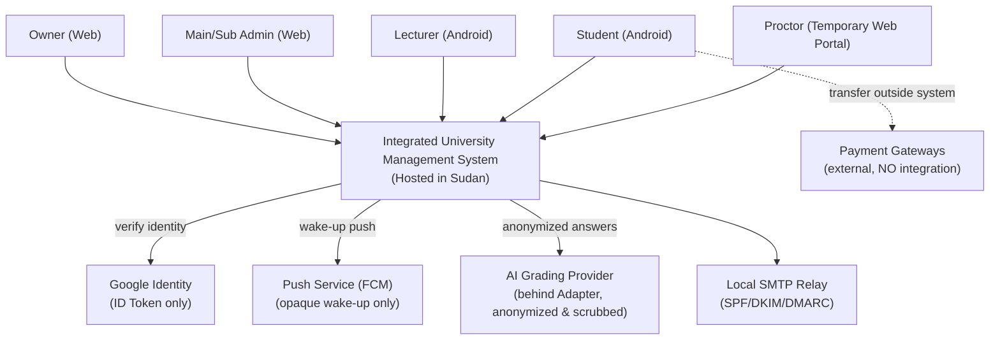
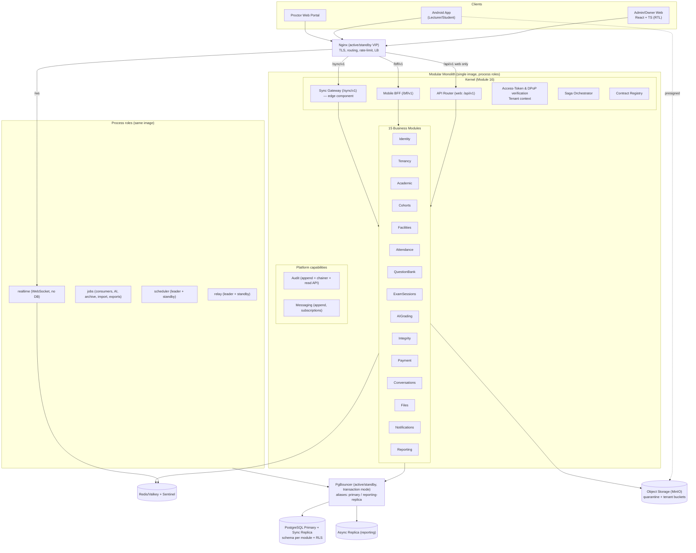
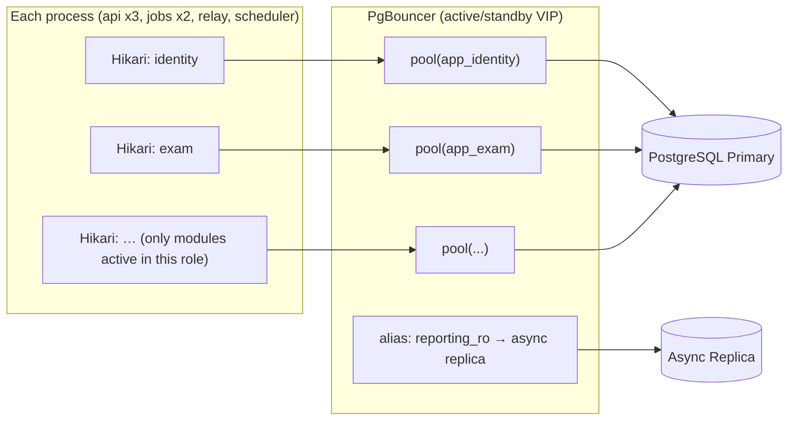
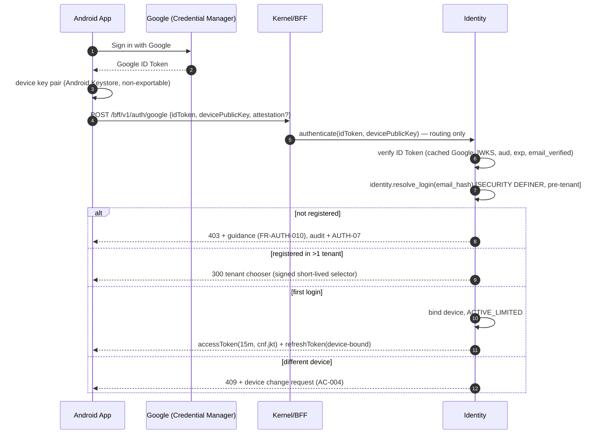
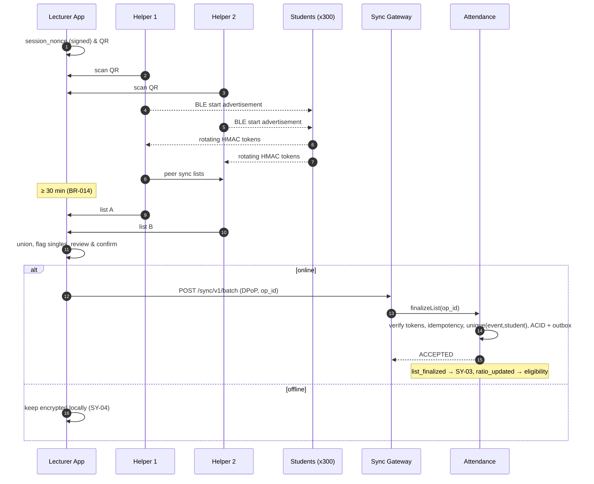
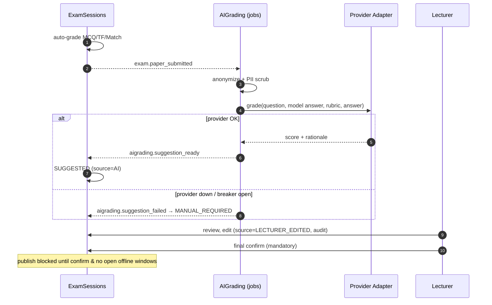
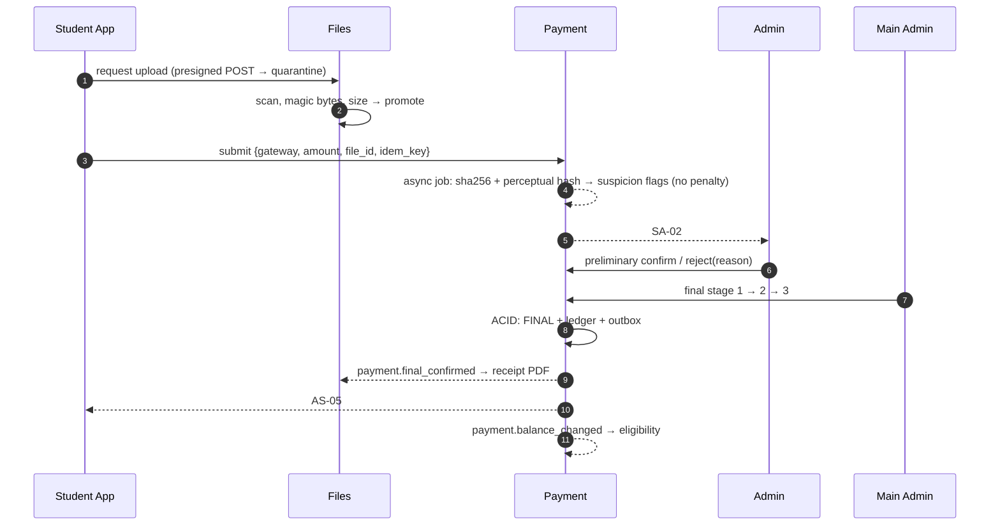
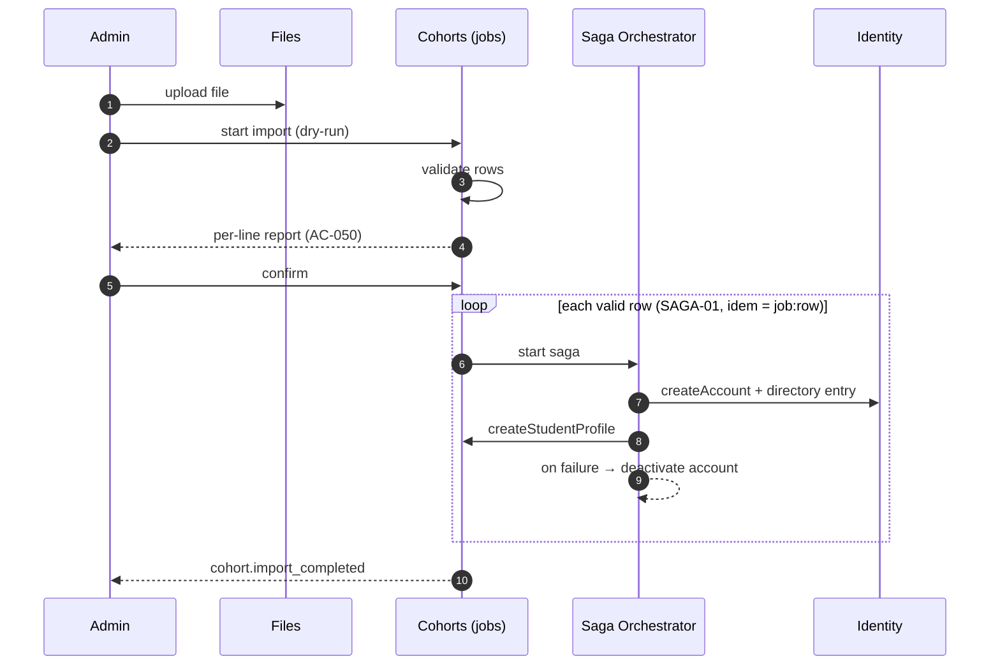
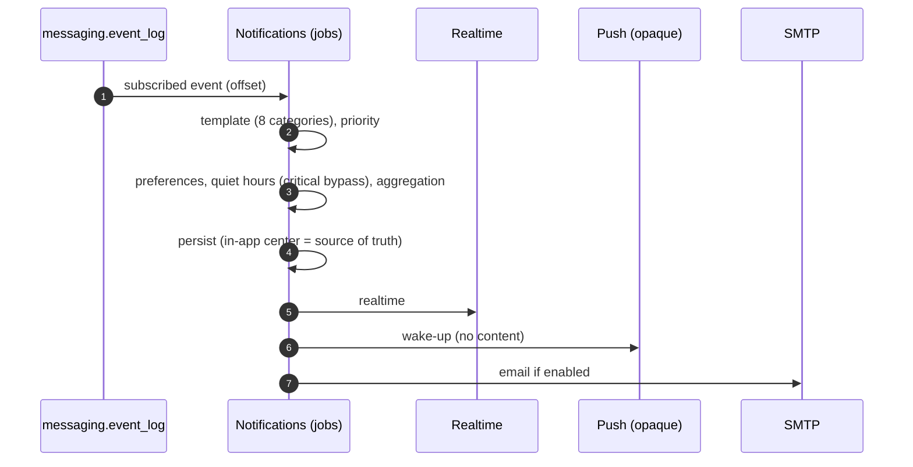
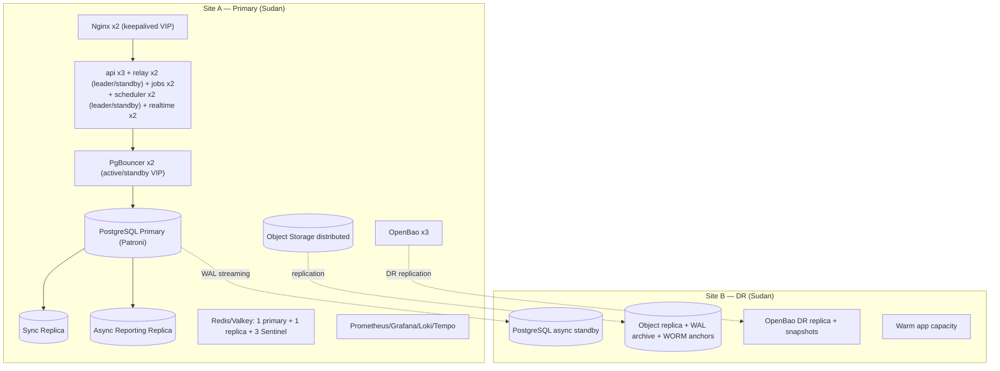

بعد مراجعة الوثيقتين كاملتين، بما فيهما ملحق BRD الموقّع بتاريخ 28/9/2026، وجدت 38 مشكلة في مسودة SAD. خمس منها حرجة لأنها تعطّل النظام فعلياً أو تفتح ثغرة أمنية مباشرة:

- **حسابات الاتصالات فيها أخطاء.** مجموع الـPools المذكور (62) يتجاوز السقف المحدد له (60). عدد أدوار الوحدات محسوب 15 والصحيح 16. مجموع Hikari المذكور 86 والصحيح 94. ولم تُحسب اتصالات عمليات الخلفية أصلاً.
- **توزيع الأحداث يُسقط بعضها.** المستهلكون يقرؤون بترتيب تسلسلي، فأي معاملة تُثبَّت متأخرة برقم أصغر تُفوَّت ولا تصل للمستهلك.
- **سلسلة التدقيق توقف النظام في الذروة.** كل معاملة تحجز قفلاً واحداً لكل الجامعة حتى نهايتها، فتصطف كل العمليات المدقَّقة خلف بعضها.
- **إغلاق الخادم للورقة يُضيع إجابات.** حين يغلق الخادم الورقة عند انتهاء الوقت، يُرفض لاحقاً التسليم الأوفلاين الأكمل منها لأنه يُعامَل كتكرار.
- **فقد الموقع الرئيسي يعني فقد المفاتيح.** خزنة المفاتيح Vault موجودة في الموقع الرئيسي فقط، فلو فُقد هذا الموقع لا يمكن فك تشفير أي نسخة احتياطية في موقع الطوارئ.

وضعت السجل الكامل للمشاكل وطريقة حل كل منها في القسم 0.5 داخل الوثيقة. والمقدمة المبسطة في أولها.

---

# وثيقة معمارية النظام (System Architecture Document – SAD)
## نظام الإدارة الجامعية المتكامل (Integrated University Management System)

---

## تمهيد: النظام بلغة مبسطة

### ما هذا النظام؟

نظام واحد يدير حياة الطالب الأكاديمية والمالية داخل الجامعة، من لحظة إنشاء حسابه وحتى أرشفة فصله الدراسي. يحل محل الدفاتر الورقية والجداول المتفرقة ومجموعات المحادثة. يقدّم النظام خدمته لجامعات متعددة في الوقت نفسه، فهو منتج اشتراكي (SaaS). كل جامعة تسمّى «مستأجراً» (Tenant)، وبياناتها معزولة كلياً عن بقية الجامعات، وكل البيانات مستضافة داخل السودان.

### من يستخدمه؟

| المستخدم | الواجهة | ماذا يفعل |
|---|---|---|
| المالك | ويب | ينشئ الجامعات وإدارييها الرئيسيين، ويتابع الاشتراكات، ولا يرى بيانات الطلاب |
| الإداري الرئيسي والفرعي | ويب | يدير البرامج والدفعات والطلاب والامتحانات والمالية والأرشيف. الفرعي يعمل بصلاحيات يحددها الرئيسي |
| المحاضر | تطبيق أندرويد | الجدول، والحضور، وبنك الأسئلة، والموازين، ومراجعة التصحيح |
| الطالب | تطبيق أندرويد | الجدول، والحضور، والامتحانات، ورفع إشعارات الدفع، والنتائج |
| المراقب | صفحة ويب مؤقتة | يتابع جلسة امتحان واحدة برابط وكلمة دخول تنتهي صلاحيتهما بانتهاء الجلسة |

الدخول بحساب Google فقط، بلا كلمات مرور. كل حساب يُربط بجهاز واحد، وتغيير الجهاز يحتاج موافقة المستوى الأعلى.

### كيف يُبنى؟ تشبيه مبسط

تخيّل النظام **مبنى واحداً فيه 15 إدارة متخصصة ومكتب استقبال**:

- **المبنى الواحد هو الـModular Monolith.** هو تطبيق برمجي واحد يُشغَّل ويُحدَّث كوحدة واحدة، فيسهل تشغيله على فريق صغير. لكنه مقسّم من الداخل إلى إدارات منفصلة بجدران صارمة، بحيث يمكن لاحقاً نقل أي إدارة إلى مبنى مستقل (Microservice) دون هدم شيء.
- **الإدارات الخمس عشرة هي الوحدات (Modules):** الهوية، والمستأجرون، والبرامج الأكاديمية، والدفعات، والمنشآت والجداول، والحضور، وبنك الأسئلة، والامتحانات، والتصحيح بالذكاء الاصطناعي، والنزاهة (مكافحة الغش)، والمالية، والمحادثات، والملفات، والإشعارات، والتقارير. لكل إدارة أرشيفها الخاص، أي Schema في قاعدة البيانات، ولا يحق لإدارة أن تفتح أرشيف غيرها. هذا مبدأ «مالك واحد لكل بيان».
- **مكتب الاستقبال هو الـKernel (الوحدة 16).** يتحقق من هوية الزائر وجامعته، ثم يوجّهه إلى الإدارة المختصة، وينسّق المعاملات التي تمر على أكثر من إدارة. لكنه لا يملك ملفات أعمال ولا يتخذ قرارات أعمال.
- **الـBFF نافذة خاصة لتطبيق الجوّال.** تجمع ما تحتاجه الشاشة من عدة إدارات في طلب واحد، لأن الشبكة ضعيفة ولا يصح أن يرسل الهاتف عشرة طلبات.
- **الـSync Gateway صندوق بريد للعمل دون اتصال.** الحضور والامتحان يعملان بلا إنترنت، وتُحفظ العمليات في الهاتف ثم تُرسل دفعة واحدة عند عودة الشبكة. كل عملية تحمل رقماً فريداً هو مفتاح Idempotency، فإرسالها مرتين لا يُحدث أثراً مكرراً.

### كيف تتحدث الإدارات مع بعضها؟

- **القراءة المباشرة عبر نافذة رسمية (API).** تسأل إدارةٌ إدارةً أخرى عبر عقد معلن، ولا يتجاوز الطلب قفزتين متزامنتين حفاظاً على زمن الاستجابة (أقل من ثانيتين).
- **الإبلاغ بالأحداث (Events).** حين تُنجز إدارة شيئاً مهماً، مثل «سلّم الطالب ورقته»، تكتب الخبر في سجلها الصادر (Outbox) ضمن العملية نفسها، فلا يضيع الخبر ولا يُكتب خبر لعملية لم تتم. بعدها ينقل ساعي البريد (Relay) الأخبار إلى لوحة إعلانات مشتركة (`messaging.event_log`). كل إدارة مهتمة تقرأ الأخبار التي اشتركت فيها فقط، وتسجل ما عالجته في سجلها الوارد (Inbox) حتى لا تعالج الخبر مرتين.
- **المعاملات الطويلة (Saga).** مثال ذلك جدولة امتحان: حجز قاعة، ثم إصدار صلاحيات المراقبين، ثم الإشعار. ينسّق الـKernel الخطوات، فإن فشلت خطوة نفّذ «تعويضاً» يتراجع عمّا سبقها، مثل تحرير الحجز.
- **نسخ القراءة المحلية (Read Projections).** إدارة الامتحانات تحتفظ بنسخة مختصرة من الحالة المالية ونسبة الحضور، تُحدَّث بالأحداث. بهذا تتحقق من أهلية الطالب فوراً حتى لو تعطلت إدارة المالية.

### البيانات والحماية

- **قاعدة PostgreSQL واحدة** فيها Schema لكل وحدة. وكل صف تابع لجامعة يحمل `tenant_id`.
- **RLS (أمن مستوى الصف):** قاعدة البيانات نفسها ترفض إظهار صف لا ينتمي لجامعة الطلب الحالي. هذا خط الدفاع الأخير حتى لو أخطأ الكود.
- **تجميع الاتصالات (HikariCP ثم PgBouncer):** فتح اتصال بقاعدة البيانات مكلف. لذلك يحتفظ التطبيق بعدد محدود من الاتصالات الجاهزة لكل وحدة (Hikari)، ويجمع PgBouncer طلبات كل النسخ في عشرات الاتصالات الحقيقية فقط. هذا ما يجعل 2,000 طالب يمتحنون في وقت واحد دون إغراق القاعدة.
- **Redis ذاكرة سريعة مؤقتة** لتسريع القراءات والبث اللحظي، وليس مصدراً للحقيقة. لو تعطل، يستمر النظام أبطأ قليلاً دون فقد أي بيان.
- **MinIO مخزن ملفات محلي** للوثائق وإشعارات الدفع والأرشيف، بمفتاح تشفير مستقل لكل جامعة. والفيديو ممنوع مطلقاً.
- **سجل التدقيق (Audit)** يُضاف إليه فقط ولا يُعدَّل ولا يُحذف. كل قيد مربوط بتجزئة القيد السابق (Hash Chain)، فأي عبث يُكتشف.
- **المبدأ الحاكم:** الآلة تقترح والإنسان يقرر. نسبة الغش ودرجة الذكاء الاصطناعي وعلامة الاشتباه المالي كلها «اقتراحات» لا تُنتج أي عقوبة دون مراجعة بشرية موثقة.

### رحلة امتحان واحد

1. قبل الامتحان بساعة، ينزّل التطبيق ورقة الطالب مشفّرة، وليس معها مفتاح الفتح.
2. عند الدخول للقاعة، يُسجَّل الحضور بالباركود. وعند ساعة البدء يستلم التطبيق مفتاحاً صغيراً فتُفتح الورقة.
3. الإجابات تُحفظ في الهاتف مشفّرة فوراً، وتُرسل للخادم كل 30 ثانية.
4. إن انقطعت الشبكة، يكمل الطالب بلا توقف. ويُحسب الوقت من ساعة الخادم عند البدء، لا من ساعة الهاتف القابلة للتلاعب.
5. أحداث مثل الخروج من التطبيق أو النسخ تُرسل لوحدة النزاهة، فتجمع النقاط وتُنبّه المراقب لحظياً. والحكم بالغش لا يصدر إلا من إنسان.
6. عند التسليم، أو عند انتهاء الوقت دون اتصال، تُرسل الورقة بمفتاح فريد يمنع التكرار. ثم تصحح الآلة الأسئلة المقالية «اقتراحاً» يراجعه المحاضر إلزامياً قبل النشر.

### التشغيل

يُشغَّل النظام في موقعين داخل السودان: موقع رئيسي، وموقع طوارئ يستلم نسخة مستمرة من البيانات. والمراقبة تتم بأدوات مستضافة ذاتياً (Prometheus وGrafana وLoki وTempo). ويُمنع نشر أي تحديث خلال نوافذ الامتحانات.

---

## 0. ضبط الوثيقة (Document Control)

### 0.1 بيانات الوثيقة

| البند | القيمة |
|---|---|
| اسم الوثيقة | وثيقة معمارية النظام (SAD) |
| الإصدار | 1.1 (مرشّحة للاعتماد) |
| الجهة المالكة | مالك المنتج |
| جهة الاعتماد | مالك المنتج حصراً (قرار BRD رقم 45) |
| النطاق الجغرافي | جمهورية السودان (استضافة محلية حصراً) |
| اللغة | العربية، والمصطلحات التقنية بالإنجليزية بين قوسين |

### 0.2 المراجع

| الرمز | المرجع | الحالة | ما أُخذ منه |
|---|---|---|---|
| BRD | وثيقة متطلبات الأعمال v1.0 بأقسامها 0–18 | معتمدة | FR، NFR، BR، AC، RSK، CN، OI |
| BRD-APX | ملحق BRD: قرارات المعمارية وحدود الوحدات وتدفقات البيانات | معتمد وموقّع (28/9/2026) | 16 وحدة، Modular Monolith، Kernel، BFF، Sync، Outbox، RLS، Saga، ميزانية الكمون |
| DEC | سجل القرارات المعمارية (Decisions For SAD) | مسودة | SAD-001…051، OPEN-01…15 |
| DIA | مخطط المعمارية مع تقنيات الاتصال والـConnection Pooling | مرجع بصري | مسار الطلب: Nginx ← Kernel ← Workers ← Redis ← ORM Pools ← PgBouncer ← PostgreSQL |

**قاعدة الأسبقية:** عند أي تعارض، يتقدم الملحق الموقّع على DEC، ويتقدم BRD على هذه الوثيقة.

### 0.3 تصنيف حالة البنود

| الوسم | المعنى |
|---|---|
| **[معتمد]** | حُسم في BRD أو ملحقه الموقّع، ولا يُعاد فتحه إلا بطلب تغيير رسمي |
| **[مقترح]** | تقترحه هذه الوثيقة، ويصبح ملزماً بتوقيع مالك المنتج على هذه الوثيقة |
| **[مفتوح]** | معلّق على مدخل خارجي، ومسجّل في القسم 26 |

### 0.4 أثر الملحق المعتمد على DEC

| مسألة DEC | الحسم |
|---|---|
| OPEN-01 / SAD-005 | **[معتمد]** Modular Monolith بنشر واحد (Single Deployable) |
| OPEN-02 / SAD-004 | **[معتمد]** 16 وحدة: 15 أعمال + Kernel |
| OPEN-09 | **[معتمد]** PostgreSQL واحدة، وSchema لكل وحدة، و`tenant_id` + RLS |
| OPEN-15 | **[معتمد]** لا Message Broker في الإصدار الأول، بل Outbox داخل PostgreSQL |
| OPEN-03 | **[مقترح]** Outbox هجين (القسم 12) |
| OPEN-04/05 | **[مقترح]** قيم ابتدائية ومنهجية (القسم 10)، تُثبَّت بعد اختبار الضغط |
| OPEN-06/07/08 | **[مقترح]** القسم 23 |
| OPEN-10/11/12/13 | **[مقترح]** الأقسام 11 و14 و15 |
| OPEN-14 | **[مفتوح]** = OI-05 |

### 0.5 سجل المراجعة: المشاكل المكتشفة في المسودة 1.0 وحلولها

الخطورة: **ح** حرج، أي يعطّل التشغيل أو الأمان · **ع** عالٍ · **م** متوسط.

| # | المشكلة في المسودة 1.0 | الخطورة | الحل في الإصدار 1.1 | القسم |
|---|---|---|---|---|
| R-01 | مجموع `pool_size` (62) أكبر من `max_db_connections` (60) رغم وصفه بأنه «تحت السقف». والـreserve_pool يضاف فوق السقف لا تحته | ح | إعادة حساب Σpool_size = 57 تحت سقف 65، مع هامش احتياطي صريح | 10.4 |
| R-02 | عدد أدوار الوحدات محسوب 15 والصحيح 16 (9 أدوار «بقية» لا 8)، ومجموع Hikari 94 لا 86 | ع | جدول كامل بكل الأدوار | 10.4 |
| R-03 | لم يُحسب أن كل عملية (jobs وscheduler وrelay وrealtime) تحمّل كل الوحدات، فتفتح 16 Pool لكل منها | ح | ملف Pools لكل دور عملية، وrealtime بلا قاعدة بيانات | 10.4 |
| R-04 | تشغيل PgBouncer على عقدتين نشطتين يضاعف الاتصالات الحقيقية، ولم يُحدد هل السقف لكل عقدة | ع | نشط/احتياطي خلف VIP، والسقف يطبَّق مرة واحدة | 10.4، 20 |
| R-05 | Hikari (20 × 3 = 60 لـexam) أكبر بكثير من pool_size (16)، فينتقل الانتظار إلى طابور PgBouncer (`query_wait_timeout` = 10s). مهلة Hikari (1.5s) لا تحمي ميزانية الثانيتين | ع | الانتظار يحدث في Hikari لا في PgBouncer (ΣHikari ≈ pool_size × 1.25)، و`query_wait_timeout` = 3s | 10.3، 10.4 |
| R-06 | سياسة RLS تحوّل `current_setting(...)::uuid` مباشرة. بعد أول `SET LOCAL` في الجلسة تصبح القيمة سلسلة فارغة لا NULL، فيفشل الاستعلام بخطأ تحويل بدل «لا شيء» | ع | `NULLIF(...,'')::uuid` داخل `(SELECT …)` لتخزين النتيجة مرة لكل استعلام | 9.3 |
| R-07 | تسجيل الدخول يبحث عن البريد في `identity` قبل معرفة المستأجر، وRLS تمنع ذلك. ولم يُعالج بريد مسجَّل في جامعتين | ح | دليل حسابات بلا RLS عبر دالة `SECURITY DEFINER`، واختيار جامعة عند التعدد | 14.1 |
| R-08 | الـKernel يتحقق من رمز Google ويصدر الرموز، فيحمل منطق مصادقة (خطر God Module، AR-03) | ع | Identity تتحقق من Google وتصدر الرموز، والـKernel يتحقق من Access Token فقط | 7.1، 14.1 |
| R-09 | التحقق من توقيع الجهاز في الـKernel يحتاج المفتاح العام من Identity، أي قفزة إضافية في كل طلب | ع | ربط الرمز بالمفتاح (`cnf.jkt` بنمط DPoP، RFC 9449)، فيتم التحقق بلا قراءة | 14.1 |
| R-10 | الـRelay يقرأ Outbox كل الوحدات بدور واحد عابر للـSchemas، ويحتاج اتصالاً مباشراً، وهو نسخة واحدة في الطوبولوجيا رغم ذكر Leader Election في AR-04 | ع | ناشر لكل وحدة بدورها، والكتابة عبر `messaging.append()`، وقائد بعقد إيجار (Lease) مع نسخة احتياطية عبر PgBouncer | 12.1، 9.2 |
| R-11 | المستهلكون يقرؤون `event_log` بترتيب تسلسلي، والمعاملات تُثبَّت بغير ترتيب أرقامها، فتسقط أحداث بصمت | ح | كاتب وحيد للصندوق (قائد الـRelay) يعطي `log_seq` متتابعاً، وإزاحة (Offset) لكل مستهلك في Schema المستهلك | 12.1 |
| R-12 | الـDLQ يكسر الترتيب لكل Aggregate، إذ يُعالج الحدث 6 بعد إسقاط الحدث 5 | ع | إيقاف أحداث الـAggregate نفسه (Parking) حتى حل الحدث المعطوب | 12.2 |
| R-13 | تبرير الـOutbox المحلي متناقض: الكتابة في Schema منصّة تُعدّ مخالفة للـOutbox، لكنها مسموحة للـAudit | م | التبرير الصحيح: قابلية فصل الوحدة إلى قاعدة مستقلة مستقبلاً. والوصول للمنصّة عبر دوال فقط | 12.1 |
| R-14 | سلسلة Hash للتدقيق متزامنة بقفل `pg_advisory_xact_lock` لكل مستأجر، يُحجز حتى نهاية المعاملة، فتتسلسل كل المعاملات المدقَّقة في الجامعة وقت الذروة | ح | إدراج غير متسلسل في المعاملة، ثم «مُسلسِل» خلفي واحد يحسب السلسلة، مع تنبيه لأي قيد غير مسلسل خلال 5 دقائق | 14.5 |
| R-15 | الوحدات تملك `INSERT` على `audit_entry` وتكتب أيضاً عبر دالة `SECURITY DEFINER` (تناقض)، والـKernel يخدم قراءة الـAudit رغم حظر امتلاكه بيانات | ع | `EXECUTE` على `audit.append()` فقط، والقراءة عبر مكوّن منصّة Audit لا عبر الـKernel | 6.2، 9.2، 14.5 |
| R-16 | إغلاق الخادم للورقة عند انتهاء الوقت يجعل التسليم الأوفلاين اللاحق «تكراراً» فيُرفض، فتضيع إجابات | ح | حالة `PROVISIONALLY_CLOSED` تقبل التسليم الموقّع حتى نهاية مهلة الأوفلاين، ثم إغلاق نهائي | 15.5، 16.2 |
| R-17 | الساعة الرتيبة في أندرويد (`elapsedRealtime`) تُصفَّر بإعادة التشغيل، وهي شائعة مع انقطاع الكهرباء (CN-05)، فيضيع حساب الوقت | ع | نقاط تحقق محفوظة كل 10 ثوانٍ، وحدث `DEVICE_RESTART` (ليس غشاً) للمراجع | 15.5 |
| R-18 | رمز الفتح القصير الذي يعرضه المراقب «مشتق من مفتاح الحزمة»، والرمز القصير لا يحمل مفتاحاً كاملاً. لو اشتُق المفتاح منه لصار قابلاً للكسر | ع | تغليف مفتاح الحزمة مرتين: بمفتاح الخادم، وبمفتاح مشتق من الرمز + سر الجهاز غير القابل للتصدير، مع حد للمحاولات | 15.5 |
| R-19 | الـSync Gateway يحفظ إيصالات Idempotency في `kernel` والوحدة تنفّذ في معاملة أخرى، فيحدث تضارب عند الفشل بينهما | ع | الحَكَم مفتاح Idempotency داخل معاملة الوحدة، وإيصال الـKernel كاش فقط | 7.1، 15.2 |
| R-20 | تطبيق الطالب يرسل أحداث الغش مباشرة إلى Integrity (16.3)، وNginx يوجّه `/api/v1` لكل العملاء، خلافاً للملحق §15 | ع | أندرويد يستخدم `/bff` و`/sync` و`/ws` فقط، وأحداث النزاهة تُجمَّع عبر Sync | 5، 16.3 |
| R-21 | المسودة وصفت Sync Gateway داخل الـKernel بأنه [معتمد]، والملحق §16 يصفه «وحدة Sync مستقلة كنقطة دخول» | م | مكوّن حافة مستقل بمسار دخول خاص ضمن حدود الـKernel، بحالة [مقترح] | 6.2، 24 |
| R-22 | الأهلية من نسخة قراءة متأخرة قد تحرم طالباً سدّد للتو | ع | الإيجاب بلا قفزة، والسلب يُؤكَّد بقراءة واحدة من Payment (القفزة 2)، مع إعادة الفحص عند الفتح | 6.3 |
| R-23 | كتالوج الأحداث يخلو من الأحداث التي تغذي نسخ القراءة (`student_ref` و`course_ref` و`user_display`)، و`attendance.ratio_updated` و`payment.gateway_changed` مذكوران في مواضع أخرى وغير موجودين فيه، و`aigrading.failed` يخالف `_failed` | ع | استكمال الكتالوج وتوحيد الأسماء | 12.3 |
| R-24 | رفع الملفات المباشر لـMinIO قبل فحصها يجعل الملف متاحاً قبل ClamAV، والرابط الموقّع لا يفرض الحجم | ع | Bucket عزل (Quarantine)، وPresigned POST مع `content-length-range`، ثم ترقية بعد الفحص | 17.1 |
| R-25 | الإداري يحتاج فتح النسخة الخارجية للأرشيف بأدوات عادية، لكن المسودة لم تحدد صيغتها، و«مفتوح ملفوف» ليس كلمة سر | ع | صيغة 7z/ZIP بـAES-256 بكلمة مرور عشوائية ≥ 24 حرفاً، والعرض الداخلي بتشفير مجزّأ قابل للبث | 17.2 |
| R-26 | Vault موجود في الموقع A فقط، وفقده يعني تعذّر فك أي نسخة احتياطية في الموقع B | ح | نسخ Vault/OpenBao ومفاتيح الفتح إلى الموقع B، وإجراء استعادة يُختبر في تمرين DR | 14.4، 20 |
| R-27 | انتخاب قائد الـScheduler غير محدد، والأقفال الاستشارية على مستوى الجلسة مستحيلة عبر Transaction Pooling | ع | جدول عقد إيجار (Lease) بمهلة | 20.2 |
| R-28 | النسخة المتزامنة (Sync Replica) تخدم التقارير الثقيلة، وتعطلها يوقف الكتابة إن كان الوضع صارماً | ع | `synchronous_mode_strict=false`، والتقارير على نسخة غير متزامنة منفصلة | 20.1 |
| R-29 | لا معالجة لعمليات تمر على كل المستأجرين (الاحتفاظ والأرشفة والمالك) تحت RLS | ع | تكرار المستأجرين عبر Tenancy مع `SET LOCAL` لكل مستأجر، وسياسة خاصة لدور المنصّة | 9.3 |
| R-30 | التحديث الإلزامي للتطبيق قد يمحو عمليات أوفلاين معلّقة، وتغيير الجهاز يبطل عمليات موقّعة سابقاً | ع | ترحيل الصندوق المحلي عبر التحديث، وقبول الخادم لإصدارين سابقين، وقبول ما وُقّع قبل زمن الإبطال | 15.2، 20.2 |
| R-31 | الإجابة المقالية قد تحوي اسم الطالب، والتعمية تُزيل المعرّفات فقط | م | تنقية النص من المعرّفات قبل الإرسال | 14.7 |
| R-32 | توزيع Google Play وFCM افتُرض متاحاً بلا تحقق في السوق السوداني | م | قناة توزيع APK موقّعة بديلة، والإشعارات داخل التطبيق هي المصدر الأساسي | 20.2 |
| R-33 | بريد SMTP محلي بلا SPF/DKIM/DMARC سيقع في البريد المزعج | م | إلزامها | 18 |
| R-34 | «Kotlin Native» مصطلح خاطئ، فهو تقنية أخرى للتجميع الأصلي متعدد المنصات. وسجل أحداث Spring Modulith يتعارض مع Outbox لكل Schema | م | «Kotlin + Jetpack Compose (Android أصلي)»، وModulith لفحص الحدود فقط | 23 |
| R-35 | مخاطر سلسلة التوريد لم تُذكر: تغيّر توزيع النسخة المجتمعية من MinIO، وترخيص Redis، وترخيص Vault | م | بدائل مسماة (Valkey، OpenBao، Ceph RGW / SeaweedFS) في القسم 23 وAR-12 | 23، 25 |
| R-36 | QA تغفل 99.5% شهرياً (قرار BRD 30) | م | إضافة QA-03b | 2.2 |
| R-37 | المسودة تسمح باستدعاء وحدة أخرى داخل معاملة مفتوحة، أي معاملة موزعة ضمنية بين Pools مختلفة | ع | حظر صريح وفحص ArchUnit | 8.1 |
| R-38 | ملاحظات بصيغة المتكلم في نهاية الوثيقة لا تناسب وثيقة اعتماد | م | تحويلها إلى «أسس البناء» في القسم 28 | 28 |

---

## 1. المقدمة

### 1.1 الغرض
تحوّل هذه الوثيقة متطلبات BRD وقرارات ملحقه إلى تصميم معماري قابل للتنفيذ والاختبار. تحدد المكونات وحدودها، وملكية البيانات، وأنماط الاتصال، والأمان، والعمل دون اتصال، وإدارة الاتصالات، والنشر، والرصد، والاختبار. وهي المرجع الملزم لوثائق DFD وC4 ومخططات التتابع وكتالوج الأحداث ومصفوفة الملكية وعقود الـAPI.

### 1.2 النطاق
تغطي الوثيقة نطاق الإصدار الأول من SC-IN-01 إلى SC-IN-15 عبر المراحل الخمس، والـMVP هو م1 + م2. ولا تغطي SC-OUT-01 إلى SC-OUT-14 (تكامل بوابات الدفع، وiOS، والفيديو، والمراقبة بالكاميرا).

### 1.3 الجمهور
فرق الخلفية والجوّال والويب، وضمان الجودة، ومشغّل النظام (ST-10)، ومالك المنتج.

---

## 2. المحركات المعمارية

### 2.1 المحركات الحاكمة

| # | المحرك | المصدر | الأثر المعماري |
|---|---|---|---|
| D1 | تعدد المستأجرين بعزل كامل | FR-OWN-002، NFR-SEC-008، AC-039 | `tenant_id` في كل جدول، وRLS بصيغة FORCE، وتحقق مزدوج، ومعرّفات عامة موقّعة بمميِّز المستأجر |
| D2 | ذروة 2,000 ممتحن متزامن | NFR-PERF-003، CN-11 | حزمة مسبقة، ومزامنة مجمّعة، وتحجيم للذروة، وPools محسوبة |
| D3 | اتصال وكهرباء غير مستقرين | CN-04، CN-05، NFR-AVL-006 | Offline-First، وSync Gateway، وIdempotency، ونقاط تحقق زمنية تصمد أمام إعادة التشغيل |
| D4 | استضافة داخل السودان | NFR-HOST-001/002، CN-01 | كل المكونات مستضافة ذاتياً، وجدول عبور حدود صريح |
| D5 | لا عقوبة آلية | BR-037، BR-026 | المقترحات منفصلة عن القرار البشري، ولا مسار برمجي يتجاوز المراجعة |
| D6 | سجلات غير قابلة للتعديل | FR-AUTH-023، NFR-SEC-005، AC-054 | Audit بإضافة فقط، وسلسلة Hash غير متزامنة، ومرساة WORM |
| D7 | فريق صغير وجامعة تجريبية | OI-01، OI-02 | Modular Monolith بأدوار عمليات |
| D8 | اعتماد Google | CN-06، RSK-04 | JWKS مخزّنة، ورموز النظام الخاصة، ومسار طوارئ (OI-11) |

### 2.2 سيناريوهات سمات الجودة

| المعرف | السمة | المحفّز | الاستجابة | المقياس |
|---|---|---|---|---|
| QA-01 | الأداء | 2,000 طالب يبدؤون خلال دقيقتين | فتح دون انتظار ملحوظ | p95 < 2s (AC-051) |
| QA-02 | الأداء | 2,000 تسليم خلال 3 دقائق | قبول بلا فقد | 0% فقد، والتسليم < 5s (NFR-PERF-007) |
| QA-03 | التوافر | تعطل عقدة تطبيق في امتحان | الاستمرار عبر النسخ | 99.9% داخل نوافذ الامتحانات |
| QA-03b | التوافر | التشغيل الشهري | — | 99.5% شهرياً (قرار BRD 30) |
| QA-04 | المرونة | انقطاع شبكة 15 دقيقة، أو إعادة تشغيل الهاتف | لا فقد واستئناف من الموضع | AC-015، AC-016 |
| QA-05 | الأمان | تغيير معرّف إلى مورد في جامعة أخرى | `403` وحادثة أمنية | AC-039 |
| QA-06 | المرونة | تعطل Redis بالكامل | لا فقد ولا فساد، وتدهور محدود | 11.4، LT-05 |
| QA-07 | قابلية التعديل | فصل وحدة الامتحانات مستقبلاً | دون إعادة تصميم البيانات أو العقود | لا Cross-Schema Join، وOutbox محلي |
| QA-08 | قابلية التدقيق | محاولة تعديل قيد تدقيق | الرفض في قاعدة البيانات | AC-054 |
| QA-09 | الاستمرارية | فقد الموقع الرئيسي | الاستعادة من الموقع B بما فيها المفاتيح | RPO ≤ 24 ساعة (المستهدف عملياً دقائق)، RTO ≤ 4 ساعات |

### 2.3 القيود الموروثة
من BRD: CN-01، وCN-02، وCN-06، وCN-08، وCN-12، وBR-049/054. ومن الملحق: Modular Monolith، وSchema لكل وحدة، وعدم الوصول لـSchema وحدة أخرى، والـKernel لا يملك بيانات أعمال، وBFF واحد لأندرويد، وقفزتان متزامنتان كحد أقصى، وأقل من ثانيتين. والقيمتان الأخيرتان أهداف تصميمية (Architecture Targets) وفق الملحق §22، لا نتائج قياس.

---

## 3. المبادئ المعمارية

| المعرف | المبدأ | التطبيق |
|---|---|---|
| P-01 | مالك واحد لكل بيان | لكل جدول وحدة مالكة، والكتابة عبرها حصراً |
| P-02 | لا وصول مباشر عبر الـSchemas | GRANT في PostgreSQL مع اختبار آلي. والوصول لـSchemas المنصّة (`messaging` و`audit`) عبر دوال `SECURITY DEFINER` فقط |
| P-03 | الـKernel ينسّق ولا يملك | لا منطق أعمال ولا بيانات أعمال ولا منطق مصادقة أعمال |
| P-04 | العقود قبل التنفيذ | OpenAPI وJSON Schema بإصدارات |
| P-05 | اتساق قوي داخل الوحدة ونهائي بينها | ACID داخل الوحدة، وSaga وتعويض بينها، ولا استدعاء لوحدة أخرى داخل معاملة مفتوحة |
| P-06 | Offline-First ميدانياً | الحضور والامتحان |
| P-07 | Idempotency شاملة | المفتاح يُفحص داخل معاملة الوحدة المالكة، وInbox لكل مستهلك |
| P-08 | دفاع متعدد الطبقات | Nginx ثم Kernel ثم الوحدة ثم RLS |
| P-09 | الإنسان يقرر | كل المؤشرات الآلية اقتراحات |
| P-10 | سيادة البيانات | ما يعبر الحدود موثّق ومقلَّل |
| P-11 | التصميم للذروة | اختبار ضغط لنوافذ الامتحانات |
| P-12 | الفشل الصريح | أزرار معطّلة بسبب، وأخطاء قابلة للتصرف (NFR-USE-005) |

---

## 4. مخطط السياق (C4 – Level 1)



بوابات الدفع خارج حدود النظام (SC-OUT-01). النظام يستقبل صورة الإشعار فقط.

---

## 5. معمارية الحاويات (C4 – Level 2) ومسار الطلب

### 5.1 المخطط



### 5.2 مسار الطلب (تفسير DIA)

| الخطوة | الطبقة | ما يحدث | ما لا يحدث |
|---|---|---|---|
| 1 | العميل | HTTPS/REST(JSON) مع Access Token، وإثبات DPoP للجوّال، وCorrelation-ID، وIdempotency-Key للكتابات | أندرويد لا يستدعي `/api/v1` |
| 2 | Nginx | ينهي TLS، ويطبّق حد معدل حسب IP، ويحدّ الجسم (25MB)، ويوازن الحمل، ويوجّه حسب المسار والعميل | لا منطق صلاحيات |
| 3 | Kernel | يتحقق من الرمز وإثبات الجهاز دون قراءة قاعدة بيانات، ويحدد المستأجر، ويولّد سياق الطلب، ويوجّه، ويجمّع في الـBFF | لا يقرأ Schema وحدة، ولا يقرر قواعد أعمال |
| 4 | الوحدة | تفويض على مستوى المورد، ثم منطق المجال، ثم فحص Idempotency في المعاملة | لا تكتب في بيانات وحدة أخرى |
| 5 | Redis | Cache-aside وبيانات لحظية | ليس مصدر حقيقة |
| 6 | Hikari ثم PgBouncer | استعارة اتصال، و`set_config(...,true)` للمستأجر | لا اتصال جديد لكل طلب |
| 7 | PostgreSQL | كتابة الأعمال + `outbox_event` + مفتاح Idempotency في معاملة واحدة، وRLS تفرض العزل | — |
| 8 | Relay | ينقل الأحداث إلى `messaging.event_log` بتسلسل متتابع | — |
| 9 | المستهلكون | يقرؤون حسب الاشتراك والإزاحة، ويحدّثون بياناتهم ونسخ القراءة مع Inbox | — |

الـWorkers الخمسة عشر في المخطط المرجعي وحدات منطقية داخل تطبيق واحد. والتطبيق يُشغَّل بأدوار عمليات من الصورة نفسها: `api` و`relay` و`jobs` و`scheduler` و`realtime`.

---

## 6. الوحدات وحدودها

### 6.1 الوحدات الست عشرة **[معتمد – الأسماء]** / **[مقترح – التفصيل]**

| # | الوحدة | Schema | المسؤولية | بيانات مملوكة (أمثلة) | BRD |
|---|---|---|---|---|---|
| 1 | Identity & Authentication | `identity` | الحسابات، والتحقق من Google وإصدار الرموز، والأدوار، وصلاحيات الفرعي وقوالبها، والأجهزة وطلبات تغييرها، والجلسات، ووصول المراقب، ودليل الحسابات للدخول | user, account_directory, role_assignment, permission_matrix, permission_template, device, device_change_request, refresh_token, proctor_access | FR-AUTH-*، BR-001…007 |
| 2 | Tenancy | `tenancy` | الجامعات، والاشتراك، والتعليق، وعدّاد الطلاب النشطين، وعدّاد استهلاك الذكاء الاصطناعي، والإعدادات العامة، وFeature Flags | tenant, subscription, billing_counter, ai_usage_counter, tenant_settings, feature_flag | FR-OWN-*، FR-SET-002 |
| 3 | Academic Programs | `academic` | البرامج، والمواد، وسلم التقديرات، وطريقة المعدل | program, course, grading_scale, academic_settings | FR-ADM-001…006، FR-SET-003 |
| 4 | Batches & Cohorts | `cohort` | الدفعات، وملفات الطلاب وحالاتهم، والوثائق، والفصل ومراحله، وتكليف المحاضرين، والاستيراد | cohort, student_profile, student_document_meta, semester_instance, lecturer_assignment, import_job | FR-ADM-007…035، FR-AUTH-013…015 |
| 5 | Facilities & Scheduling | `facilities` | المنشآت، والحجوزات، والاقتراح، وأحداث الجدول، والتعارض | facility, booking, booking_request, schedule_event | FR-FAC-*، BR-055…059 |
| 6 | Attendance | `attendance` | جلسات BLE/QR/الباركود، والقوائم، والدمج، والمخالفات، والتعديل | attendance_session, attendance_record, helper_list, violation_log | FR-ATT-*، BR-013…019 |
| 7 | Question Bank | `qbank` | الأنواع الستة، والوسوم، والإجابات النموذجية، وتعليمات الذكاء الاصطناعي | question, question_option, model_answer, ai_rubric, topic | FR-EXM-006…015 |
| 8 | Exam Sessions | `exam` | الموازين، والتحضير، والجلسات، والحزم، والأوراق، والتسليم، والحرمان، والملحق، وأعمال السنة، والجمع والنشر، والنتائج | weighting, exam, exam_package, exam_key, exam_paper, answer, submission, deprivation_request, coursework_grade, result, eligibility_projection | FR-EXM-*، FR-LEC-*، BR-020…033 |
| 9 | AI Grading | `aigrading` | الطلبات، والمقترحات، وإعادة التصحيح، والمحوّل، والتنقية | grading_job, grading_suggestion, provider_call_log | FR-CHT-001…012 |
| 10 | Integrity | `integrity` | الأحداث، والنقاط، والتحذيرات، والمراجعة، والحكم، والتظلّم | integrity_event, session_score, review_case, verdict, appeal | FR-PRC-*، BR-034…040 |
| 11 | Payment Verification | `payment` | البوابات، والإشعارات، والتأكيد المبدئي والنهائي، والمعاملات، والإيصالات، والأرصدة، والاشتباه | gateway, transaction, review_batch, receipt_meta, ledger_balance, suspicion_flag, receipt_fingerprint | FR-PAY-*، BR-041…047 |
| 12 | Conversations | `conversation` | الدردشات، والدعم، والقنوات، والإعلانات | thread, message, channel, post, comment, announcement | FR-CHA-* |
| 13 | File Repository | `files` | البيانات الوصفية، والتخزين، والعزل والفحص، والروابط المؤقتة، والأرشيف | file_object, file_category_link, archive_package, archive_key_ref | FR-FIL-*، FR-ADM-040…046 |
| 14 | Notifications | `notification` | الخريطة، والقوالب، والأولويات، والقنوات، والصمت، والتجميع، والمركز | notification, template, user_preference, delivery_attempt | FR-NOT-*، FR-SET-007 |
| 15 | Reporting & Analytics | `reporting` | نسخ القراءة، ولوحة القيادة، والإحصائيات، والتصدير، ومؤشرات المالك | dashboard_projection, finance_stats, exam_stats, platform_metrics | FR-DSH-*، FR-PAY-010…014 |
| 16 | Kernel | `kernel` | التوجيه، والـBFF، وSync Gateway، والتحقق من الرمز، والـSaga، والعقود، وعقود الإيجار | saga_instance, saga_step, contract_registry, sync_receipt_cache, leader_lease | الملحق §3–§4، §15–16 |

### 6.2 مكوّنات منصّة **[مقترح]**

| المكوّن | التموضع | التعليل |
|---|---|---|
| **Audit** | Schema `audit`، وكتابة عبر `audit.append()` فقط، ومُسلسِل خلفي، وواجهة قراءة وتصدير يملكها مكوّن Audit نفسه لا الـKernel | بيانات حوكمة. يُحسم كونه «الوحدة 17» أو «قدرة منصّة» في SAD-OI-03، والتوصية: قدرة منصّة |
| **Messaging** | Schema `messaging`، وكتابة عبر `messaging.append()` من الـRelay فقط، وقراءة عبر RLS بالاشتراك | بنية تراسل |
| **Sync Gateway** | مكوّن حافة بمسار دخول مستقل `/sync/v1` ضمن حدود الـKernel، قابل للفصل كعملية مستقلة دون تغيير العقد | يوفّق بين الملحق §15 (BFF في الـKernel) و§16 (وحدة Sync كنقطة دخول) |
| **Settings** | كل وحدة تملك إعداداتها، وشاشة إدارية موحدة تجمعها (DEC SAD-008) | P-01 |
| **Realtime Gateway** | دور عملية بلا قاعدة بيانات، يعتمد على Redis Pub/Sub | — |

### 6.3 قرارات ملكية حاسمة

ملكية «الطالب» موزّعة: الحساب والهوية والجهاز في `Identity`، والملف الأكاديمي والشخصي والحالة والوثائق في `Cohorts`، والربط بـ`user_id`. وملف الوثيقة الثنائي في `Files`.

الموازين يملكها `ExamSessions` مرتبطةً بمعرّف التكليف، والتكليف يملكه `Cohorts` (BRD §5.2). وحدث الغش مرتبط بالورقة ويملكه `Integrity`. وقرار الرسوب النهائي يملكه `ExamSessions` بعد حدث الحكم النهائي (DEC SAD-009).

**الأهلية لدخول الامتحان:** يحسبها `ExamSessions` من `eligibility_projection`، أي الحالة المالية من أحداث Payment ونسبة الحضور من `attendance.ratio_updated`.

- إن كانت النسخة تقول «مؤهل»، يُقبل بلا أي قفزة إضافية.
- إن قالت «غير مؤهل»، يُجرى تأكيد بقراءة واحدة متزامنة من `Payment` أو `Attendance` (القفزة 2 المسموحة) قبل الرفض، لمنع الحرمان الخاطئ بسبب تأخر الأحداث. فإن تعذّرت القراءة، يُعرض للمراقب خيار «سماح مؤقت موثّق» يُراجَع لاحقاً.
- تُعاد الأهلية عند تنزيل الحزمة وعند طلب مفتاح الفتح.

أحداث الجدول التعليمية يملكها `Facilities`، وحدث «امتحان» في الجدول انعكاس لجلسة في `ExamSessions` يُنشأ عبر SAGA-02.

---

## 7. الـKernel تفصيلاً

### 7.1 المكونات

| المكوّن | الوظيفة | الحدود |
|---|---|---|
| API Router | يوجّه `/api/v1/{module}/...` لعملاء الويب إلى واجهة الوحدة داخل العملية | لا تحويل ولا قواعد أعمال |
| Mobile BFF | نقاط مجمّعة لأندرويد، مثل `GET /bff/v1/student/home` | قفزة واحدة لكل وحدة بالتوازي، ولا وحدة تستدعي وحدة داخل التجميع |
| Sync Gateway | يستقبل الدفعات، ويتحقق من الرمز وإثبات الجهاز وتوقيع العناصر، ويعالج انحراف الساعة، ويمرر كل عنصر للوحدة المالكة، ويعيد إيصالاً لكل عنصر | Idempotency الحاكمة داخل الوحدة. `sync_receipt_cache` كاش لتسريع الرد على التكرار فقط |
| AuthN Context | يتحقق من Access Token (ES256) ومن إثبات DPoP المطابق لـ`cnf.jkt`، ويستخرج `tenant_id` و`user_id` و`device_id`، ويطابق مميِّز المستأجر في المعرّفات العامة، ويحمّل `permission_scope` من الكاش | لا يتحقق من رمز Google ولا يصدر رموزاً، فهذه مهمة Identity |
| Event Bus | يدير الاشتراكات والـRelay والـDLQ | لا يفسّر الأحداث |
| Saga Orchestrator | ينسّق بحالة في `kernel.saga_*`، وكل أمر يحمل مفتاح Idempotency = `saga_id:step` | يرسل أوامر ولا يكتب في بيانات الوحدات |
| Contract Registry | العقود وإصداراتها ومستهلكوها | يُستخدم في CI |

### 7.2 المحظورات
يُحظر على الـKernel: امتلاك جداول أعمال، والوصول لـSchema أي وحدة، وحساب درجة أو رصيد أو أهلية، وتخزين أكثر من المعرّفات والحالات اللازمة للـSaga، وتنفيذ منطق مصادقة الأعمال.

### 7.3 سياق الطلب

```json
{
  "correlation_id": "01J9Z...ULID",
  "tenant_id": "uuid",
  "user_id": "uuid",
  "roles": ["SUB_ADMIN"],
  "permission_scope": {"finance": "READ_WRITE", "exams": "NONE"},
  "device_id": "uuid",
  "client": "android|web|proctor",
  "idempotency_key": "uuid (writes only)",
  "request_time_server": "2026-10-09T10:00:00Z"
}
```

`permission_scope` لا يُحمل داخل الرمز، بل يُقرأ من كاش يُبطَل بحدث `identity.permissions_changed`. بهذا يسري سحب الصلاحية خلال ثوانٍ، لا بعد انتهاء الرمز.

---

## 8. أنماط الاتصال

### 8.1 القواعد **[معتمد]** مع توضيح **[مقترح]**
- القراءة المتزامنة عبر Public API مسجّلة، وهي داخل العملية حالياً وتصبح HTTP/gRPC عند الفصل.
- الكتابة في الوحدة المالكة فقط، والعمليات متعددة الوحدات عبر Saga أو أحداث.
- **محظور:** استدعاء واجهة وحدة أخرى أثناء معاملة قاعدة بيانات مفتوحة. كل وحدة تستخدم Pool مستقلاً، فهذا يُنتج معاملة موزعة ضمنية بلا ضمانات. يُفرض بقاعدة ArchUnit وفحص `TransactionSynchronizationManager` في الاختبارات.

### 8.2 قاعدة القفزتين
تُحسب من الـKernel: القفزة 1 إلى الوحدة، والقفزة 2 (اختيارية) قراءة واحدة من وحدة أخرى.

| السيناريو | النمط |
|---|---|
| دخول الامتحان والأهلية | نسخة محلية. والسلب يُؤكَّد بالقفزة 2 (6.3) |
| نافذة بيانات الطالب | تجميع بالتوازي في البوابة أو الـBFF: Cohorts + Payment + ExamSessions |
| نشر الدرجات | أمر في `ExamSessions` ثم أحداث |
| جدولة امتحان | SAGA-02 |

### 8.3 ميزانية الكمون (p95) **[مقترح]**

| المقطع | الميزانية |
|---|---|
| الشبكة من العميل إلى Nginx مع TLS | 600ms |
| Nginx ثم الـKernel (تحقق بلا قراءة قاعدة) | 30ms |
| منطق الوحدة | 100ms |
| انتظار اتصال (Hikari) | ≤ 50ms (مقياس التحذير الرئيسي) |
| استعلامات (≤ 5 مفهرسة) | 150ms |
| القفزة الثانية (إن وُجدت) | 250ms |
| التسلسل والرد | 70ms |
| **الإجمالي** | **≤ 1,250ms، مع هامش حتى 2s** |

---

## 9. معمارية البيانات

### 9.1 البنية

```text
PostgreSQL Cluster (Primary + Sync Replica + Async Reporting Replica) — داخل السودان
├── identity    ├── qbank         ├── files
├── tenancy     ├── exam          ├── notification
├── academic    ├── aigrading     ├── reporting
├── cohort      ├── integrity     ├── kernel
├── facilities  ├── payment       ├── messaging (منصّة)
├── attendance  ├── conversation  └── audit     (منصّة)
```

### 9.2 الأدوار والصلاحيات **[مقترح]**

| الدور | النوع | الصلاحيات |
|---|---|---|
| `owner_<module>` | NOLOGIN | مالك جداول الوحدة، ويُستخدم من Flyway فقط |
| `app_<module>` (16 دوراً) | LOGIN عبر PgBouncer | DML على Schema الوحدة فقط، و`EXECUTE` على `audit.append()`، و`EXECUTE` على `messaging.read_subscribed()`، ولا أي صلاحية مباشرة على جداول المنصّة |
| `app_relay` | LOGIN عبر PgBouncer | `EXECUTE` على `messaging.append()`. ويقرأ Outbox كل وحدة باتصال بدور تلك الوحدة لا بدور عابر |
| `app_audit_chainer` | LOGIN | `EXECUTE` على `audit.chain_pending()` فقط |
| `app_platform` | LOGIN | `tenancy` و`reporting.platform_*` فقط، بسياسة RLS خاصة لا تتطلب سياق مستأجر (FR-OWN-003، BR-006) |
| `audit_reader` | LOGIN | `SELECT` على `audit` عبر سياسة تفرض المستأجر |
| `migrator` | LOGIN (CI/CD) | يتقمّص `owner_*` |

ويُطبَّق كذلك: `REVOKE ALL ON SCHEMA <x> FROM PUBLIC`، ولا `BYPASSRLS` لأي دور تطبيقي، و`ENABLE` + `FORCE ROW LEVEL SECURITY` على كل جداول الأعمال، وجداول المنصّة مملوكة لأدوار NOLOGIN مستقلة.

**قرار تبعي:** دور لكل وحدة يعني Pool لكل زوج (قاعدة، مستخدم) في PgBouncer، أي 16 + أدوار المنصّة. وهذا محسوب في 10.4.

### 9.3 عزل المستأجرين بـRLS **[معتمد – المبدأ]** / **[مقترح – التنفيذ]**

```sql
ALTER TABLE exam.exam_paper ENABLE ROW LEVEL SECURITY;
ALTER TABLE exam.exam_paper FORCE ROW LEVEL SECURITY;

CREATE POLICY tenant_isolation ON exam.exam_paper
  USING      (tenant_id = (SELECT NULLIF(current_setting('app.tenant_id', true), '')::uuid))
  WITH CHECK (tenant_id = (SELECT NULLIF(current_setting('app.tenant_id', true), '')::uuid));

BEGIN;
SELECT set_config('app.tenant_id', :tenant, true);   -- LOCAL للمعاملة فقط
SELECT set_config('app.user_id',   :user,   true);
SELECT set_config('app.correlation_id', :cid, true);
-- ... العمليات
COMMIT;
```

القواعد:

1. `SET` على مستوى الجلسة ممنوع. المسموح `set_config(..., true)` فقط، ويُفرض في طبقة الوصول المشتركة وبفحص Lint.
2. `NULLIF(...,'')` إلزامي. بعد أول ضبط محلي في الجلسة يعود المتغير سلسلة فارغة لا NULL، وتحويلها المباشر إلى uuid يرمي خطأ. السلوك المطلوب «لا صفوف».
3. الصيغة `(SELECT …)` تجعل PostgreSQL يحسب القيمة مرة لكل استعلام. وكل فهرس على جداول الأعمال يبدأ بـ`tenant_id`.
4. **AC-039:** المعرّف العام يُبنى بالصيغة `{tenantCode}_{base32(UUIDv7)}_{hmac8}`، حيث `hmac8` = أول 8 بايت من HMAC(مفتاح المنصّة، tenant_id ‖ id). يفك الـKernel المعرّف، فإن اختلف المستأجر أو فشل الـHMAC أعاد `403` وسجّل `SECURITY.CROSS_TENANT_ACCESS` قبل أن يصل الطلب لأي وحدة. وتبقى RLS الطبقة الأخيرة.
5. نسخ القراءة والأحداث تحمل `tenant_id`، ويضبط المستهلك السياق من الحدث قبل المعالجة.
6. **العمليات العابرة للمستأجرين** (الاحتفاظ، والأرشفة المجدولة، والتذكيرات): يحصل الـScheduler على قائمة المستأجرين النشطين من واجهة Tenancy، ثم يعالج كل مستأجر في معاملات مستقلة بسياقه. ولا توجد سياسة «كل المستأجرين» لأي دور غير `app_platform`، وهذا الدور مقصور على الجداول المجمّعة.
7. **العزل في النسخ الاحتياطي (NFR-SEC-008):** نسخ العنقود الكاملة مشفّرة. والتصدير المنطقي لكل مستأجر يتم بأداة تصدير تطبيقية تعمل بدور الوحدة وسياق المستأجر، لا بـ`pg_dump` الخام الذي يعمل بدور يتجاوز RLS. ويُختبر ربع سنوياً.

### 9.4 المعرّفات والأنواع
المفتاح الداخلي UUIDv7، والمعرّف العام وفق 9.3، والأموال `numeric(14,2)` بالجنيه السوداني (FR-PAY-029)، والأزمنة `timestamptz` بـUTC وتُعرض بمنطقة الجامعة. والـCorrelation-ID بصيغة ULID.

### 9.5 الحذف والاحتفاظ

| البيان | السياسة | المصدر |
|---|---|---|
| السجل الأكاديمي والمالي | بلا حذف وبلا سقف، والتصحيح بقيود تصحيحية | BR-044، BR-053 |
| المعاملات المالية | لا `DELETE` على `payment.transaction` لأي دور | FR-PAY-026 |
| الوثائق الحساسة | حذف أو تعمية بعد 5 سنوات من التخرج أو انتهاء العلاقة، مع إخطار مسبق | NFR-SEC-010/011، AC-038 |
| الإشعارات | المعلوماتية 90 يوماً، والحرجة والمالية والامتحانية سنة | FR-NOT-008 |
| `messaging.event_log` | 90 يوماً تشغيلياً، ثم أرشفة مضغوطة لسنة. وإعادة بناء نسخ القراءة الأقدم تتم بواجهات Snapshot لدى الوحدات المالكة | **[مقترح]** |
| سجل Audit | دائم للأكاديمي والمالي | **[مقترح – يحسم OPEN-12]** |

التقسيم الزمني الشهري (Partitioning) يُطبَّق على: `integrity.integrity_event`، و`exam.answer`، و`messaging.event_log`، و`audit.audit_entry`.

### 9.6 مصفوفة ملكية البيانات (مختصرة)

| الكيان | المالك | القرّاء | نمط القراءة |
|---|---|---|---|
| User / Device | Identity | Kernel، Cohorts، Notifications | API + Projection `user_display` (حدث `identity.user_display_changed`) |
| Tenant / Subscription | Tenancy | Kernel، Reporting | API + `tenancy.tenant_status_changed` |
| Program / Course | Academic | Cohorts، Facilities، ExamSessions، QBank، Reporting | Projection `course_ref` (`academic.course_upserted`) |
| Student Profile / Status | Cohorts | ExamSessions، Attendance، Payment، Reporting، Tenancy | Projection `student_ref` بلا بيانات حساسة (`cohort.student_enrolled` / `_updated` / `_status_changed`) |
| Lecturer Assignment | Cohorts | ExamSessions، QBank، Facilities، Conversations | Projection (`cohort.lecturer_assigned` / `_unassigned`) |
| Schedule Event / Booking | Facilities | Attendance، ExamSessions، Notifications | API + Projection (`facilities.schedule_event_changed`) |
| Attendance Record | Attendance | ExamSessions، Reporting | `attendance.ratio_updated` |
| Question | QBank | ExamSessions (Snapshot عند التأكيد)، AIGrading (داخل أمر التصحيح) | API |
| Exam / Paper / Grade / Result | ExamSessions | Reporting، Files، Notifications | أحداث |
| Integrity Event / Verdict | Integrity | ExamSessions، Reporting | أحداث |
| Grading Suggestion | AIGrading | ExamSessions | `aigrading.suggestion_ready` |
| Transaction / Balance | Payment | ExamSessions، Cohorts، Reporting | أحداث |
| File Object | Files | الجميع | روابط موقّعة مؤقتة |
| Notification | Notifications | — | — |
| Audit Entry | Audit (منصّة) | الإداري الرئيسي فقط | API قراءة وتصدير |

---

## 10. إدارة الاتصالات (Connection Pooling) **[أولوية صريحة]**

### 10.1 الطبقات



| الطبقة | الدور | الاتصال |
|---|---|---|
| Hikari لكل وحدة ولكل عملية | يحدّ التزامن ويعزل الوحدات (Bulkhead). **هنا يحدث الانتظار** | اتصالات عميل إلى PgBouncer |
| PgBouncer | يجمّع اتصالات العملاء في عشرات الاتصالات الحقيقية | `pool_mode = transaction` |
| PostgreSQL | ينفّذ | مكلفة ومحدودة |

### 10.2 قيود وضع Transaction Pooling

| القيد | المعالجة |
|---|---|
| `SET` لا يستمر بين المعاملات | `set_config(...,true)` فقط (9.3) |
| Prepared Statements | PgBouncer ≥ 1.21 مع `max_prepared_statements = 200` |
| `LISTEN/NOTIFY` والأقفال الاستشارية على مستوى الجلسة | ممنوعة كلياً. انتخاب القادة بجدول `kernel.leader_lease`، والأقفال بـ`pg_advisory_xact_lock` فقط. ولا يوجد أي اتصال مباشر من التطبيق |
| المعاملات الطويلة | `idle_in_transaction_session_timeout` و`statement_timeout` لكل دور |

### 10.3 المهل والسلوك عند الامتلاء **[مقترح]**

| الإعداد | التفاعلي (api) | الخلفي (jobs/relay/scheduler) |
|---|---|---|
| Hikari `connectionTimeout` | 1,000ms | 30s |
| Hikari `maxLifetime` | 30 دقيقة | 30 دقيقة |
| Hikari `idleTimeout` / `minimumIdle` | 10 دقائق / 1 | 10 دقائق / 0 |
| `keepaliveTime` | 5 دقائق | 5 دقائق |
| `statement_timeout` (لكل دور) | 5s | 120s (يُضبط على مستوى الجلسة البرمجية بـ`SET LOCAL` لمهام jobs) |
| `lock_timeout` | 2s | 10s |
| `idle_in_transaction_session_timeout` | 10s | 60s |
| PgBouncer `query_wait_timeout` | 3s (شبكة أمان فقط، لأن الانتظار الطبيعي يحدث في Hikari) | — |
| PgBouncer `server_lifetime` | 3600s | — |

**عند امتلاء Hikari:** يُرجع الطلب `503` مع `Retry-After`، ويرتفع `pool_timeout_total`. تطبيق الامتحان لا يتأثر لأن الإجابات محفوظة محلياً، ويُعيد المحاولة بـBackoff أسّي مع Jitter. والأعمال الخلفية تعيد المحاولة.

**Failover:** يشير PgBouncer إلى الـPrimary الحالي عبر VIP يديره Patroni (vip-manager أو HAProxy). وعند الانتقال تُغلق الاتصالات القديمة (`RECONNECT`).

### 10.4 التحجيم والقيم الابتدائية **[مقترح – يحسم OPEN-04/05 مبدئياً، والتثبيت بعد LT-01…06]**

**المنهجية:**

1. الاتصالات النشطة المفيدة ≈ (عدد الأنوية × 2) + الأقراص الفعالة. لخادم بـ16 نواة على NVMe يقارب ذلك 32–40.
2. PgBouncer نشط/احتياطي، فالسقف يطبَّق مرة واحدة: `max_db_connections = 65`، وΣ`pool_size` = 57، والهامش (8) يغطي `reserve_pool_size = 2` و`reserve_pool_timeout = 1s`. الاحتياطي محدود فعلياً بالسقف.
3. `max_connections` في PostgreSQL = 65 (PgBouncer) + 5 (Replication) + 10 (إدارة وترحيل ورصد) + 20 هامش = **100**.
4. قاعدة Hikari: Σ(maximumPoolSize لوحدة m عبر كل العمليات) ≤ pool_size(m) × 1.25. هذا يُبقي الانتظار في Hikari ضمن مهلته القصيرة.

| دور الوحدة | `pool_size` | Hikari لكل نسخة api (×3) | Hikari لكل نسخة jobs (×2) | relay / scheduler | التعليل |
|---|---|---|---|---|---|
| app_exam | 14 | 5 | 1 | 1 / 1 | ذروة البدء والتسليم + مستهلك الأحداث |
| app_integrity | 5 | 2 | — | — / — | أحداث مجمّعة |
| app_identity | 5 | 2 | — | — / — | ذروة الدخول |
| app_attendance | 3 | 1 | — | 1 / — | رفع القوائم |
| app_kernel | 3 | 1 | — | — / 1 | Saga وعقود الإيجار |
| app_payment | 3 | 1 | — | — / — | — |
| app_notification | 3 | — | 1 | 1 / — | المستهلك والإرسال في jobs |
| app_cohort | 3 | 1 | — | — / — | الاستيراد عبر Saga |
| app_reporting | 2 (primary) | — | 1 | — / — | كتابة نسخ القراءة. والقراءة الثقيلة عبر `reporting_ro` (pool 6 على النسخة غير المتزامنة) |
| app_tenancy، academic، facilities، qbank، aigrading، conversation، files (7) | 2 لكل دور = 14 | 1 | aigrading/files: 1 | — / files: 1 | حمل منخفض |
| app_audit_chainer | 1 | — | — | — / 1 | مُسلسِل واحد |
| app_platform | 1 | 1 (نسخة واحدة) | — | — / — | واجهة المالك |
| **المجموع** | **57 ≤ 65** | | | | `max_client_conn = 2000` |

**ملاحظات:**
- الـRelay يستخدم Pool الوحدة التي يقرأ Outboxها بدورها، لذلك يظهر في عمود relay لعدة وحدات (1 لكل وحدة نشطة).
- دور `realtime` لا يتصل بقاعدة البيانات إطلاقاً.
- ملف Pools لكل دور عملية يُحدَّد بمتغير بيئة، وأي وحدة غير مدرجة في الملف لا يُنشأ لها Pool في تلك العملية.

### 10.5 أنماط تخفيف الذروة
1. **حزمة امتحان منزّلة مسبقاً:** تُولَّد الحزم في `jobs` قبل الموعد وتُخزَّن في Object Storage، ويُنزّلها العميل عبر رابط موقّع، فلا تمر عبر قاعدة البيانات وقت الذروة. وعند البدء يُطلب مفتاح صغير من Redis.
2. **مزامنة مجمّعة:** كل 30 ثانية أو عند 5 تغييرات، وتشمل الإجابات وأحداث النزاهة غير العاجلة في الدفعة نفسها (≈ 67 طلباً/ثانية لـ2,000 ممتحن).
3. **التسليم معاملة واحدة قصيرة** بمفتاح Idempotency، والتصحيح الآلي خلفي.
4. **قراءات لوحة القيادة** من `reporting` ومن النسخة غير المتزامنة.

### 10.6 المراقبة
المقاييس: `hikaricp_connections_active/idle/pending` و`acquire_seconds` لكل وحدة ودور عملية، و`pgbouncer_pools_cl_waiting` و`sv_active` و`sv_idle` و`maxwait`، و`pg_stat_activity` حسب الدور، و`numbackends`.

التنبيهات: `hikari pending > 0` لأكثر من 30 ثانية في api، و`maxwait > 1s` لدقيقتين، و`cl_waiting > 20`، وامتلاء Pool > 90% لخمس دقائق.

---

## 11. Redis والكاش

### 11.1 الاستخدامات **[معتمد – المبدأ]**

| الاستخدام | مثال | مصدر الحقيقة |
|---|---|---|
| Cache-aside | إعدادات المستأجر، والصلاحيات، والمواد، والجدول، والبوابات | PostgreSQL |
| مفاتيح الامتحان | `{env}:exam:{tenant}:{exam}:key` | `exam.exam_key` (مشفّر) |
| Pub/Sub | أحداث الغش للمراقب (SY-13)، والحضور الحي | — |
| Rate Limiting | الدخول، ورفع الإشعارات، والمزامنة، وبوابة المراقب | — |
| Denylist | الخروج من كل الأجهزة (FR-AUTH-021) | `identity.refresh_token` |
| قفل خفيف | — | Idempotency في PostgreSQL هي الحَكَم |

**ممنوع:** الدرجات المعتمدة، والأرصدة، والحالات النهائية، وأي بيان لا يُعاد بناؤه (DEC SAD-020).

**الحماية:** TLS داخلي، وACL لكل دور عملية، وتعطيل الأوامر الخطرة (`FLUSHALL` و`KEYS` و`CONFIG`). ومفاتيح الامتحان لا تُخزَّن قبل T0 − 5 دقائق.

### 11.2 تسمية المفاتيح
`{env}:{module}:{tenant_id}:{entity}:{id}:v{schemaVersion}`. و`tenant_id` إلزامي ويُفرض في مكتبة الكاش.

### 11.3 TTL والإبطال **[مقترح]**

| البيان | TTL | الإبطال |
|---|---|---|
| إعدادات المستأجر والصلاحيات | 5 دقائق | `*.settings_changed`، `identity.permissions_changed` |
| بوابات الدفع | 10 دقائق | `payment.gateway_changed` (AC-029) |
| الجدول الأسبوعي | 2 دقيقة | `facilities.schedule_event_changed` |
| مفتاح الامتحان | المدة + 30 دقيقة | انتهاء الجلسة |
| لوحة القيادة | بلا كاش تلقائي (FR-DSH-003) | زر التحديث |

### 11.4 السلوك عند تعطل Redis **[مقترح – يحسم OPEN-13]**

| الوظيفة | السلوك |
|---|---|
| الكاش | تجاوز إلى PostgreSQL بقاطع دائرة |
| الجلسات | JWT صالح 15 دقيقة غير متأثر. Denylist تعود إلى `refresh_token`. والرموز الملغاة تبقى صالحة حتى 15 دقيقة كحد أقصى، وهذا خطر مقبول وموثّق |
| مفاتيح الامتحان | من `exam.exam_key` |
| بوابة المراقب | Polling كل 5 ثوانٍ، والأحداث محفوظة |
| Rate Limiting | حد محلي داخل كل نسخة، وصارم لتسجيل الدخول وبوابة المراقب |
| التوافر | عقدة رئيسية + نسخة واحدة + 3 Sentinel، بلا Persistence |

---

## 12. الأحداث والـOutbox

### 12.1 Outbox هجين **[مقترح – يحسم OPEN-03]**

**التعليل:** الـOutbox المحلي في Schema الوحدة يضمن الذرّية، ويبقى صحيحاً عند فصل الوحدة إلى قاعدة مستقلة مستقبلاً (QA-07). أما الكتابة المباشرة في صندوق مركزي فتربط الوحدة بقاعدة المنصّة وتمنع فصلها. والصندوق المشترك يحقق متطلب الملحق §6.

```mermaid
flowchart LR
    subgraph TX["ACID tx (owning module)"]
      B["business rows"]
      O["INSERT exam.outbox_event"]
      IK["INSERT exam.idempotency_key"]
    end
    TX -->|commit| RL["Relay leader<br/>(reads each outbox with module role)"]
    RL -->|messaging.append() — single writer, gap-free log_seq| EL[("messaging.event_log")]
    EL --> C1["Notifications consumer<br/>notification.inbox + consumer_offset"]
    EL --> C2["Reporting consumer"]
    EL --> C3["AIGrading consumer"]
```

1. **Outbox محلي** (`<module>.outbox_event`) في معاملة الأعمال نفسها.
2. **Relay بقائد واحد** يُنتخب عبر `kernel.leader_lease` بمهلة 15 ثانية، مع نسخة احتياطية جاهزة. يقرأ Outbox كل وحدة بدورها (`FOR UPDATE SKIP LOCKED`، دفعات حتى 500)، ويكتب عبر `messaging.append()`، ثم يعلّم `published_at`.
3. **تسلسل بلا فجوات:** الـRelay هو الكاتب الوحيد في `event_log` ويُثبّت الدفعات تتابعياً، فيصبح `log_seq` مرئياً بترتيبه دائماً. والأثر في حال إعادة الإرسال بعد فشل: حدث مكرر يلتقطه الـInbox.
4. **المستهلك:** يقرأ `log_seq > offset` للأحداث المشترَك بها (RLS على `messaging.subscription`)، ويعالج كل حدث في معاملة تشمل الأثر + `inbox` + تحديث `<module>.consumer_offset`. بهذا تتحقق المعالجة الفعلية مرة واحدة (Effectively-once).
5. **الكمون:** Polling كل 200ms، وهدف `outbox_lag` < 5 ثوانٍ (التنبيه عند 60 ثانية).

### 12.2 بنية الحدث

```json
{
  "event_id": "uuidv7",
  "event_type": "exam.paper_submitted",
  "event_version": 1,
  "tenant_id": "uuid",
  "producer": "exam",
  "aggregate_type": "exam_paper",
  "aggregate_id": "uuid",
  "aggregate_seq": 7,
  "occurred_at": "2026-10-09T10:41:03.120Z",
  "correlation_id": "ulid",
  "causation_id": "uuid",
  "idempotency_key": "uuid",
  "payload": { "paper_id": "uuid", "exam_id": "uuid", "submitted_at_server": "...", "mode": "ONLINE|OFFLINE_SYNCED" }
}
```

**القواعد:**
- الحمولة تحمل معرّفات وحالات وحقولاً وصفية غير حساسة، مثل اسم المادة والدفعة لتقليل الاستدعاءات. والبيانات الشخصية تُطلب عبر API.
- الترتيب مضمون لكل `aggregate_id`.
- إعادة المحاولة بـBackoff حتى 10 مرات، ثم `<module>.dead_letter`. **وأي حدث لاحق للـAggregate نفسه يُوقف (Parked) حتى حل المعطوب**، بينما تستمر أحداث الـAggregates الأخرى. ويصدر تنبيه للمشغّل.
- التطور بإضافات فقط داخل الإصدار، والتغيير الكاسر يعني إصداراً جديداً يُبث بالتوازي.

### 12.3 كتالوج الأحداث الأولي

| الحدث | المنتج | المستهلكون | الإشعار |
|---|---|---|---|
| `identity.user_created` | Identity | Cohorts، Notifications | AUTH-05 |
| `identity.user_display_changed` | Identity | Cohorts، Notifications، Conversations | — |
| `identity.login_unknown_device` | Identity | Notifications | AUTH-08 |
| `identity.login_unregistered_email` | Identity | Notifications | AUTH-07 |
| `identity.device_change_requested` / `_approved` / `identity.device_revoked` | Identity | Notifications، Kernel (Saga، الكاش) | — |
| `identity.permissions_changed` | Identity | Kernel (الكاش)، Reporting | — |
| `tenancy.tenant_status_changed` | Tenancy | Kernel، جميع الوحدات | — |
| `tenancy.settings_changed` / `<module>.settings_changed` | المالك | Kernel (الكاش) | — |
| `academic.course_upserted` / `_deleted` | Academic | Cohorts، Facilities، ExamSessions، QBank، Reporting | — |
| `cohort.student_enrolled` / `_updated` / `_status_changed` | Cohorts | Tenancy (العدّاد)، ExamSessions، Attendance، Payment، Reporting | — |
| `cohort.lecturer_assigned` / `_unassigned` | Cohorts | ExamSessions، QBank، Facilities، Conversations | — |
| `cohort.document_submitted` / `_verified` / `_rejected` | Cohorts | Notifications، Identity | SA-01، AS-01، AS-02 |
| `cohort.semester_phase_changed` | Cohorts | Facilities، ExamSessions، Reporting | — |
| `cohort.import_completed` | Cohorts | Notifications | — |
| `facilities.booking_confirmed` / `_conflict_detected` | Facilities | ExamSessions، Notifications | SY-06، SY-07، SY-09 |
| `facilities.schedule_event_changed` | Facilities | Attendance، ExamSessions، Notifications، Kernel (الكاش) | — |
| `attendance.list_finalized` | Attendance | Reporting، Notifications | SY-03 |
| `attendance.ratio_updated` | Attendance | ExamSessions (الأهلية)، Reporting | — |
| `attendance.upload_pending` | Attendance | Notifications | SY-04 |
| `qbank.bank_confirmed` | QBank | ExamSessions، Notifications | LA-04 |
| `exam.weighting_confirmed` | ExamSessions | Notifications، Reporting | LA-03 |
| `exam.scheduled` | ExamSessions | Facilities، Notifications | AL-08، AL-09، LS-03 |
| `exam.session_started` / `_ended` | ExamSessions | Integrity، Notifications، Identity (إنهاء وصول المراقب) | SY-10، SY-21 |
| `exam.paper_provisionally_closed` | ExamSessions | Reporting | — |
| `exam.paper_submitted` / `_auto_submitted` | ExamSessions | AIGrading، Reporting، Notifications | SY-19، SY-20 |
| `exam.deprivation_changed` | ExamSessions | Notifications، Reporting | — |
| `exam.grades_published` | ExamSessions | Notifications، Reporting، Files | LS-10، SY-35 |
| `exam.semester_results_published` | ExamSessions | Cohorts، Files، Notifications، Kernel (SAGA-05) | AS-18 |
| `integrity.event_recorded` | Integrity | Realtime | SY-13 |
| `integrity.warning_threshold_reached` | Integrity | Notifications | SY-16 |
| `integrity.referral_threshold_reached` | Integrity | Notifications، Reporting | SY-14، SY-22 |
| `integrity.verdict_confirmed` / `_final` / `_cleared` | Integrity | ExamSessions، Notifications | AS-11، AS-12 |
| `aigrading.suggestion_ready` / `aigrading.suggestion_failed` | AIGrading | ExamSessions | — |
| `aigrading.usage_recorded` | AIGrading | Tenancy | — |
| `payment.submitted` | Payment | Notifications، Reporting | SA-02 |
| `payment.preliminary_confirmed` / `_rejected` | Payment | Notifications، Reporting | AS-04، AS-06 |
| `payment.final_confirmed` | Payment | Files، Notifications، Cohorts، Reporting | AS-05 |
| `payment.balance_changed` | Payment | ExamSessions، Cohorts، Reporting | — |
| `payment.gateway_changed` | Payment | Kernel (الكاش) | — |
| `payment.suspicion_flagged` | Payment | Reporting | — |
| `files.archive_built` | Files | Notifications | SY-32، SY-33 |

### 12.4 التطور نحو Broker
استبدال `event_log` بـKafka أو NATS JetStream يغيّر وجهة الـRelay ومصدر قراءة المستهلك فقط. والـOutbox والـEnvelope والـInbox تبقى كما هي (الملحق §11).

---

## 13. الـSagas والاتساق

### 13.1 ACID داخل الوحدة **[معتمد]**
كل من الآتي معاملة واحدة مع Outbox ومفتاح Idempotency: تسليم الامتحان، والحالة النهائية للإجابة، والتأكيد المالي النهائي مع الرصيد، وتثبيت قائمة الحضور.

### 13.2 كتالوج الـSagas **[مقترح]**

كل خطوة أمر بمفتاح `saga_id:step`، فتُستأنف الـSaga بعد أي انهيار من آخر خطوة مؤكدة.

| Saga | الخطوات | التعويض |
|---|---|---|
| **SAGA-01 إنشاء طالب أو استيراد** | (1) Cohorts: Dry-run وتقرير بالسطر (AC-050) (2) تأكيد الإداري (3) Identity: حساب «بانتظار أول دخول» + تسجيله في `account_directory` (4) Cohorts: الملف والربط (5) Notifications | فشل 4 ← تعطيل الحساب. كل سطر Saga مستقلة بمفتاح `import_job_id:row` |
| **SAGA-02 جدولة امتحان** | (1) ExamSessions: قبول (2) Facilities: حجز مع منع التعارض (3) Identity: صلاحيات المراقبين بانتهاء محدد (4) ExamSessions: `SCHEDULED` + جدولة توليد الحزم (5) Notifications | فشل 3 ← تحرير الحجز. فشل 2 ← إعادة الطلب للإداري مع البديل |
| **SAGA-03 تغيير جهاز** | (1) طلب (2) موافقة الإداري، أو المالك للإداري الرئيسي (3) Identity: إبطال الجهاز القديم ورموزه مع تسجيل `revoked_at` (4) Notifications | — |
| **SAGA-04 حكم الغش** | (1) Integrity: «تثبيت» بتعليل واسم وزمن (2) مهلة التظلّم (OI-10) (3) بعد المهلة أو رفض التظلّم: `verdict_final` (4) ExamSessions: الرسوب | قبول التظلّم ← `cleared`. **لا مسار يصل إلى 4 دون 1** (AC-022) |
| **SAGA-05 إغلاق الفصل والأرشفة** | (1) جمع النتائج ونشرها (2) Cohorts: المرحلة «نتائج وأرشفة» (3) Scheduler: SY-34 بعد المدة (4) Files: يطلب حزم تصدير غير متزامنة من الوحدات (5) بناء الحزمة (6) SY-32 (7) SY-33 حتى التحميل | Idempotent بإعادة المحاولة، وتنبيه المشغّل |
| **SAGA-06 التأكيد المالي النهائي** | (1) Payment: نهائي + رصيد (ACID) (2) Files: الإيصال PDF (3) AS-05 (4) الأهلية عبر `payment.balance_changed` | فشل 2 يُعاد. ولا عكس للمعاملة، فالتصحيح بمعاملة تصحيحية (BR-044) |

**الشرط المسبق لنشر الدرجات:** لا تُنشر درجات امتحان فيه ورقة بحالة `PROVISIONALLY_CLOSED` لم تنتهِ مهلتها (15.5).

---

## 14. الأمان

### 14.1 المصادقة **[مقترح – التنفيذ]**



**الرموز:**
- الـAccess Token من نوع JWT (ES256)، مدته 15 دقيقة، ويحمل `tenant_id` و`user_id` و`roles` و`device_id` و`cnf.jkt` (بصمة مفتاح الجهاز). ومفاتيح التوقيع في Vault مع تدوير ربع سنوي ونشر JWKS داخلي.
- كل طلب من الجوّال يحمل إثبات DPoP موقّعاً بمفتاح الجهاز، ويتحقق الـKernel من مطابقته لـ`cnf.jkt` دون قراءة قاعدة بيانات (حل R-09).
- الـRefresh Token عشوائي، ومخزّن مُجزَّأً، ومربوط بالجهاز، ويتطلب توقيع الجهاز للتجديد.

**ربط الجهاز:**
- الإداري في الويب يُربط بمفتاح WebCrypto غير قابل للتصدير في IndexedDB، والمتصفح الجديد يحتاج تصديقاً (FR-AUTH-018).
- **دليل الحسابات** `identity.account_directory(email_hash, tenant_id, user_id, status)` بلا RLS، ويُقرأ عبر الدالة فقط. وإن كان البريد مسجلاً في أكثر من جامعة، يختار المستخدم الجامعة، وكل حساب مستقل بأجهزته.

**حماية تكميلية:** Play Integrity اختياري (14.6). والجلسة الخاملة قابلة للضبط (FR-AUTH-024). و«لست أنا» في AUTH-08 يُطلق SAGA-03 بإبطال فوري.

**مسار الطوارئ (OI-11) [مفتوح]:** المقترح رمز طوارئ لمرة واحدة يصدره المالك للإداري الرئيسي، صالح 24 ساعة، مربوط بجهازه المسجّل، ومسجّل في Audit.

### 14.2 التفويض

| الطبقة | الآلية |
|---|---|
| Kernel | الدور العام وسماح اللوحة (`NONE` / `READ` / `READ_WRITE` / `FULL`) من الكاش |
| الوحدة | سياسات على مستوى المورد، مثل: المحاضر لا يرى إلا طلاب مواده، بلا وثائق ولا مالية (FR-LEC-005، AC-047) |
| قاعدة البيانات | RLS وصلاحيات الـSchema |
| الواجهة | إخفاء العناصر (FR-DSH-008)، وهي راحة للمستخدم لا حماية |

### 14.3 بوابة المراقب (FR-AUTH-020، القرار 40)
- رابط بمعرّف عشوائي 128 بت، وكلمة دخول من 8 أحرف. يُخزَّنان مُجزَّأين في `identity.proctor_access` مع `expires_at` = نهاية الجلسة + 30 دقيقة، ونطاق جلسة واحدة.
- **الحماية:** 5 محاولات خاطئة تقفل الرابط 15 دقيقة مع إشعار الإداري، وحد معدل صارم، وجلسة المتصفح مربوطة بكوكي `HttpOnly` و`SameSite=Strict`.
- عند `exam.session_ended` يُلغى الوصول، ويعرض الرابط «انتهت الصلاحية» (AC-005).
- الإشعارات عبر WebSocket فقط (FR-NOT-010، AC-042).
- كلمة دخول لمرة واحدة للطالب ذي الحالة الخاصة (FR-EXM-042).
- البوابة تعرض قائمة الطلاب المنقطعين، وتولّد رموز الفتح الأوفلاين (15.5).

### 14.4 التشفير وإدارة المفاتيح

| البيان | التشفير |
|---|---|
| النقل | TLS 1.2 كحد أدنى (1.3 مفضل). وmTLS أو شبكة خاصة داخلياً |
| PostgreSQL | LUKS للأقراص، والنسخ الاحتياطية مشفّرة (pgBackRest `repo-cipher`) |
| الحقول الحساسة | AES-256-GCM على مستوى التطبيق بـDEK لكل مستأجر ملفوف بـKEK |
| Object Storage | SSE بمفتاح لكل مستأجر (KES أو ما يعادله) |
| حزم الأرشيف | 17.2 |
| أسرار الأجهزة (HMAC الحضور) | مشفّرة بـDEK المستأجر، ومخزّنة على الهاتف في Keystore كمفتاح HMAC غير قابل للتصدير |
| الجوّال | SQLCipher بمفتاح محمي بـKeystore |
| إدارة المفاتيح | OpenBao (أو Vault) مستضاف ذاتياً بعنقود من 3 عقد في الموقع A + **نسخة أداء/DR في الموقع B**. لقطات مشفّرة يومية إلى الموقع B. مفاتيح الفتح (Unseal/Recovery) موزعة بأسلوب Shamir على 3 من 5 أمناء، ونسخة ورقية في خزنة الموقع B. تدوير الـKEK سنوياً. واستعادة المفاتيح جزء إلزامي من تمرين DR |

### 14.5 سجل التدقيق **[مقترح – يحسم SAD-015/OPEN-12]**

```sql
CREATE TABLE audit.audit_entry (
  seq            bigint GENERATED ALWAYS AS IDENTITY,
  tenant_id      uuid,                 -- NULL لعمليات المالك (سلسلة مستقلة)
  occurred_at    timestamptz NOT NULL DEFAULT now(),
  actor_id       uuid, actor_role text,
  action         text NOT NULL,
  resource_type  text, resource_id uuid,
  purpose        text,                 -- إلزامي للوصول للوثائق (NFR-SEC-003)
  correlation_id text,
  details        jsonb,
  chain_pos      bigint,               -- يملؤه المُسلسِل
  prev_hash      bytea,
  entry_hash     bytea                 -- SHA-256(prev_hash || canonical(row))
) PARTITION BY RANGE (occurred_at);
```

**الكتابة:** عبر `audit.append(...)` (`SECURITY DEFINER`) داخل معاملة الوحدة، بلا أي قفل تسلسلي. القيد يُثبَّت أو يُلغى مع العملية.

**التسلسل:** المُسلسِل (`audit-chainer`، قائد واحد في scheduler) يلتقط كل ثانيتين القيود غير المسلسلة لكل مستأجر، ويعطيها `chain_pos` متتابعاً ويحسب السلسلة. ترتيب السلسلة هو ترتيب التسلسل لا ترتيب `seq`، فلا تتأثر بالتثبيت غير المرتب.

**المنع:** مشغّل (Trigger) يرفض أي `UPDATE` أو `DELETE`، عدا ملء أعمدة السلسلة من NULL مرة واحدة بدور المُسلسِل. والجدول مملوك لدور NOLOGIN مستقل. ومشغّل حدث (Event Trigger) يرفض `DROP`/`DETACH`/`TRUNCATE` على `audit` لغير `migrator` بموافقة موثقة. وصلاحية المستخدم الأعلى (Superuser) محصورة بالمشغّل التقني مع تسجيل كامل في أداة الرصد.

**المرساة:** آخر Hash لكل مستأجر يُصدَّر كل ساعة إلى WORM bucket (Object Lock) في الموقع B. وأي قيد غير مسلسل لأكثر من 5 دقائق يطلق تنبيهاً.

**القراءة:** واجهة مكوّن Audit، للإداري الرئيسي فقط، مع التصدير (FR-AUTH-023). وسجل المالك مستقل (FR-OWN-006).

### 14.6 ما يعبر الحدود (NFR-HOST-003)

| الخدمة | ما يُرسل | ما لا يُرسل أبداً | الحالة |
|---|---|---|---|
| Google Identity | المصادقة من الجهاز، والتحقق بـJWKS مخزّنة | أي بيان من النظام | **[معتمد]** |
| FCM | Device token + إيقاظ بمعرّف معتم | العنوان والنص وأي بيان شخصي | **[مقترح]** |
| مزوّد الذكاء الاصطناعي | السؤال، والإجابة النموذجية، والتعليمات، ونص الإجابة بعد التنقية، ومعرّف معتم | الاسم والرقم الجامعي والمعرّفات | **[مفتوح – OI-12]** |
| Play Integrity (اختياري) | شهادة سلامة الجهاز | — | **[مقترح]** |

### 14.7 التصحيح الآلي وسيادة البيانات **[مقترح]**
يُبنى `AIGrading` خلف واجهة `GradingProvider` بمزوّدين:

- **(أ) نموذج مفتوح الأوزان داخل السودان:** يحقق NFR-HOST-001 حرفياً، ويحتاج خادم GPU.
- **(ب) API خارجية مع تعمية:** تحتاج تصديقاً صريحاً لأن نص الإجابة يعبر الحدود.

الاقتراح: البدء بـ(ب) إن صُدِّق، مع قياس AC-026، ثم تقييم (أ).

**قبل الإرسال:** تنقية النص من أي اسم أو رقم جامعي أو هاتف أو بريد عبر مطابقة مع بيانات الطالب المعروفة محلياً + أنماط عامة. يُستبدل ما يُكتشف برمز، ويُسجَّل حدوث التنقية دون محتواها.

**في الحالتين:** سقوف لكل مستأجر، وعدّاد للمالك (FR-CHT-011)، وقاطع دائرة، وتحويل يدوي تلقائي (FR-CHT-012، AC-028).

---

## 15. معمارية تطبيق أندرويد

### 15.1 الطبقات

```text
UI (Jetpack Compose, RTL) → ViewModels → Use Cases
        ↓
Repository ── Local DB (Room + SQLCipher)
        ↓
Sync Engine (WorkManager, local_outbox, Idempotency, Backoff, schema migrations)
        ↓
Secure Network (TLS + Pinning with backup pins + DPoP)
        ↓
Native: BLE Advertiser/Scanner, Exam Lock Mode, Sensors, Keystore, Time Checkpoints
```

**تثبيت الشهادات (Pinning):** على المفتاح العام لشهادتين وسيطتين على الأقل (رئيسية واحتياطية)، مع خطة تدوير منشورة قبل 90 يوماً. هذا يمنع تعطّل التطبيق عند تجديد الشهادة.

### 15.2 بروتوكول المزامنة **[مقترح]**

**البنية:** كل عملية تُكتب في `local_outbox` بالحقول: `op_id` (UUIDv7)، و`op_type`، و`op_version`، والحمولة، و`client_monotonic_ms`، و`boot_count`، و`server_time_offset`، والتوقيع.

**الإرسال:** `POST /sync/v1/batch`، ويُعاد إيصال لكل عنصر بإحدى الحالات `ACCEPTED` أو `DUPLICATE` أو `REJECTED(reason)` أو `CONFLICT(resolution)`. الحالة `DUPLICATE` تُعامل كنجاح (AC-007). ومفتاح `op_id` يُفحص داخل معاملة الوحدة المالكة (`<module>.idempotency_key`).

**حساب الوقت:** يُعتمد `server_time_offset` المحسوب عند كل تواصل، والساعة الرتيبة مع نقاط التحقق (15.5).

**التوافق عبر التحديثات:**
- الخادم يقبل `op_version` لإصدارين سابقين على الأقل.
- التحديث الإلزامي لا يُفعَّل والصندوق المحلي غير فارغ أثناء جلسة امتحان. وترحيلات Room تحافظ على `local_outbox`.
- العمليات الموقّعة بجهاز أُبطل لاحقاً تُقبل إن كان `client_signed_at` المقدَّر قبل `revoked_at` ووصلت ضمن 72 ساعة، وإلا تُحال للإداري.

### 15.3 الحضور بالبلوتوث **[مقترح – يحتاج PoC وفق SAD-038]**

1. يبدأ المحاضر الجلسة: `session_nonce` من الخادم، أو يولّده هاتفه أوفلاين ويوقّعه، ثم يعرضه في QR.
2. يمسح المساعدان الـQR، ويبثّان إشارة البدء كإعلان BLE.
3. يبث هاتف الطالب (خدمة أمامية Foreground Service) رمزاً دواراً كل 30 ثانية: `token = Trunc_16B(HMAC-SHA256(device_secret, session_nonce ‖ slot))` + `student_short_id` (4 بايت). يتسع ذلك في 31 بايت للإعلان التقليدي: 3 بايت للأعلام، و4 لترويسة بيانات الخدمة، و16 للرمز، و4 للمعرّف، و2 للـslot.
4. يمسح المساعدان، ويخزّنان محلياً، ويتزامنان بينهما.
5. اتحاد القائمتين، وتعليم من ظهر في قائمة واحدة فقط (BR-015).
6. الخادم يتحقق من كل رمز. يُرفض المعاد أو المنسوخ أو المنتهي (AC-007)، وقيد فريد على `(event_id, student_id)` يمنع التكرار (BR-018).
7. التحويل التلقائي إلى QR على هاتف المحاضر (BR-016، AC-009).

**الـPoC الإلزامي:** 300 جهاز، و10 طلاب/ثانية لكل ماسح (NFR-PERF-006)، وتصادم الإعلانات، وتفاوت المصنّعين. والخطر المتبقي (ترك الهاتف مع زميل) مُقَر به (RSK-05، CN-08).

### 15.4 وضع الامتحان ومكافحة الغش

| المتطلب | التنفيذ | الحدود |
|---|---|---|
| منع لقطة الشاشة (FR-PRC-003) | `FLAG_SECURE` | لا يمنع التصوير بجهاز آخر (CN-03) |
| منع التقسيم والنوافذ العائمة (FR-PRC-002) | `resizeableActivity=false`، و`isInMultiWindowMode`، و`startLockTask` بموافقة المستخدم | يتفاوت حسب الإصدار |
| تعطيل النسخ واللصق (FR-PRC-001) | تعطيل قوائم التحديد، ومراقبة الحافظة | — |
| رصد الأحداث الخمسة (FR-PRC-004) | الحافظة: `OnPrimaryClipChangedListener` · المساعد: فقد التركيز مع `onPause` دون `onStop` (استدلالي) · الستارة: `onWindowFocusChanged(false)` دون `onPause` · الحركة: عتبة جايروسكوب · العودة: `onStop` ثم `onResume` | استدلالي، لذا الأوزان قابلة للضبط والمراجعة إلزامية (RSK-01) |
| تمييز الانقطاع (FR-EXM-029، AC-016) | فقد الشبكة والتطبيق في المقدمة = حدث شبكة. وإعادة التشغيل = `DEVICE_RESTART`. ولا شيء منهما غش | — |
| الإعلان عن الحدود (FR-PRC-020) | شاشة أذونات مع إقرار بطابع زمني (FR-AUTH-016) | — |

**إرسال الأحداث:** تُوقَّع، وتُرسل ضمن دفعات المزامنة عبر `/sync/v1`. حدث «العودة بعد الخروج» يُرسل فوراً كعنصر منفرد إن وُجد اتصال، لتنبيه المراقب لحظياً.

**الحساب المعتمد** في الخادم (`Integrity`): بأوزان المستأجر، وسقف 100، بلا اضمحلال، ولكل جلسة على حدة (AC-019، AC-020). وإزالة التكرار بـ`event_id`. والعميل يعكس الحساب محلياً للتحذير الصامت فقط (BR-036).

### 15.5 الامتحان مع الانقطاع **[مقترح – يحسم SAD-039/OPEN-10]**

| المسألة | السياسة |
|---|---|
| حماية الأسئلة | حزمة لكل طالب (سحب متوازن في الخادم، FR-EXM-015) مشفّرة بـ`K_pkg` (AES-256-GCM)، تُولَّد مسبقاً وتُنزَّل قبل البدء بمدة قابلة للضبط (افتراضياً 60 دقيقة)، بغض النظر عن قيد «الواي فاي فقط» |
| تغليف المفتاح | `K_pkg` يُغلَّف مرتين داخل الحزمة: (1) `Wrap(K_release)`، حيث `K_release` يُطلق عند T0 من Redis أو `exam.exam_key`؛ (2) `Wrap(HKDF(device_secret_keystore ‖ unlock_code ‖ paper_id))` للفتح الأوفلاين |
| الفتح الأوفلاين | رمز من 8 خانات يولّده المراقب في بوابته لكل طالب منقطع عند T0، صالح لتلك الورقة فقط. كسره يتطلب سر الجهاز غير القابل للتصدير، والتطبيق يقفل بعد 5 محاولات ويطلب رمزاً جديداً. ويُسجَّل الإصدار في Audit |
| مصدر الوقت | `T0_server` + المدة المنقضية بالساعة الرتيبة |
| الصمود أمام إعادة التشغيل | نقطة تحقق مشفّرة كل 10 ثوانٍ (`elapsed`، ووقت الجهاز، و`boot_count`). بعد إعادة التشغيل: `elapsed = آخر نقطة + فرق ساعة الجهاز`، محدوداً بين الصفر و`زمن الانطفاء المعقول`. إن عادت ساعة الجهاز للوراء أو قفزت بشكل شاذ، تُحتسب المدة القصوى الآمنة ويُسجَّل `DEVICE_RESTART` و`CLOCK_ANOMALY` للمراجع، دون اعتبارهما غشاً |
| الحفظ | محلي مستمر مشفّر (FR-EXM-027)، ومزامنة كل 30 ثانية |
| انتهاء الوقت أوفلاين | تسليم تلقائي محلي موقّع بـ`T0_server + elapsed` (FR-EXM-030) |
| موقف الخادم عند انتهاء الوقت | الأوراق المتصلة تُسلَّم تلقائياً بآخر نسخة (`exam.paper_auto_submitted`). والأوراق المنقطعة تُوضع في `PROVISIONALLY_CLOSED`، ويُقبل تسليمها الموقّع إن وصل خلال المهلة (افتراضياً 24 ساعة) وكانت سلسلة الإجابات متسقة زمنياً. وعند انقضاء المهلة تُغلق بآخر نسخة مُزامنة وتُحال للإداري |
| التسليم المتأخر بعد المهلة | يُحال للإداري ولا يُرفض آلياً |
| الانقطاع الطويل | أكثر من حد قابل للضبط (افتراضياً 20% من الزمن) يُعلَّم «ظرف تقني» لقرار إداري (RSK-02) |
| إثبات الحضور الفعلي | الطالب المنقطع يظهر في بوابة المراقب، ويؤكد المراقب حضوره الفيزيائي، ويُحفظ ذلك مع الورقة |
| الدليل | سلسلة Hash للإجابات المحلية تُرفع مع التسليم، وكل التسليمات الأوفلاين موسومة `OFFLINE_SYNCED` ظاهرة للمراجع |

---

## 16. التدفقات الحرجة

### 16.1 الحضور بالبلوتوث



### 16.2 الامتحان مع الانقطاع والاستئناف

```mermaid
sequenceDiagram
    autonumber
    participant A as Student App
    participant B as BFF / Sync GW
    participant E as ExamSessions
    participant O as Object Storage
    participant R as Redis
    participant P as Proctor Portal
    A->>B: GET package link (T-60m)
    B->>E: eligibility (projection; confirm if negative) + paper
    E-->>A: presigned URL + T0 plan
    A->>O: download encrypted package
    A->>B: barcode check-in (via proctor)
    alt online at T0
        A->>B: GET unlock (T0)
        B->>E: re-check eligibility
        E->>R: get K_release (fallback exam_key)
        R-->>A: K_release + server time
    else offline at T0
        P->>P: issue per-student unlock code (audited)
        A->>A: unwrap via HKDF(device_secret, code)
    end
    loop every 30s / 5 answers
        A->>A: encrypt, save, hash chain, time checkpoint
        A->>B: sync batch (answers + integrity events)
        B->>E: upsert answers (ACID, idempotent)
    end
    Note over A: network lost / device restart
    A->>A: continue locally; NETWORK / DEVICE_RESTART events
    Note over E: time ends → PROVISIONALLY_CLOSED for offline papers
    A->>A: local auto-submit signed
    A->>B: sync submission (op_id) when back
    B->>E: submit (accepted within offline window)
    E-->>A: ACCEPTED (server receipt)
    Note over E: exam.paper_submitted → AIGrading, SY-19
```

### 16.3 تجميع نقاط الغش

```mermaid
sequenceDiagram
    autonumber
    participant A as Student App
    participant SG as Sync Gateway
    participant I as Integrity
    participant RT as Realtime (Redis Pub/Sub)
    participant P as Proctor Portal
    participant N as Notifications
    A->>SG: integrity events (batched; EXIT_RETURN immediate)
    SG->>I: record(event_id, type, ts, paper_id, sig)
    I->>I: dedupe, score += weight, cap 100 (ACID + outbox)
    I->>RT: publish event_recorded
    RT-->>P: live update (SY-13); silent on student
    alt score ≥ warning
        I->>N: SY-16
    end
    alt score ≥ referral
        I->>I: review_case
        I->>N: SY-14, SY-22 after session
    end
    Note over I: verdict only by human with reason (SAGA-04)
```

### 16.4 التصحيح الآلي مع المراجعة البشرية



### 16.5 التأكيد المالي ثلاثي المراحل



### 16.6 الاستيراد الجماعي



### 16.7 مسار الإشعار



---

## 17. الملفات والأرشيف

### 17.1 التخزين
- Object Storage موزّع بـErasure Coding في الموقع A، مع نسخ إلى الموقع B. وBucket لكل مستأجر (`t-{tenant}`) بسياسات ومفتاح مستقلين.
- **الرفع:** Presigned POST (مدته 5 دقائق) مع `content-length-range` ونوع معلن، إلى Bucket عزل (`quarantine`) لا يُقرأ منه.
- **الفحص بعد الرفع:** Magic Bytes، ورفض أي فيديو (BR-054، AC-037)، وClamAV، وضغط الصور، والحد (25MB قابل للضبط). بعدها يُنقل الملف إلى Bucket المستأجر ويُفعَّل.
- **في العميل:** فحص مسبق للنوع والحجم لتوفير البيانات (CN-04).
- **التنزيل:** روابط موقّعة (5 دقائق) بعد التحقق من الصلاحية. وكل وصول لوثيقة حساسة يُسجَّل في Audit مع حقل الغرض (NFR-SEC-003).

### 17.2 حزمة الأرشيف (SAGA-05)
- **المحتوى:** الحضور، والدرجات، والدفعات، وصور الإشعارات، والإيصالات، والمواد، والمحاضرون، والملفات الدراسية بلا فيديو، وإجابات الأونلاين (FR-ADM-042). تُبنى عبر مهام تصدير غير متزامنة تملكها كل وحدة.
- وثائق الطلاب في «مجلد الدفعة» خارج الفصل، ويُشار إليها بالمرجع (BR-052).
- **الصيغة الداخلية:** حاوية مجزّأة بتشفير AES-256-GCM لكل ملف، بمفتاح حزمة عشوائي ملفوف بـKEK المستأجر. هذا يسمح بالعرض أونلاين للقراءة فقط عبر بث وفك تشفير ملف بملف، دون تحميل الحزمة كاملة في الذاكرة (BR-050).
- **النسخة الخارجية:** ملف 7z أو ZIP بتشفير AES-256 قابل للفتح بأدوات قياسية، وكلمة مرور عشوائية ≥ 24 حرفاً محفوظة مشفّرة. تُنزَّل للإداري الرئيسي فقط، وتُكشف كلمتها لحظة التحميل وتُسجَّل (BR-051، AC-036).

---

## 18. الإشعارات

| الجانب | التصميم |
|---|---|
| الخريطة | 8 فئات (AUTH، ADM-LEC، ADM-STD، LEC-STD، STD-LEC، LEC-ADM، STD-ADM، SYS)، وقوالب مرقّمة. وAS-13 وSA-04 وSA-05 محظورة بفحص CI (AC-040) |
| الأولوية | حرج يتجاوز الصمت (AC-041) · مطلوب إجراء · معلوماتي |
| البنية | أيقونة، وعنوان، ونص، وطابع، وزر أو زران كحد أقصى بـDeep Link وأمر موقّع (FR-NOT-004) |
| التجميع | لكل (مستخدم، نوع، مورد) مع عدّاد (FR-NOT-007) |
| القنوات | داخل التطبيق (المصدر الدائم)، وPush للإيقاظ فقط مع Polling عند فتح التطبيق إن غاب FCM، وبريد SMTP محلي مع SPF وDKIM وDMARC ونطاق إرسال مخصص |
| المراقب | بوابة الويب فقط (FR-NOT-010) |
| الجدولة | التذكيرات المالية، وSY-10، وSY-18، وSY-33 عبر `scheduler` |

---

## 19. التقارير ولوحة القيادة
- `Reporting` يبني نسخ القراءة من الأحداث فقط، ويُثري البيانات الوصفية من Envelope الحدث. وإعادة البناء الكاملة عبر واجهات Snapshot لدى الوحدات.
- لوحة القيادة عند الطلب، مع فلتر النطاق (FR-DSH-001…003).
- الاستعلامات الثقيلة عبر `reporting_ro` على النسخة غير المتزامنة.
- «يحتاج إجراءك الآن» يُفلتر بالصلاحيات (FR-DSH-009).
- التصدير PDF/Excel عمل خلفي بنفس الاستعلام والفلتر (AC-032).
- مؤشرات المالك مجمّعة فقط (FR-OWN-003/004).

---

## 20. النشر والبنية التحتية

### 20.1 الطوبولوجيا **[مقترح – تعتمد على OI-05]**



**إعداد Patroni:** `synchronous_mode: true`، و`synchronous_mode_strict: false`. لو تعطلت النسخة المتزامنة، تستمر الكتابة مع تنبيه فوري، ولا يُعلَّق النظام. وتغ
يُدار تحميل التقارير الثقيلة على النسخة غير المتزامنة، فلا يؤثر تأخرها على الكتابة.

**أهداف الاستمرارية:**
- RPO: الهدف المعتمد ≤ 24 ساعة. والمتوقع عملياً دقائق، بفضل بث WAL المستمر إلى الموقع B وأرشفته.
- RTO ≤ 4 ساعات. يُنفَّذ بتحويل يدوي موثّق (Runbook) إلى الموقع B، ويشمل: فتح OpenBao، وترقية الـStandby، وتحويل DNS.

### 20.2 التشغيل والإصدار

| الجانب | القرار |
|---|---|
| بيئة التشغيل | Kubernetes خفيف (k3s) أو Docker Compose، ولا تعتمد حدود الوحدات على أي منهما (الملحق) |
| انتخاب القادة | `kernel.leader_lease(role, holder, expires_at)`. يُجدَّد كل 5 ثوانٍ، والمهلة 15 ثانية، ويُحدَّث بشرط `expires_at < now() OR holder = me` في معاملة قصيرة عبر PgBouncer |
| الترحيلات | Flyway لكل Schema. والتغييرات بنمط Expand/Contract، فلا تغيير كاسر في إصدار واحد |
| النشر | Rolling. **تجميد إلزامي داخل نوافذ الامتحانات** وقبلها بـ24 ساعة |
| Feature Flags | في `tenancy.feature_flag` لكل مستأجر |
| تحديث الجوّال | حد أدنى للإصدار يُفرض من الخادم، ولا يُفعَّل أثناء جلسة امتحان ولا مع وجود صندوق محلي غير فارغ |
| التوزيع | Google Play + قناة APK موقّعة بديلة من موقع الجامعة، مع فحص التوقيع داخل التطبيق |
| النسخ الاحتياطي | pgBackRest: نسخة كاملة أسبوعياً، وتفاضلية يومياً، وWAL مستمر، وPITR. والنسخ في الموقعين، ومشفّرة |
| تمارين DR | ربع سنوية، وتشمل استعادة المفاتيح والتحقق من سلسلة Audit |
| تصدير مستأجر | أداة تطبيقية بسياق المستأجر (9.3)، وتُختبر ربع سنوياً |

---

## 21. الرصد والمشاهدة (Observability)

| العنصر | الأداة | الملاحظات |
|---|---|---|
| المقاييس | Prometheus + Grafana | لوحات لكل وحدة ودور عملية، ولوحة «نافذة امتحان» خاصة |
| السجلات | Loki | سجلات منظمة JSON تحمل `correlation_id` و`tenant_id`، وبلا بيانات شخصية |
| التتبع | OpenTelemetry + Tempo | تتبع موزع عبر الوحدات وجلسات الـSaga |
| مؤشرات الأعمال | Grafana | `outbox_lag`، والـDLQ، والأحداث الموقوفة، والقيود غير المسلسلة في Audit، وطابور المزامنة، وفشل التصحيح الآلي |
| التنبيه | Alertmanager | إلى المشغّل (ST-10) عبر بريد وقناة رسائل محلية |
| لوحة المشغّل | Grafana | تسد فجوة BRD §3.3 الخامسة (NFR-SCL-003) |

**SLOs:** p95 < 2s للمسارات التفاعلية، و`outbox_lag` < 5s، وتوافر 99.9% داخل النوافذ و99.5% شهرياً، وصفر فقد في التسليم.

---

## 22. استراتيجية الاختبار والجودة

| النوع | الأداة | الهدف |
|---|---|---|
| الوحدات | JUnit 5 / Kotest | منطق المجال، ومعايير القبول مربوطة بمعرّفات AC وBR |
| حدود الوحدات | Spring Modulith Verify + ArchUnit | منع الاستيراد العابر، ومنع الاستدعاء داخل معاملة مفتوحة (8.1) |
| حدود قاعدة البيانات | اختبار آلي للـGRANT | فشل أي وصول عابر للـSchemas (P-02) |
| التكامل | Testcontainers (PostgreSQL + PgBouncer الحقيقي + Redis) | Transaction Pooling، و`set_config`، وRLS بقيمة فارغة |
| عزل المستأجرين | مجموعة مخصصة | AC-039 لكل نقطة API |
| العقود | Contract Registry + فحص CI | توافق OpenAPI وJSON Schema |
| الأحداث | اختبارات Relay | عدم سقوط أحداث مع تثبيت غير مرتب، وإيقاف الـAggregate عند DLQ |
| الضغط | k6 / Gatling | LT-01…07 |
| الفوضى (Chaos) | قتل عمليات، وقطع الشبكة، وتعطيل Redis والنسخة المتزامنة | QA-03، QA-06، R-28 |
| الجوّال | Espresso + اختبارات أجهزة حقيقية | إعادة التشغيل أثناء الامتحان، وانقطاع الشبكة، والتحديث مع صندوق معلّق |
| الأمان | SAST + DAST + مراجعة يدوية لمسارات المصادقة والمراقب | — |

### سيناريوهات الضغط الإلزامية

| المعرف | السيناريو | معيار النجاح |
|---|---|---|
| LT-01 | 2,000 ممتحن يبدؤون خلال دقيقتين | p95 < 2s (AC-051) |
| LT-02 | مزامنة 2,000 ممتحن كل 30 ثانية لمدة ساعتين | p95 < 1s، وبلا تراكم في Hikari |
| LT-03 | 2,000 تسليم خلال 3 دقائق مع 10% إعادة إرسال | صفر تكرار وصفر فقد (AC-051) |
| LT-04 | 20 قائمة حضور بـ300 طالب متزامنة | قبول كامل |
| LT-05 | تعطيل Redis أثناء LT-02 | استمرار الخدمة، وp95 ≤ 3s |
| LT-06 | خنق PgBouncer إلى 50% | فشل سريع منضبط (503) وتعافٍ تلقائي |
| LT-07 | 300 جهاز BLE في القاعة (PoC ميداني) | 10 طلاب/ثانية لكل ماسح، وتغطية ≥ 99% |
| LT-08 | 500 ممتحن منقطعون يعودون معاً بعد 15 دقيقة | قبول كل التسليمات خلال 5 دقائق، دون فقد |

---

## 23. التقنيات المقترحة **[مقترح – يحسم OPEN-06/07/08]**

| الطبقة | التقنية | التعليل / البديل |
|---|---|---|
| الخلفية | Java 21 + Spring Boot 3 + Spring Modulith | نضج، وفرق متاحة. Modulith لفحص الحدود فقط، ولا يُستخدم سجل أحداثه الداخلي لأنه يتعارض مع Outbox لكل Schema |
| الوصول للبيانات | JPA/Hibernate للكتابة + jOOQ/JDBC للتقارير | — |
| الويب | React + TypeScript، مع RTL وi18next | — |
| الجوّال | Kotlin + Jetpack Compose (Android أصلي) | الوصول الكامل لـBLE وLock Task وKeystore. وKotlin Multiplatform خيار مستقبلي لـiOS |
| قاعدة البيانات | PostgreSQL 16+ مع Patroni وpgBackRest | — |
| الاتصالات | HikariCP + PgBouncer ≥ 1.21 **[معتمد]** | — |
| الكاش | Redis 7 أو Valkey 8 + Sentinel | Valkey بديل بترخيص BSD تحسباً لتغيّر ترخيص Redis |
| التخزين | MinIO (إصدار مثبت ومدعوم) | البدائل: Ceph RGW أو SeaweedFS، تحسباً لتغيّر توزيع النسخة المجتمعية. والكود يستخدم S3 API فقط |
| المفاتيح | OpenBao (مفضّل) أو Vault | OpenBao بترخيص MPL، وVault ترخيصه BSL |
| الحافة | Nginx **[معتمد]** | — |
| الرصد | Prometheus، Grafana، Loki، Tempo، OpenTelemetry | — |
| CI/CD | محلي (GitLab CE أو Gitea + Woodpecker) | سيادة البيانات |

---

## 24. سجل القرارات المعمارية (ADR)

| ADR | القرار | الحالة |
|---|---|---|
| ADR-01 | Modular Monolith | معتمد |
| ADR-02 | 16 وحدة (15 + Kernel) | معتمد |
| ADR-03 | PostgreSQL واحدة، Schema ودور لكل وحدة | معتمد |
| ADR-04 | `tenant_id` + RLS FORCE + `set_config(...,true)` مع `NULLIF` | معتمد (المبدأ) / مقترح (التنفيذ) |
| ADR-05 | Outbox هجين بكاتب وحيد وتسلسل بلا فجوات | مقترح |
| ADR-06 | لا Message Broker في الإصدار الأول | معتمد |
| ADR-07 | Hikari لكل وحدة ودور عملية + PgBouncer Transaction نشط/احتياطي | مقترح |
| ADR-08 | Redis غير حرج | مقترح |
| ADR-09 | BFF في الـKernel، وSync Gateway مكوّن حافة بمسار مستقل | معتمد (BFF) / مقترح (Sync) |
| ADR-10 | الامتحان الأوفلاين: حزمة مسبقة، وتغليف مزدوج، و`PROVISIONALLY_CLOSED` | مقترح |
| ADR-11 | Audit مكوّن منصّة بسلسلة Hash غير متزامنة ومرساة WORM | مقترح |
| ADR-12 | محوّل ذكاء اصطناعي بمزوّدين مع تنقية | مقترح |
| ADR-13 | Push بلا محتوى | مقترح |
| ADR-14 | التقنيات (القسم 23) | مقترح |
| ADR-15 | REST/OpenAPI، وإهمال الإصدارات بعد 6 أشهر | مقترح |
| ADR-16 | موقعان + PITR + نسخ المفاتيح للموقع B | مقترح |
| ADR-17 | المصادقة في Identity، والـKernel يتحقق من الرمز وDPoP فقط | مقترح |
| ADR-18 | انتخاب القادة بعقود إيجار في الجدول، ولا اتصالات مباشرة | مقترح |

---

## 25. المخاطر المعمارية

| المعرف | الخطر | الاحتمال / الأثر | التخفيف | المرجع |
|---|---|---|---|---|
| AR-01 | فشل الـPoC للبلوتوث في القاعات الكبيرة | متوسط / عالٍ | PoC قبل م3، وQR كبديل جاهز | NFR-PERF-006 |
| AR-02 | تآكل حدود الوحدات مع الوقت | عالٍ / عالٍ | GRANT + ArchUnit + مراجعة العقود | QA-07 |
| AR-03 | تضخم الـKernel (God Module) | متوسط / عالٍ | ADR-17، وقائمة محظورات 7.2 | P-03 |
| AR-04 | تأخر الأحداث يعطّل الأهلية أو الإشعارات | متوسط / متوسط | قائد احتياطي، و`outbox_lag` SLO، وتأكيد السلب (6.3) | 12.1 |
| AR-05 | خطأ في أرقام الـPools | متوسط / عالٍ | LT-01…06 قبل الإطلاق | 10.4 |
| AR-06 | التحايل على أحداث الغش من جهاز معدّل | متوسط / متوسط | توقيع الأحداث، وPlay Integrity اختياري، والمراجعة البشرية | RSK-01 |
| AR-07 | انقطاع Google | منخفض / عالٍ | JWKS مخزّنة، ومسار الطوارئ | RSK-04، OI-11 |
| AR-08 | تعذّر استضافة محلية بتوافر 99.9% | متوسط / عالٍ | موقعان، وOffline-First، وتقييم تعاقدي | RSK-03، OI-05 |
| AR-09 | تعارض السيادة مع مزوّد ذكاء اصطناعي خارجي | متوسط / عالٍ | تعمية وتنقية، وخيار محلي، وبديل يدوي | OI-12 |
| AR-10 | التلاعب بالساعة أو إعادة التشغيل في الامتحان الأوفلاين | متوسط / عالٍ | زمن الخادم، ونقاط التحقق، وسلسلة Hash، وتأكيد المراقب | RSK-02 |
| AR-11 | فقد المفاتيح يجعل النسخ الاحتياطية غير قابلة للاستعادة | منخفض / حرج | نسخ OpenBao للموقع B، وShamir، وتمارين DR | R-26 |
| AR-12 | تغيّر تراخيص أو توزيع مكونات مفتوحة المصدر | متوسط / متوسط | بدائل مسماة، وواجهات قياسية (S3، Redis protocol) | القسم 23 |
| AR-13 | تعذّر الوصول لـGoogle Play أو FCM في السوق المحلي | متوسط / متوسط | قناة APK بديلة، والإشعارات داخل التطبيق مصدر أساسي | R-32 |

---

## 26. المسائل المفتوحة المتبقية

| المعرف | المسألة | يحجب | الجهة |
|---|---|---|---|
| SAD-OI-01 | تصديق التقنيات (ADR-14) | بدء التطوير | مالك المنتج |
| SAD-OI-02 | تصديق Outbox الهجين (ADR-05) | تصميم الـSchemas | مالك المنتج |
| SAD-OI-03 | Audit وMessaging مكوّنا منصّة أم الوحدة 17 | تصميم Audit | مالك المنتج |
| SAD-OI-04 | مزوّد الاستضافة ومواصفات الموقعين (= OI-05 / OPEN-14) | أهداف التوافر | مالك المنتج |
| SAD-OI-05 | موارد خادم قاعدة البيانات الفعلية | تثبيت أرقام 10.4 | مالك المنتج + المشغّل |
| SAD-OI-06 | مزوّد الذكاء الاصطناعي وقبول عبور الإجابات المنقّاة (= OI-12) | المرحلة م4 | مالك المنتج |
| SAD-OI-07 | مسار الطوارئ للمصادقة (= OI-11) | RSK-04 | مالك المنتج |
| SAD-OI-08 | الإصدار الأدنى من Android (= OI-08) | تطبيق الجوّال | الفريق + مالك المنتج |
| SAD-OI-09 | مهلة التسليم الأوفلاين (افتراضياً 24 ساعة) وحد «الظرف التقني» (20%) | ADR-10 | مالك المنتج + الجامعة |
| SAD-OI-10 | مهلة التظلّم (= OI-10) | SAGA-04 | مالك المنتج + الجامعة |
| SAD-OI-11 | قبول Play Integrity الاختياري | ربط الجهاز | مالك المنتج |
| SAD-OI-12 | سياسة البريد المسجّل في أكثر من جامعة (اختيار أم منع) | 14.1 | مالك المنتج |

---

## 27. مصفوفة التتبع: المتطلبات غير الوظيفية مقابل التكتيكات

| المتطلب | التكتيكات | القسم |
|---|---|---|
| NFR-PERF-003/004، AC-051 | حزمة مسبقة من Object Storage، ومزامنة مجمّعة، وPools محسوبة، وقراءات من النسخة غير المتزامنة | 10، 15.5 |
| NFR-PERF-006 | BLE برموز HMAC دوارة، وماسحان، واتحاد القوائم | 15.3 |
| NFR-PERF-007 | حفظ محلي، وتسليم بمعاملة قصيرة، و`PROVISIONALLY_CLOSED` | 13.1، 15.5 |
| NFR-PERF-008 | تصحيح خلفي، وقاطع دائرة، وتحويل يدوي | 16.4 |
| NFR-AVL-001/002 | نسخ متعددة، وPatroni غير صارم، وSentinel، وتجميد النشر | 20 |
| NFR-AVL-003/004 | PITR، والموقع B بمفاتيحه، وتمارين DR | 20 |
| NFR-AVL-006 | Offline-First، وSync Gateway، وIdempotency داخل الوحدة | 15.2 |
| NFR-SEC-001/004 | TLS، وتشفير حقول، وSSE لكل مستأجر، وأرشيف بمفتاح لكل حزمة | 14.4، 17.2 |
| NFR-SEC-002 | تفويض متعدد الطبقات | 14.2 |
| NFR-SEC-003/005، AC-054 | Audit بإضافة فقط، وسلسلة غير متزامنة، ومرساة WORM | 14.5 |
| NFR-SEC-007، AC-027 | تعمية وتنقية في المحوّل | 14.7 |
| NFR-SEC-008، AC-039 | RLS + معرّفات موقّعة + حادثة أمنية + تصدير لكل مستأجر | 9.3 |
| NFR-SEC-010، AC-038 | مهمة احتفاظ مجدولة لكل مستأجر مع إخطار | 9.5 |
| NFR-HOST-001…003 | استضافة ذاتية، وجدول العبور | 14.6، 20 |
| NFR-PLT-007 | ضغط الوسائط، وفحص مسبق في العميل، وتجميع الـBFF | 15، 17 |
| NFR-SCL-001/002 | مستأجر بلا تعديل كود، وإعدادات لكل وحدة، وFeature Flags | 6، 20.2 |
| NFR-SCL-003 | مكدّس الرصد ولوحة المشغّل | 21 |
| NFR-SCL-004 | اختبارات مربوطة بمعرّفات AC وBR | 22 |
| NFR-USE-001/002 | RTL أصلي وi18n | 23 |

---

## 28. أسس البناء

- **أسبقية الملحق الموقّع:** في كل تعارض بين ملحق BRD (28/9/2026) وسجل DEC، اعتُمد الملحق. لذلك صارت OPEN-01 وOPEN-02 وOPEN-09 وOPEN-15 معتمدة.
- **الـWorkers الخمسة عشر في المخطط المرجعي** هي الوحدات المنطقية الخمس عشرة داخل تطبيق واحد، يُضاف إليها الـKernel وحدةً سادسة عشرة.
- **الأرقام في القسم 10.4** قيم ابتدائية لخادم افتراضي بـ16 نواة، وتُثبَّت بعد SAD-OI-05 واختبارات LT-01…06.
- **الإصدار 1.1** يعالج 38 ملاحظة مراجعة مسجلة في القسم 0.5، ولا يغيّر أي قرار معتمد في BRD أو ملحقه.

---

## ملحق أ: المصطلحات المعمارية

| المصطلح | التعريف |
|---|---|
| Modular Monolith | تطبيق واحد قابل للنشر، مقسّم إلى وحدات معزولة منطقياً بحدود مفروضة آلياً |
| Tenant (مستأجر) | جامعة واحدة، وهي وحدة العزل الأعلى للبيانات |
| Kernel | الوحدة 16: توجيه وتحقق وتنسيق، بلا بيانات أعمال |
| BFF | واجهة مجمّعة مخصّصة لتطبيق الجوّال |
| Sync Gateway | نقطة استقبال دفعات المزامنة من العمل دون اتصال |
| Outbox | جدول في Schema الوحدة يُكتب فيه الحدث في معاملة البيانات نفسها |
| Inbox | جدول لدى المستهلك يسجل الأحداث المعالجة لمنع التكرار |
| Read Projection | نسخة قراءة محدودة لدى وحدة غير مالكة، تُحدَّث بالأحداث |
| Saga | عملية متعددة الوحدات بخطوات وتعويضات ينسّقها الـKernel |
| RLS | سياسات PostgreSQL لعزل الصفوف حسب المستأجر |
| Transaction Pooling | وضع في PgBouncer يُعار فيه الاتصال الحقيقي طوال المعاملة فقط |
| Idempotency Key | معرّف يجعل إعادة الطلب نفسه بلا أثر إضافي |
| Correlation ID | معرّف يربط كل خطوات عملية واحدة عبر المكونات |
| DPoP | إثبات امتلاك المفتاح: كل طلب يوقّعه مفتاح الجهاز المربوط بالرمز |
| Hash Chain | ربط كل قيد تدقيق بتجزئة القيد السابق لاكتشاف العبث |
| WORM | تخزين «اكتب مرة واقرأ مراراً» لا يقبل التعديل أو الحذف |
| Leader Lease | عقد إيجار زمني في جدول يضمن وجود نسخة قائدة واحدة لعملية ما |
| PROVISIONALLY_CLOSED | حالة ورقة انتهى وقتها وصاحبها منقطع، تقبل تسليمه الموقّع خلال المهلة |
| RPO / RTO | أقصى فقد بيانات مقبول / أقصى زمن استعادة مقبول |

---

## الاعتماد

| الجهة | الدور | التوقيع | التاريخ |
|---|---|---|---|
| مالك المنتج | المصادقة على البنود [مقترح] وإغلاق المسائل المفتوحة في القسم 26 | | |

*توقيع مالك المنتج على هذه الوثيقة يحوّل كل البنود الموسومة [مقترح] إلى [معتمد]. أما بنود القسم 26 فتبقى مفتوحة إلى أن تُحسم كلٌّ منها بقرار مستقل.*